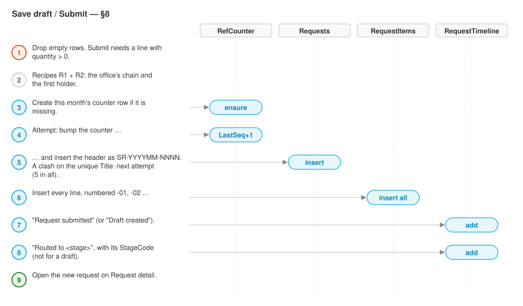
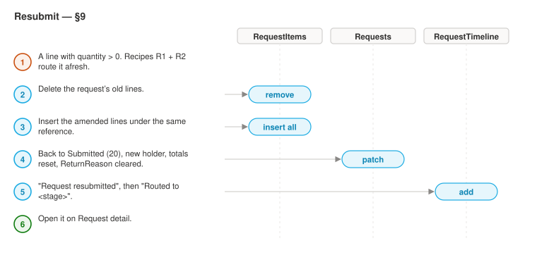
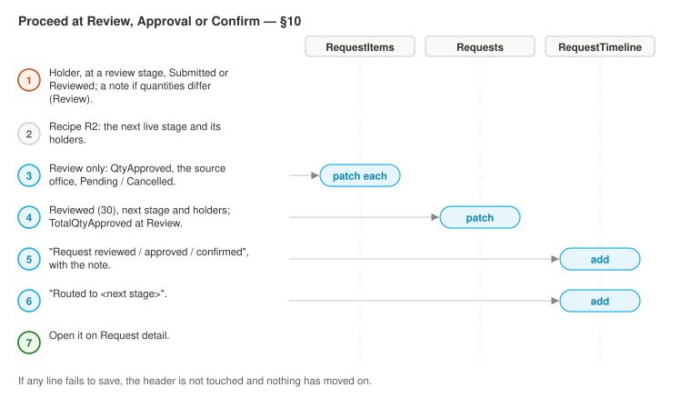
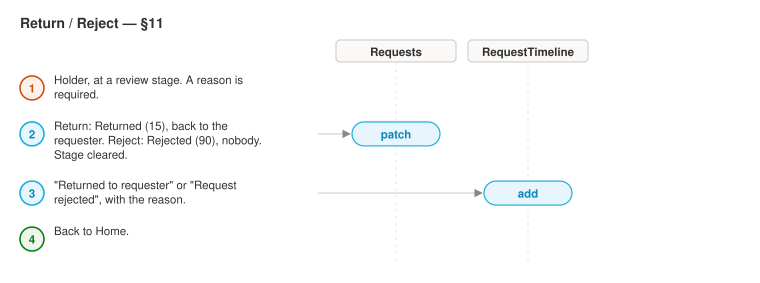
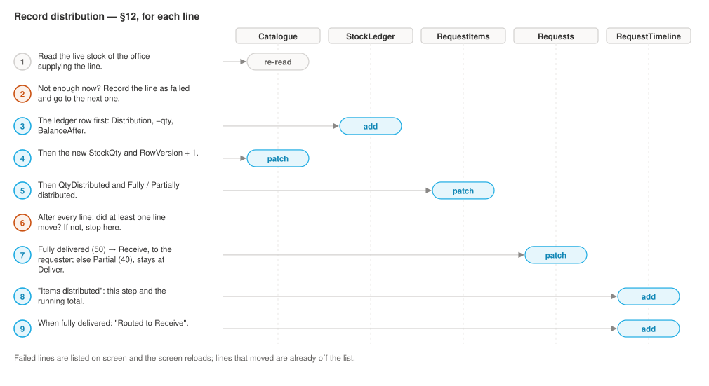
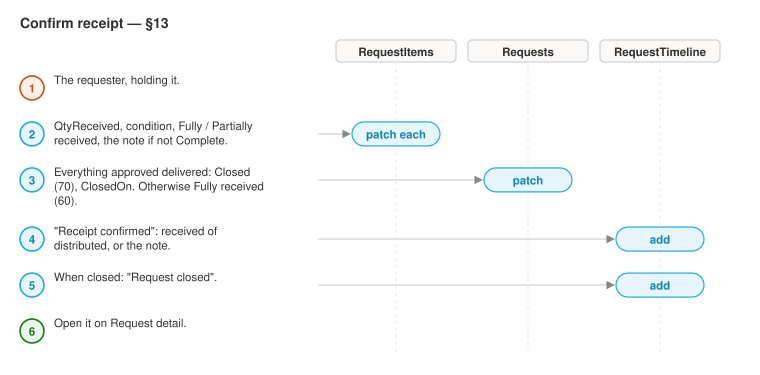
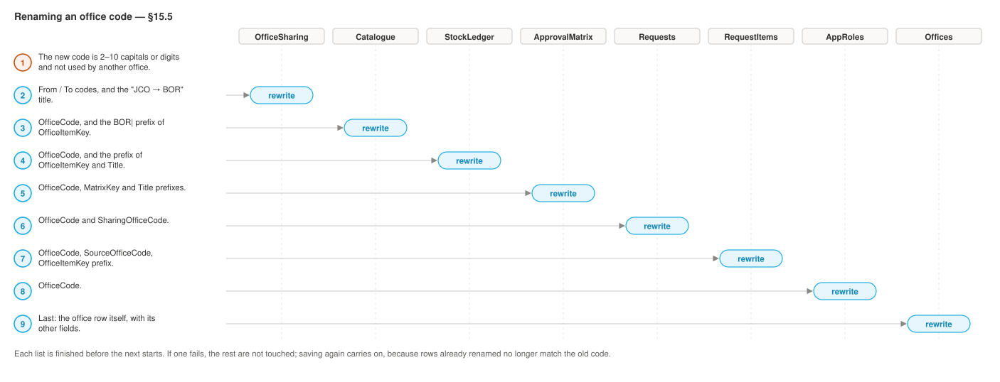

# App glue — everything Studio's "Paste code" cannot carry

Office Supplies canvas app. Work top to bottom with this file open beside Power
Apps Studio.

**Scope of this file.** Paste code delivers *control subtrees* only. It cannot
deliver the App object, `App.Formulas`, `App.OnStart`, `App.StartScreen`, screen
*creation*, data-source bindings, connection references, or the Data row limit.
All of that is typed by hand from this file.

Sources of truth this file was written against:

- `styles.css` — every colour, size and radius below is copied from it, verbatim.
- `docs/schema.md` — every column name below exists there. Do not invent columns.
- The plan's `StatusRank` table, `StageCode` table and Delegation contract.

Three Phase-1 renames/additions are already reflected here:
`RequestComments.CommentAuthor` (not `Author`), `Offices.OfficeType`,
`ApprovalMatrix.ActorRoleCode`, `RequestItems.UnitCost`.

---

## Section 1 — `App.Formulas`

Studio: select the **App** object in the tree view → property dropdown →
**Formulas** → paste the whole block below.

### Named formulas vs `App.OnStart` — the rule

```
//  NAMED FORMULAS (App.Formulas)          |  App.OnStart
//  --------------------------------------- | ------------------------------------
//  Recomputed automatically when their     |  Runs once, imperatively, at launch.
//  inputs change. Cannot be Set(). No      |  Set() / ClearCollect() / Patch()
//  ordering dependency. No data call at    |  live here — and ONLY here.
//  launch, so they do not slow startup.    |
//                                          |
//  => CONSTANTS live here: colours, sizes, |  => ANYTHING THAT NEEDS A DATA CALL
//     radii, spacing, the status table,    |     lives there: colOffices,
//     the journey-stage table.             |     colMatrix, colMyRoles, and the
//                                          |     role booleans derived from them.
```

Two consequences that bite if ignored:

1. You **cannot** move `ClearCollect(colOffices, Offices)` into `App.Formulas` —
   named formulas are declarative and cannot contain behaviour functions.
2. A named formula **cannot reference a global variable or a collection**. That is
   why the role-check booleans in Section 2 are `Set()` variables in `OnStart` and
   not named formulas here. *(Uncertain: the exact wording of this restriction has
   moved between releases. If Studio accepts `isStorekeeper = CountRows(Filter(colMyRoles, …)) > 0`
   in `App.Formulas`, prefer that — it self-updates. If it red-squiggles, use the
   `OnStart` form in Section 2. Test it once and pick one.)*

### 1.1 Brand and neutrals

```powerfx
// ── Brand ─────────────────────────────────────────────────────────────────
clrBrand       = ColorValue("#1CABE2");   // --brand       UNICEF cyan
clrBrandDark   = ColorValue("#0F86B5");   // --brand-dark
clrBrandTint   = ColorValue("#E6F6FC");   // --brand-tint
clrFocus       = ColorValue("#1CABE2");   // --focus  (same value as --brand,
                                          //  kept separate so focus can be
                                          //  retuned without moving the brand)

// ── Fluent neutrals ───────────────────────────────────────────────────────
clrCanvas      = ColorValue("#FAF9F8");   // --canvas       page background
clrSurface     = ColorValue("#FFFFFF");   // --surface      cards, nav, topbar
clrInk         = ColorValue("#323130");   // --ink          primary text
clrInk2        = ColorValue("#605E5C");   // --ink-2        secondary text
clrInk3        = ColorValue("#8A8886");   // --ink-3        tertiary / disabled
clrLine        = ColorValue("#EDEBE9");   // --line         hairline borders
clrLineStrong  = ColorValue("#D2D0CE");   // --line-strong  input + button borders
clrOnBrand     = ColorValue("#FFFFFF");   // #fff on .btn-primary, .avatar, .dot
```

### 1.2 Status colours — all nine, foreground + background

Verified against `styles.css` lines 22-30.

```powerfx
// --st-draft / --st-draft-bg …
clrStDraft       = ColorValue("#605E5C");  clrStDraftBg       = ColorValue("#F3F2F1");
clrStSubmitted   = ColorValue("#0078D4");  clrStSubmittedBg   = ColorValue("#EFF6FC");
clrStReviewed    = ColorValue("#8764B8");  clrStReviewedBg    = ColorValue("#F5F0FA");
clrStPartial     = ColorValue("#CA5010");  clrStPartialBg     = ColorValue("#FCF1EA");
clrStDelivered   = ColorValue("#038387");  clrStDeliveredBg   = ColorValue("#E9F5F5");
clrStReceived    = ColorValue("#107C10");  clrStReceivedBg    = ColorValue("#EDF6ED");
clrStClosed      = ColorValue("#323130");  clrStClosedBg      = ColorValue("#F3F2F1");
clrStReturned    = ColorValue("#986F0B");  clrStReturnedBg    = ColorValue("#FBF6E9");
clrStRejected    = ColorValue("#A4262C");  clrStRejectedBg    = ColorValue("#FAEEEF");
```

Note `clrStDraft` == `clrInk2` and `clrStClosed` == `clrInk`; `clrStDraftBg` ==
`clrStClosedBg`. That is what the CSS does. Keep them as separate names so a
status recolour never drags a neutral with it.

### 1.3 Catalogue / stock state colours

`styles.css` lines 326-329 reuse status tokens for the four stock states.

```powerfx
clrStockOk     = clrStReceived;   // .stock-ok    "Active"
clrStockLow    = clrStPartial;    // .stock-low   "Low stock"
clrStockOut    = clrStRejected;   // .stock-out   "Out of stock"
clrStockLend   = clrStReviewed;   // .stock-lend  borrowed from a sharing office
```

### 1.4 Avatar accents

```powerfx
clrAvatar      = clrBrandDark;             // .avatar        default
clrAvatarAlt   = ColorValue("#8764B8");    // .avatar.alt
clrAvatarAlt2  = ColorValue("#038387");    // .avatar.alt2
clrAvatarAlt3  = ColorValue("#CA5010");    // .avatar.alt3

// Deterministic accent from a person's name, so the same person is always the
// same colour. Usage: Index(tblAvatarAccent, Mod(Len(ThisItem.Requester), 4) + 1).Colour
tblAvatarAccent =
Table(
    { Slot: 1, Colour: clrAvatar    },
    { Slot: 2, Colour: clrAvatarAlt },
    { Slot: 3, Colour: clrAvatarAlt2},
    { Slot: 4, Colour: clrAvatarAlt3}
);
```

### 1.5 Spacing scale

Every value below appears in `styles.css`. Power Apps has no `gap`, so these are
used as `X`/`Y` offsets, `Padding*` on containers, and explicit spacer heights.

```powerfx
spc2   = 2;    // .leg dot ring inset, .chip .held margin
spc4   = 4;    // .nav gap, .tile gap
spc5   = 5;    // .field gap, .btn-sm vertical padding
spc6   = 6;    // .badge icon gap, .nav-label bottom padding
spc7   = 7;    // .btn icon gap
spc8   = 8;    // .btn vertical padding, .nav item vertical padding
spc9   = 9;    // .chip gap, .leg .lbl margin-top
spc10  = 10;   // .nav item gap, .callout gap, .card-head gap
spc11  = 11;   // .btn-sm horizontal padding, .table td vertical padding
spc12  = 12;   // .nav padding, .nav-user padding
spc14  = 14;   // .topbar gap, .table cell horizontal padding, .card-head padding
spc16  = 16;   // .btn horizontal padding, .field margin-bottom, .grid-3 gap
spc18  = 18;   // .card-body padding, .tile horizontal padding
spc20  = 20;   // .grid-2 gap
spc22  = 22;   // .journey top padding, .timeline li bottom padding
spc24  = 24;   // .content top padding
spc28  = 28;   // .content horizontal padding
spc34  = 34;   // .mock-note margin-top
spc56  = 56;   // .content bottom padding

// Fixed dimensions lifted straight from the CSS
dimNavWidth    = 264;   // .shell grid-template-columns
dimContentMax  = 1180;  // .content max-width
dimAvatar      = 28;    // .avatar, .leg .dot, .t-dot
dimBrandMark   = 32;    // .brand-mark
dimGlyph       = 18;    // .nav .glyph
dimQtyBox      = 84;    // .qty input
dimRailBar     = 2;     // .leg::before / ::after connector thickness
dimActiveBar   = 3;     // .nav a[aria-current] left indicator
```

### 1.6 Border radii

```powerfx
rad4      = 4;    // --radius : buttons, inputs, nav items, callouts, t-note
rad6      = 6;    // .card, .brand-mark
radPill   = 999;  // .badge, .chip, .persona, .card-head .count
radCircle = 14;   // 50% of dimAvatar (28) — .avatar, .leg .dot, .t-dot
```

> **Power Apps note.** Canvas controls do not take a single `BorderRadius`; they
> take `RadiusTopLeft` / `RadiusTopRight` / `RadiusBottomLeft` / `RadiusBottomRight`,
> and a radius is clamped to half the control's smaller dimension. `radPill = 999`
> is therefore safe as a "fully rounded" sentinel on any pill of any height, and
> `radCircle` only produces a circle on a 28×28 control.

### 1.7 Type scale

Sizes are in px exactly as authored in `styles.css`; Power Apps `Size` accepts
decimals, so 14.5 and 13.5 survive.

```powerfx
// size                       weight                    where it is used
szDisplay      = 26;   // FontWeight.Bold        .tile .t-num  (KPI number)
szPageTitle    = 18;   // FontWeight.Semibold    .topbar h1
szSection      = 15;   // FontWeight.Semibold    .brand-name, .brand-mark (Bold)
szCardTitle    = 14.5; // FontWeight.Semibold    .card-head h2
szBody         = 14;   // FontWeight.Normal      body base
szControl      = 13.5; // Semibold on .btn and .tab-list label,
                       // Normal on .input / .select / textarea
szTable        = 13;   // FontWeight.Normal      .table td
                       // also .leg .dot (Bold) and .t-title (Semibold)
szLabel        = 12.5; // Semibold on .field label and .chip .who;
                       // Normal on .ref, .tile .t-cap, .callout, .t-note,
                       // .btn-sm, .nav-user .who
szBadge        = 12;   // FontWeight.Semibold    .badge, .leg .lbl, .stock-*
                       // Normal on .t-dot glyph
szCaption      = 11.5; // Semibold on .table th, .card-head .count, .tile .t-flag
                       // Normal on .persona, .field .hint, .t-meta, .mock-note
szMicro        = 11;   // Bold on .avatar; Semibold on .nav-label, .chip .held
                       // Normal on .leg .sub, .brand-name small, .chip small
```

Fonts and letter-spacing:

```powerfx
// styles.css --font is "Segoe UI Variable Text", "Segoe UI", system-ui.
// VERIFIED present in this environment's Font list. Accept the loss of the
// Variable Text optical sizing.
fntUI   = Font.'Segoe UI';
// styles.css --mono is "Cascadia Code", Consolas, "Courier New".
// VERIFIED: the Font list has no Cascadia and no Consolas; Courier New is the
// only monospace offered. Used only by the .ref reference number.
fntMono = Font.'Courier New';

// The full list this environment offers, confirmed in Studio: Arial, Courier New,
// Dancing Script, Georgia, Great Vibes, Lato, Lato Black, Lato Hairline, Lato
// Light, Open Sans, Open Sans Condensed, Patrick Hand, Segoe UI, Verdana.
//
// WARNING: Studio's default for a newly inserted Label or Button is Open Sans,
// NOT Segoe UI. Every text control Phase 3 writes must set Font: =fntUI
// explicitly. Omit it and the control silently renders in Open Sans, which is a
// visibly different face from the mock-up.
```

Uppercase tracking (`.table th`, `.nav-label`) has no Power Apps equivalent —
`letter-spacing` is not a canvas property. Render those with `Upper(...)` and
accept the tighter tracking.

### 1.8 Shadows

```powerfx
// --shadow-2 / --shadow-8 have no direct canvas equivalent. Options:
//   a) Container/Rectangle: no shadow property at all.
//   b) HtmlText control with an inline box-shadow — slow, does not theme.
//   c) A 1px clrLine border, which is what the mock-up already draws under the
//      shadow, and is what the .pa.yaml in Phase 3 should use.
// Decision: (c). Cards get BorderColor = clrLine, BorderThickness = 1.
```

### 1.9 Status resolver — table-driven

One edit adds a status. Everything (colour, background, glyph, rank, open/closed)
comes off this one table.

```powerfx
// Rank values are the plan's StatusRank table, verbatim. Requests.StatusRank is
// written in the same Patch as Requests.Status; this table is what supplies the
// number. Open = Rank < 70.
tblStatus =
Table(
    { StatusText: "Draft",            Rank: 10, Fg: clrStDraft,     Bg: clrStDraftBg,     Glyph: "✎", StockLike: false },
    { StatusText: "Returned",         Rank: 15, Fg: clrStReturned,  Bg: clrStReturnedBg,  Glyph: "↩", StockLike: false },
    { StatusText: "Submitted",        Rank: 20, Fg: clrStSubmitted, Bg: clrStSubmittedBg, Glyph: "●", StockLike: false },
    { StatusText: "Reviewed",         Rank: 30, Fg: clrStReviewed,  Bg: clrStReviewedBg,  Glyph: "◆", StockLike: false },
    { StatusText: "Partial delivery", Rank: 40, Fg: clrStPartial,   Bg: clrStPartialBg,   Glyph: "◐", StockLike: false },
    { StatusText: "Fully delivered",  Rank: 50, Fg: clrStDelivered, Bg: clrStDeliveredBg, Glyph: "▣", StockLike: false },
    { StatusText: "Fully received",   Rank: 60, Fg: clrStReceived,  Bg: clrStReceivedBg,  Glyph: "✓", StockLike: false },
    { StatusText: "Closed",           Rank: 70, Fg: clrStClosed,    Bg: clrStClosedBg,    Glyph: "■", StockLike: false },
    { StatusText: "Rejected",         Rank: 90, Fg: clrStRejected,  Bg: clrStRejectedBg,  Glyph: "✕", StockLike: false }
);

// Fallback record, so a status typed into SharePoint that this table does not
// know about renders as neutral text rather than blowing up the gallery.
recStatusFallback =
    { StatusText: "", Rank: 0, Fg: clrInk2, Bg: clrStDraftBg, Glyph: "•", StockLike: false };

// Catalogue badge states (admin.html). Derived, never stored — see schema.md §3.
tblStockState =
Table(
    { StateText: "Active",       Fg: clrStockOk,   Bg: clrStReceivedBg, Glyph: "✓" },
    { StateText: "Low stock",    Fg: clrStockLow,  Bg: clrStPartialBg,  Glyph: "⚠" },
    { StateText: "Out of stock", Fg: clrStockOut,  Bg: clrStRejectedBg, Glyph: "✕" },
    { StateText: "Discontinued", Fg: clrStClosed,  Bg: clrStClosedBg,   Glyph: "■" }
);
```

**How screens use it.** Named formulas take no parameters (canvas named formulas
are parameterless — user-defined functions are a separate, still-moving feature,
so this file does not rely on them). The lookup is therefore written inline at
each use site, always through `Coalesce` onto the fallback:

```powerfx
// A gallery row's status badge (Requests.Status is a Choice, hence .Value):
// Label.Color
Coalesce(LookUp(tblStatus, StatusText = ThisItem.Status.Value).Fg, clrInk2)
// Rectangle.Fill  (behind the label)
Coalesce(LookUp(tblStatus, StatusText = ThisItem.Status.Value).Bg, clrStDraftBg)
// Glyph label .Text
Coalesce(LookUp(tblStatus, StatusText = ThisItem.Status.Value).Glyph, "•")

// Writing a status — Status and StatusRank always move together:
With({ st: LookUp(tblStatus, StatusText = "Reviewed") },
    Patch(Requests, recReq, { Status: { Value: st.StatusText }, StatusRank: st.Rank })
)

// Open/closed test used by the Home tiles (evaluated locally, on a collection
// that was itself fetched with the delegable StatusRank < 70 filter):
LookUp(tblStatus, StatusText = ThisItem.Status.Value).Rank < 70
```

> **Glyph caveat, flagged rather than guessed.** The mock-up's glyphs
> (`✎ ↩ ● ◆ ◐ ▣ ✓ ■ ✕`) are plain Unicode in a `<span>`. In a canvas Label under
> `Font.'Segoe UI'` most render, but `◐` and `▣` are the two most likely to fall
> back to a substitute glyph on some clients. If either renders as a box in
> Studio, swap the `Glyph` column for the Fluent icon enum on an Icon control
> instead, via a Switch on the same `StatusText`:
> `Switch(ThisItem.Status.Value, "Draft", Icon.Edit, "Returned", Icon.Undo, "Submitted", Icon.Send, "Reviewed", Icon.CheckBadge, "Partial delivery", Icon.Hamburger, "Fully delivered", Icon.Trending, "Fully received", Icon.CheckMark, "Closed", Icon.LockOrange, "Rejected", Icon.Cancel, Icon.Bookmark)`.
> Do **not** put `Icon.*` enum values inside `tblStatus` — a table column must
> have one type, and mixing an image enum into a record alongside Color and
> Number is exactly the kind of thing that type-checks in one release and not the
> next. Keep the Switch on the control.

### 1.10 Journey stages — the six canonical legs

```powerfx
// Verbatim from request-detail.html lines 81-109, in order.
// StageCode matches ApprovalMatrix.StageCode / Requests.CurrentStageCode /
// RequestTimeline.StageCode (5 Choice values). "Submitted" is the requester's own
// act and has NO StageCode and NO matrix row — that is why there are 6 legs and
// 5 stage codes.
//
// The skip rule is the ABSENCE of a matrix row: a leg is skipped iff no active
// row exists in colMatrix for the request's MatrixKey + this StageCode.
tblJourney =
Table(
    { Leg: 1, LegLabel: "Submitted",       StageCode: "",         ActorLabel: "Requester",           Skippable: false },
    { Leg: 2, LegLabel: "Review",          StageCode: "Review",   ActorLabel: "Reviewer",            Skippable: true  },
    { Leg: 3, LegLabel: "Approval",        StageCode: "Approval", ActorLabel: "Finance approval",    Skippable: true  },
    { Leg: 4, LegLabel: "Confirm",         StageCode: "Confirm",  ActorLabel: "Chief Field Office",  Skippable: true  },
    { Leg: 5, LegLabel: "Deliver",         StageCode: "Deliver",  ActorLabel: "Storekeeper",         Skippable: true  },
    { Leg: 6, LegLabel: "Receive & close", StageCode: "Receive",  ActorLabel: "Requester",           Skippable: true  }
);

// The copy the mock-up puts under a struck-through leg.
txtLegSkipped = "not required in this office";
```

**How the rail renders (Phase 3 will bind a gallery to this).** Left-join the six
canonical legs against the collected matrix rows for the current request:

```powerfx
// Gallery.Items — one row per canonical leg, already carrying everything the
// template needs. varMatrixKey is set when a request is opened (Section 2).
AddColumns(
    tblJourney,
    IsSkipped,
        And(
            Skippable,
            IsBlank(
                LookUp(colMatrix,
                       MatrixKey = varMatrixKey And StageCode.Value = StageCode).ID
            )
        ),
    ActorName,
        Coalesce(
            LookUp(colMatrix,
                   MatrixKey = varMatrixKey And StageCode.Value = StageCode).ApproverEmail,
            ActorLabel
        )
)
```

> **Uncertain — name collision.** Inside `AddColumns` over `tblJourney`, the bare
> name `StageCode` is ambiguous between the `tblJourney` column and
> `colMatrix.StageCode`. Phase 3 must disambiguate with an `As` alias
> (`ForAll(tblJourney As leg, …)` / `LookUp(colMatrix As m, m.StageCode.Value = leg.StageCode)`).
> Written above in the readable form; rewrite with aliases when the screen YAML
> is generated and Studio flags it.
>
> Skipped legs use the Label `Strikethrough` property
> (`Strikethrough: ThisItem.IsSkipped`), not a separate control.

---

## Section 2 — `App.OnStart`

> **The current text is `App.OnStart.fx`**, which adds lower-cased emails
> (DEF-09), the `req` and `as` link parameters, `varPersonaRole`,
> `varMyOfficeName`, `varEditRef` and `varQueue`. Paste that file; the block
> below is the first version.

Studio: **App** object → property dropdown → **OnStart** → paste. Then
right-click the App object → **Run OnStart** to test without republishing.

Every query below is from the plan's Delegation contract or is a small reference
list. No `Search()`, no `<>` on text, no `Not`, no `Sort` on a Choice column.

```powerfx
// ── 1. Reference data (small lists, one round trip each) ───────────────────

// All offices, including inactive ones — scrAdmin tab 3 renders the full table
// with an Active column, so it must not be pre-filtered.
ClearCollect(colOffices, Offices);

// The approval matrix. IsActive = true on a Yes/No column IS delegable to
// SharePoint. Small list (max 5 rows per office+section).
ClearCollect(colMatrix, Filter(ApprovalMatrix, IsActive = true));

// Office sharing links — needed by the Review screen's ceiling calculation.
ClearCollect(colSharing, Filter(OfficeSharing, IsActive = true));

// ── 2. The single role query ───────────────────────────────────────────────
// ONE delegable query (UserEmail is indexed text, IsActive is Yes/No). Every
// role check after this is local. Never re-query AppRoles per screen.
ClearCollect(
    colMyRoles,
    Filter(AppRoles, UserEmail = User().Email, IsActive = true)
);

// ── 3. User and context variables ──────────────────────────────────────────
Set(varUserEmail, User().Email);
Set(varUserName,  User().FullName);

// Default office = the office on the user's Requester role if they have one,
// else whatever their first role names, else blank. Coalesce over blank text.
Set(
    varMyOffice,
    Coalesce(
        LookUp(colMyRoles, RoleCode.Value = "Requester").OfficeCode,
        First(colMyRoles).OfficeCode,
        ""
    )
);

// varOffice is the office the screens are CURRENTLY looking at. It starts at the
// user's own office; scrAdmin and scrReports let an Administrator repoint it.
// Every Catalogue / StockLedger query keys off varOffice, never off varMyOffice.
Set(varOffice, varMyOffice);

// ── 4. Role booleans ───────────────────────────────────────────────────────
// Derived from colMyRoles, so they are variables, not named formulas — a named
// formula cannot reference a collection. Consequence: if AppRoles changes
// mid-session these are stale until the app is relaunched. Acceptable; roles
// are administered rarely. RoleCode is a Choice column, hence .Value.
Set(varIsRequester,  CountRows(Filter(colMyRoles, RoleCode.Value = "Requester"))           > 0);
Set(varIsReviewer,   CountRows(Filter(colMyRoles, RoleCode.Value = "Reviewer"))            > 0);
Set(varIsCFO,        CountRows(Filter(colMyRoles, RoleCode.Value = "Chief Field Office"))  > 0);
Set(varIsStorekeeper,CountRows(Filter(colMyRoles, RoleCode.Value = "Storekeeper"))         > 0);
Set(varIsAdmin,      CountRows(Filter(colMyRoles, RoleCode.Value = "Administrator"))       > 0);

// ── 5. Working state ───────────────────────────────────────────────────────
Set(varBusy, false);        // button guard — see Section 5
Set(varRef, "");            // the request reference currently open
Set(varMatrixKey, "");      // "<OfficeCode>|<Section>" for the open request
Set(varErrorMsg, "");       // last user-facing error, "" when clean
```

### 2.1 Role-check expressions the screens reference

`CountRows` is not delegable — which is fine and deliberate: every expression
below runs against `colMyRoles`, an in-memory collection of at most a handful of
rows that was itself fetched by one delegable query.

```powerfx
// Global (any office) — already computed in OnStart:
varIsReviewer
varIsStorekeeper
varIsAdmin

// Office-scoped — a Storekeeper in BOR must not distribute JCO stock:
CountRows(Filter(colMyRoles, RoleCode.Value = "Storekeeper", OfficeCode = varOffice)) > 0
CountRows(Filter(colMyRoles, RoleCode.Value = "Reviewer",    OfficeCode = varOffice)) > 0

// "Is this request mine to act on right now?" — the button-enable test on
// scrReview / scrDistribute / scrReceipt. Mirrors the delegable Home query so
// the two can never disagree:
And(
    LookUp(tblStatus, StatusText = varReq.Status.Value).Rank < 70,
    Or(
        varReq.CurrentlyWithEmail    = varUserEmail,
        varReq.CurrentlyWithOICEmail = varUserEmail
    )
)

// "Am I the originator?" — gates the Receive & close leg, which routes to the
// requester and has a blank ApproverEmail on its matrix row (schema.md §5):
varReq.RequesterEmail = varUserEmail

// Matrix resolution for a request: section row wins, office-wide row is the
// fallback. Both forms are MatrixKey = x, so both delegate.
Coalesce(
    LookUp(colMatrix,
           MatrixKey = varReq.OfficeCode & "|" & varReq.Section.Value,
           StageCode.Value = "Review"),
    LookUp(colMatrix,
           MatrixKey = varReq.OfficeCode & "|All sections",
           StageCode.Value = "Review")
)
```

### 2.2 `App.StartScreen`

```powerfx
scrHome
```

Set this **after** the eight screens exist. Do not use `Navigate()` in `OnStart`;
`StartScreen` is the supported replacement and it evaluates before OnStart
completes, which is what makes the app start fast.

---

## Section 3 — Data sources to add

Studio: **Data** → **Add data** → **SharePoint** → the existing SharePoint
connection → enter the site URL → tick all twelve → **Connect**.

Site URL:

```
https://trailanalyticslimited602.sharepoint.com/sites/OfficeSupplies
```

| # | List / library | Base template | Why the app needs it |
|---|---|---|---|
| 1 | `Offices` | List | `colOffices`; scrAdmin tab 3 |
| 2 | `OfficeSharing` | List | `colSharing`; the Review ceiling fallback |
| 3 | `Catalogue` | List | Item picker, stock, reconciliation |
| 4 | `StockLedger` | List | Ledger writes, reconciliation, scrReports |
| 5 | `ApprovalMatrix` | List | `colMatrix`; the journey rail; routing |
| 6 | `Requests` | List | Every screen |
| 7 | `RequestItems` | List | Lines on every workflow screen |
| 8 | `RequestComments` | List | scrRequestDetail |
| 9 | `RequestTimeline` | List | scrRequestDetail |
| 10 | `RequestDocuments` | **Document library** | scrRequestDetail attachments |
| 11 | `AppRoles` | List | `colMyRoles` |
| 12 | `RefCounter` | List | Reference minting |

Two things to check the moment they appear in the Data pane:

- `RequestDocuments` must come in as a **library**, not a list. If Studio offers
  it under "Document libraries" that is correct.
- Every column must show its clean internal name (`OfficeCode`, not
  `Office_x0020_Code`). If any `_x0020_` appears, the provisioning script did not
  run for that column and it must be recreated before any formula binds to it.

### Data row limit — set to **1**

**Settings → General → Data row limit → `1`.**

This is not optional and not a nicety. A non-delegable formula does not fail —
it silently truncates to the row limit and returns a plausible-looking wrong
answer, and `Set` / `With` / `UpdateContext` produce **no delegation warning at
all**. At a row limit of 1, a query that is genuinely delegating still returns
its rows (the server does the filtering); a query that is not delegating returns
exactly one row or none. That difference is the only reliable oracle.

> **Named check — Yes/No columns. Do this first, before anything else.**
> Querying the provisioned site directly over SharePoint REST, `IsActive eq true`
> returns **only the rows where `IsActive` is false** — it matched the single
> discontinued catalogue item and none of the ten active ones. `IsActive eq 1`
> returns the correct ten. SharePoint's REST OData mis-binds the boolean literal.
>
> The Power Apps connector composes its own `$filter` and is *expected* to get this
> right, so this is probably a hand-query artifact only — but it is not safe to
> assume, because `IsActive = true` appears in three load-bearing places:
> `ClearCollect(colMatrix, Filter(ApprovalMatrix, IsActive = true))`,
> `ClearCollect(colSharing, Filter(OfficeSharing, IsActive = true))`, and the
> delegable `Filter(Catalogue, OfficeCode = varOffice, IsActive = true)`. If the
> connector shares the defect, the app loads the *inactive* matrix rows and the
> journey rail resolves against the wrong data — with no error and no warning.
>
> **Test:** the Bor catalogue must return **9** active items (10 rows less the
> discontinued `BOR|FAXTONER-L100`), and `colMatrix` must hold **4** rows. If either
> comes back as 1, rewrite the predicate as `IsActive <> false`, or add a shadow
> number column, the same way `StatusRank` shadows `Status`.

Walk every screen at 1 and confirm each of the plan's five delegable queries
still returns rows. **Raise to 2000 only when every screen is clean**, and if a
query fails, fix the *schema* (add the index, add the shadow column), not the
formula.

Note while testing at 1: `colOffices`, `colMatrix`, `colSharing` and `colMyRoles`
will each hold at most one row, so role gating and the journey rail will look
broken. That is expected. Verify those four after raising the limit to 2000.

> **Walk the row-limit-1 pass READ-ONLY. Do not press any action button.**
> The truncation is not confined to what you see — it reaches the write paths.
> §5.3's rollup computes `Sum(Filter(RequestItems, RequestRefNo = varRef),
> QtyDistributed)`; at a row limit of 1 that filter yields **one line**, and the
> resulting wrong total is then *written back to SharePoint*. `CountRows(...) = 0`
> in the same block will likewise read as fully-distributed off a single row.
> Open screens, confirm the five queries return rows, and stop there. Raise the
> limit to 2000 **before** the end-to-end workflow walk.

---

## Section 4 — Studio hand-steps, in order

1. **Create the app.** make.powerapps.com → Create → Blank app → **Canvas** →
   **Tablet** layout. Name: `Office Supplies`. (Tablet, not phone — the mock-up
   is a 264px nav plus a 1180px content column.)
2. **Add the 12 data sources** from Section 3. All twelve before any screen work.
3. **Set Data row limit = 1** (Settings → General). Section 3.
4. **Create the 8 screens**, by exact name, in this order. Insert → New screen →
   Blank, then rename in the tree view. The name is load-bearing —
   `Navigate(scrReview)` will not resolve against `Screen2`.

   | Order | Screen name | Mock-up page |
   |---|---|---|
   | 1 | `scrHome` | `index.html` |
   | 2 | `scrNewRequest` | `new-request.html` |
   | 3 | `scrReview` | `review.html` |
   | 4 | `scrDistribute` | `distribute.html` |
   | 5 | `scrReceipt` | `receipt.html` |
   | 6 | `scrRequestDetail` | `request-detail.html` |
   | 7 | `scrAdmin` | `admin.html` |
   | 8 | `scrReports` | `reports.html` |

   Delete the default `Screen1` once `scrHome` exists.
5. **Paste each screen's YAML.** Right-click the screen in the tree view →
   **Paste code** (Phase 3 output, `powerapps/screens/*.pa.yaml`). If a paste is
   rejected, split it per container and paste in chunks — validation is
   all-or-nothing but there is no size limit.
6. **Type `App.Formulas`** — Section 1, the whole block.
7. **Type `App.OnStart`** — Section 2. Then right-click the App object → **Run
   OnStart** and confirm the four collections populate (View → Collections).
8. **Set `App.StartScreen` = `scrHome`** — Section 2.2. Only after step 4.
9. **Raise Data row limit to 2000** once every screen is delegation-clean.
10. **Copy the corrected YAML back out** of Studio (right-click each screen →
    View code → Copy) and overwrite `powerapps/screens/*.pa.yaml`. The repo is
    regenerated *from* Studio, never the reverse.

---

## Section 5 — Stock: reconciliation and the distribution write sequence

### 5.1 The constraint that shapes the reconciliation

`provision/03-seed.sh` deliberately leaves `StockLedger` **empty**. Fabricated
movements would put the reconciliation into a false-mismatch state on day one.

**Therefore: "no ledger row for this `OfficeItemKey`" is _no drift_, not a
mismatch.** If the routine compares `StockQty` against a blank `BalanceAfter`, all
eleven seeded catalogue items flag on first run and the Phase 5 acceptance check
("run reconciliation, confirm it's a no-op") fails immediately.

The blank test must be on the ledger row's **`ID`**, never on `BalanceAfter` —
`BalanceAfter` of `0` is a legitimate value (archive boxes hit 0 in the Phase 5
walkthrough) and `IsBlank(0)` is false but `Coalesce`/`If` around a numeric blank
is exactly where this bug hides.

### 5.2 Reconciliation — `btnReconcile.OnSelect`

Also runs automatically at the end of 5.3.

```powerfx
If(varBusy, false,                       // re-entrancy guard
Set(varBusy, true);
Set(varErrorMsg, "");
Clear(colReconDrift);
Clear(colReconScanned);

// Bound the scan with a delegable filter: OfficeCode is indexed, IsActive is
// Yes/No. Never scan the whole Catalogue across all offices.
ClearCollect(
    colReconScanned,
    Filter(Catalogue, OfficeCode = varOffice, IsActive = true)
);

ForAll(
    colReconScanned As cat,
    With(
        {
            // Live read of the newest ledger row for this key.
            // StockLedger is append-only, so the highest ID IS the newest row —
            // more reliable than MovedOn, which can tie to the second.
            // Filter on OfficeItemKey (indexed) + Sort by ID both delegate.
            led:
                First(
                    Sort(
                        Filter(StockLedger, OfficeItemKey = cat.OfficeItemKey),
                        ID,
                        SortOrder.Descending
                    )
                )
        },
        If(
            // ── THE BLANK CASE. No ledger row at all => nothing to reconcile
            //    against => NOT drift. This is the seeded state of every item.
            IsBlank(led.ID),
            false,

            // ── A ledger row exists. Now the comparison is meaningful.
            If(
                led.BalanceAfter <> cat.StockQty,
                Collect(
                    colReconDrift,
                    {
                        OfficeItemKey: cat.OfficeItemKey,
                        OfficeCode:    cat.OfficeCode,
                        ItemCode:      cat.ItemCode,
                        ItemName:      cat.Title,
                        CacheQty:      cat.StockQty,
                        LedgerQty:     led.BalanceAfter,
                        Delta:         led.BalanceAfter - cat.StockQty
                    }
                ),
                false
            )
        )
    )
);

// ── Repair pass. The ledger is truth; StockQty is the cache. Write the
//    Adjustment row first (audit before mutation), then correct the cache.
ForAll(
    colReconDrift As d,
    With(
        { live: LookUp(Catalogue, OfficeItemKey = d.OfficeItemKey) },
        IfError(
            Patch(
                StockLedger,
                Defaults(StockLedger),
                {
                    Title:         d.OfficeItemKey & " " & Text(Now(), "yyyy-mm-dd"),
                    OfficeItemKey: d.OfficeItemKey,
                    OfficeCode:    d.OfficeCode,
                    ItemCode:      d.ItemCode,
                    MovementType:  { Value: "Adjustment" },
                    QtyDelta:      d.Delta,          // signed: ledger minus cache
                    BalanceAfter:  d.LedgerQty,      // unchanged — the ledger was right
                    RequestRefNo:  "",               // blank for a manual adjustment
                    MovedOn:       Now(),
                    MovedByEmail:  varUserEmail,
                    MovedBy:       { '@odata.type': "#Microsoft.Azure.Connectors.SharePoint.SPListExpandedUser",
                                     Claims:      "i:0#.f|membership|" & varUserEmail,
                                     Department:  "",
                                     DisplayName: varUserName,
                                     Email:       varUserEmail,
                                     JobTitle:    "",
                                     Picture:     "" },
                    Notes:         "Stock cache drift corrected by reconciliation. "
                                   & "Cache read " & Text(d.CacheQty)
                                   & ", ledger balance " & Text(d.LedgerQty) & "."
                }
            );
            Patch(
                Catalogue,
                live,                                 // live record => ETag sent
                { StockQty: d.LedgerQty, RowVersion: live.RowVersion + 1 }
            ),
            Set(varErrorMsg,
                "Reconciliation could not correct " & d.ItemName & ": " & FirstError.Message)
        )
    )
);

Set(varBusy, false);
Notify(
    If(CountRows(colReconDrift) = 0,
       "Reconciliation complete — no drift. "
         & Text(CountRows(colReconScanned)) & " items checked.",
       Text(CountRows(colReconDrift)) & " of "
         & Text(CountRows(colReconScanned)) & " items corrected."
    ),
    If(CountRows(colReconDrift) = 0, NotificationType.Success, NotificationType.Warning)
)
)
```

**Notes on the above, including what is not certain.**

- `MovedBy` is a Person column. The `'@odata.type'` record shape is the standard
  SharePoint-connector form for patching a Person field. It is verbose but it is
  the only form that reliably resolves a user by email without a separate
  `Office365Users` connector. **Uncertain:** if the tenant rejects the raw
  claims string, drop the `MovedBy` line entirely — `MovedByEmail` is the shadow
  the app actually filters on and `MovedBy` is not required (schema.md §4).
- `Sort(..., ID, SortOrder.Descending)` on SharePoint: `ID` is a sortable numeric
  column and this should delegate. **Verify it at Data row limit 1** — if the
  ledger has rows and this returns the *oldest*, it is not delegating and must be
  replaced with `SortByColumns(..., "MovedOn", SortOrder.Descending)`.
- `<>` here is a **local** comparison between two numbers already in memory. It
  is not a query predicate, so the "`<>` does not delegate" rule does not apply.
- No `RequestTimeline` row is written. `RequestTimeline.RequestRefNo` is required
  (schema.md §9) and a stock reconciliation has no request. The `Stock adjusted`
  event type there is for a request-scoped adjustment only.

### 5.3 Distribution write sequence — `btnConfirmDistribution.OnSelect`

> **Superseded by Section 12**, which adds the UAT round 2 fixes (DEF-05, DEF-06,
> DEF-119, DEF-122). Kept here for the reasoning behind the four mitigations.

Honours all four mitigations: ledger first with `BalanceAfter`; a live `LookUp`
re-read immediately before the `Catalogue` patch; `varBusy` guard; sequential
`ForAll`, never `Concurrent`.

**Input contract.** The screen stages one row per line into `colDistLines`
*before* this button runs (built from the gallery, one `Collect` per line):

```powerfx
// { LineID, LineNo, ItemCode, ItemName, OfficeItemKey, SourceOfficeCode,
//   QtyApproved, QtyDistributedBefore, QtyToDistribute, IsCatalogueItem }
// SourceOfficeCode is the LENDING office when the sharing fallback applied,
// otherwise the request's own OfficeCode. OfficeItemKey is always
// "<SourceOfficeCode>|<ItemCode>" — the stock that actually moves.
// A free-text line (IsCatalogueItem = false) has a blank OfficeItemKey and is
// excluded from the stock path entirely.
```

```powerfx
// Guard: the whole body is inert while a previous run is in flight.
// btnConfirmDistribution.DisplayMode = If(varBusy, DisplayMode.Disabled, DisplayMode.Edit)
If(varBusy, false,
Set(varBusy, true);
Set(varErrorMsg, "");
Clear(colDistResult);

// ── Sequential, line by line. NOT wrapped in Concurrent(). ─────────────────
ForAll(
    Sort(
        Filter(colDistLines, QtyToDistribute > 0, IsCatalogueItem = true),
        LineNo
    ) As ln,
    With(
        {
            // MITIGATION 2 — live re-read against the DATA SOURCE, immediately
            // before the write. Never from colCatalogue. This is the record that
            // carries the ETag, and it is the ONLY quantity the ceiling is
            // validated against — never the value the screen loaded.
            live: LookUp(Catalogue, OfficeItemKey = ln.OfficeItemKey)
        },
        If(
            IsBlank(live.ID),
            Collect(colDistResult,
                { LineNo: ln.LineNo, Ok: false,
                  Msg: ln.ItemName & ": no catalogue row for " & ln.OfficeItemKey }),

            ln.QtyToDistribute > live.StockQty,
            Collect(colDistResult,
                { LineNo: ln.LineNo, Ok: false,
                  Msg: ln.ItemName & ": only " & Text(live.StockQty)
                       & " in stock now (someone else moved it); "
                       & Text(ln.QtyToDistribute) & " requested." }),

            // ── The write sequence ────────────────────────────────────────
            IfError(
                // MITIGATION 1 — LEDGER ROW FIRST, with BalanceAfter computed
                // from the live read. An orphan ledger row is recoverable and
                // visible; a silent stock move is neither.
                Patch(
                    StockLedger,
                    Defaults(StockLedger),
                    {
                        Title:         ln.OfficeItemKey & " " & Text(Now(), "yyyy-mm-dd"),
                        OfficeItemKey: ln.OfficeItemKey,
                        OfficeCode:    ln.SourceOfficeCode,
                        ItemCode:      ln.ItemCode,
                        MovementType:  { Value: "Distribution" },
                        QtyDelta:      -ln.QtyToDistribute,             // signed
                        BalanceAfter:  live.StockQty - ln.QtyToDistribute,
                        RequestRefNo:  varRef,
                        MovedOn:       Now(),
                        MovedByEmail:  varUserEmail,
                        Notes:         "Distributed against " & varRef
                                       & " line " & Text(ln.LineNo) & "."
                    }
                );

                // Then the cache. Patching `live` (not a fresh Defaults record,
                // not a collection row) is what sends the ETag, so a concurrent
                // edit surfaces here as an error rather than as a lost update.
                Patch(
                    Catalogue,
                    live,
                    {
                        StockQty:   live.StockQty - ln.QtyToDistribute,
                        RowVersion: live.RowVersion + 1
                    }
                );

                // Then the line.
                Patch(
                    RequestItems,
                    LookUp(RequestItems, ID = ln.LineID),
                    {
                        QtyDistributed:   ln.QtyDistributedBefore + ln.QtyToDistribute,
                        SourceOfficeCode: ln.SourceOfficeCode,
                        LineStatus:
                            { Value:
                                If(ln.QtyDistributedBefore + ln.QtyToDistribute
                                       >= ln.QtyApproved,
                                   "Fully distributed",
                                   "Partially distributed") }
                    }
                );

                Collect(colDistResult, { LineNo: ln.LineNo, Ok: true, Msg: "" }),

                // IfError handler
                Collect(colDistResult,
                    { LineNo: ln.LineNo, Ok: false,
                      Msg: ln.ItemName & ": " & FirstError.Message })
            )
        )
    )
);

// ── Roll the header up, from the lines as they now stand on the server ────
//
// GUARD (added at review). Without this test the rollup runs even when every
// line failed, or when the request is entirely free-text and the loop above
// matched nothing. The request would then move Reviewed -> "Partial delivery",
// CurrentStageCode -> "Receive", and land in the originator's queue with ZERO
// goods distributed — recoverable only by editing the item in SharePoint.
// A distribution that moved nothing must leave the header untouched.
If(
CountRows(Filter(colDistResult, Ok)) > 0,

With(
    { lines: Filter(RequestItems, RequestRefNo = varRef) },   // delegable, indexed
    With(
        {
            // Sum / CountRows are not delegable, but `lines` is already bounded
            // by a delegable filter to one request's lines — tens of rows.
            totDist: Sum(lines, QtyDistributed),
            totAppr: Sum(lines, QtyApproved),
            fullyOut: CountRows(Filter(lines, QtyDistributed < QtyApproved)) = 0
        },
        With(
            {
                st: LookUp(tblStatus,
                           StatusText = If(fullyOut, "Fully delivered", "Partial delivery"))
            },
            Patch(
                Requests,
                LookUp(Requests, Title = varRef),
                {
                    Status:              { Value: st.StatusText },
                    StatusRank:          st.Rank,          // same Patch, always
                    TotalQtyDistributed: totDist,
                    CurrentStageCode:    { Value: "Receive" },
                    // Hand the request back to the originator for receipt.
                    CurrentlyWithEmail:  LookUp(Requests, Title = varRef).RequesterEmail,
                    CurrentlyWithOICEmail: ""
                }
            );
            Patch(
                RequestTimeline,
                Defaults(RequestTimeline),
                {
                    Title:        "Items distributed",
                    RequestRefNo: varRef,
                    EventType:    { Value: "Distributed" },
                    FromStatus:   "Reviewed",
                    ToStatus:     st.StatusText,
                    StageCode:    { Value: "Deliver" },
                    ActorEmail:   varUserEmail,
                    OccurredOn:   Now(),
                    Detail:       Text(totDist) & " of " & Text(totAppr)
                                  & " approved units distributed."
                }
            )
        )
    )
)
);   // <- closes the "at least one line succeeded" guard

Set(varBusy, false);

// MITIGATION 4 — self-heal immediately after the stock moves.
Select(btnReconcile);

If(
    CountRows(Filter(colDistResult, !Ok)) > 0,
    Notify(First(Filter(colDistResult, !Ok)).Msg, NotificationType.Error),
    Notify("Distribution recorded.", NotificationType.Success)
)
)
```

**Notes and caveats.**

- **`ForAll` ordering, stated honestly.** Power Fx documents `ForAll` as having
  *no guaranteed evaluation order*, and in theory may parallelise. In practice
  the SharePoint connector serialises writes inside a `ForAll`, and — critically
  — the design does not depend on ordering: each iteration targets a *distinct*
  `OfficeItemKey`, so two iterations can never race each other. What matters is
  the plan's rule, which is honoured: do **not** wrap this in `Concurrent()`,
  which genuinely does run branches in parallel and would let two lines on the
  same item both read the same `StockQty`.
- `Sort(..., LineNo)` is over a local collection, so it is free and makes the
  audit trail read in line order.
- The `Select(btnReconcile)` call requires `btnReconcile` to exist on
  `scrDistribute` itself — `Select()` reaches a control on the *current* screen
  only, never one on another screen. **Phase 3 must therefore give `scrDistribute`
  its own reconcile button** (zero-width, off-canvas, `Visible: false` is fine —
  a hidden control can still be `Select`ed), in addition to the visible one on
  `scrAdmin`. Do not point this at `scrAdmin`'s button. The alternative, if that
  proves awkward, is to inline the whole §5.2 body here.
- `CurrentlyWithOICEmail: ""` clears the OIC standby. Writing `""` rather than
  `Blank()` keeps the column a searchable empty string; either works for the
  delegable `= User().Email` test, which will simply not match.
- Free-text lines (`IsCatalogueItem = false`) are filtered out of the stock loop
  entirely — they are un-stockable and default to 0 to distribute, per the plan's
  Phase 5 check. If the screen needs to record a distributed quantity on such a
  line, patch `RequestItems` for it in a separate `ForAll` with **no** ledger and
  **no** `Catalogue` write.

---

## Section 6 — Reference number minting

> **Superseded by Section 8.** The loop below puts `Set()` inside `ForAll`, which
> Power Apps does not allow, and relies on an order `ForAll` does not promise.
> Section 8 writes the five attempts out one after another instead. This section
> is kept for the notes on the period key and `Now()`.

`SR-YYYYMM-NNNN`, counter restarts each month. SharePoint enforces uniqueness via
`EnforceUniqueValues` on `Requests.Title`; the app only retries.

`btnSubmit.OnSelect` (scrNewRequest).

```powerfx
If(varBusy, false,
Set(varBusy, true);
Set(varErrorMsg, "");
Set(varMintOk, false);
Set(varNewRef, "");

// Period key. Deliberately NOT Text(Now(), "yyyymm") — Power Fx format strings
// overload "mm" between month and minute depending on the surrounding tokens,
// and this must never silently mint SR-202607-… as SR-202643-…
Set(varPeriod, Text(Year(Now()), "0000") & Right("0" & Text(Month(Now())), 2));

// Make sure the period row exists before anyone reads it. First submission of a
// new month creates it at 0 — that is the per-month restart.
If(
    IsBlank(LookUp(RefCounter, Title = varPeriod).ID),
    IfError(
        Patch(RefCounter, Defaults(RefCounter), { Title: varPeriod, LastSeq: 0 }),
        // Someone else created it in the same second. Harmless — carry on.
        false
    )
);

// ── Retry loop, capped at 5 attempts ──────────────────────────────────────
ForAll(
    Sequence(5) As attempt,
    If(
        varMintOk,
        false,                                  // already succeeded — no-op
        With(
            { row: LookUp(RefCounter, Title = varPeriod) },   // live read each pass
            With(
                { nextSeq: row.LastSeq + 1 },
                // Bump the counter first, then read the number back off our own
                // write. A concurrent minter that also read LastSeq will collide
                // on Requests.Title below, not here.
                IfError(
                    Patch(RefCounter, row, { LastSeq: nextSeq });

                    Set(varNewRef,
                        "SR-" & varPeriod & "-" & Right("000" & Text(nextSeq), 4));

                    // THE uniqueness gate. If another user minted the same
                    // number, SharePoint rejects this insert and IfError catches
                    // it; the next pass re-reads LastSeq, which by then has moved.
                    Patch(
                        Requests,
                        Defaults(Requests),
                        {
                            Title:             varNewRef,
                            OfficeCode:        varOffice,
                            Section:           { Value: cboSection.Selected.Value },
                            RequesterEmail:    varUserEmail,
                            CurrentlyWithEmail: varNextApproverEmail,
                            CurrentlyWithOICEmail: varNextOICEmail,
                            Status:            { Value: "Submitted" },
                            StatusRank:        LookUp(tblStatus, StatusText = "Submitted").Rank,
                            CurrentStageCode:  { Value: varNextStageCode },
                            Purpose:           { Value: cboPurpose.Selected.Value },
                            SubmittedOn:       Now(),
                            LineCount:         CountRows(colNewLines),
                            TotalQtyRequested: Sum(colNewLines, QtyRequested),
                            SharingOfficeCode: varSharingOfficeCode
                        }
                    );

                    Set(varMintOk, true),

                    // IfError handler — collision or transient failure.
                    Set(varErrorMsg, FirstError.Message)
                )
            )
        )
    )
);

Set(varBusy, false);

If(
    varMintOk,
    Set(varRef, varNewRef);
    Notify("Request " & varNewRef & " submitted.", NotificationType.Success);
    Navigate(scrRequestDetail, ScreenTransition.Fade),

    Notify(
        "Could not allocate a reference after 5 attempts. " & varErrorMsg,
        NotificationType.Error
    )
)
)
```

**Notes and caveats.**

- **`Right("000" & Text(nextSeq), 4)`** gives `0001` … `9999` and degrades
  gracefully past 9999 by truncating the leading digit — at which point
  `EnforceUniqueValues` starts rejecting and the loop reports it rather than
  minting a duplicate. 9999 requisitions in one month is far outside this
  design's envelope.
- **`Text(Year(Now()), "0000")`** — the explicit format string is deliberate and
  must not be simplified back to `Text(Year(Now()))`. `Year()` returns a number,
  and `Text()` on a bare number under a locale with thousands separators yields
  `2,026`, minting `SR-2,026 07-…`. The `"0000"` form is correct under every
  locale, so there is nothing to test here.
- **`ForAll` + `Sequence(5)` + a variable guard** is the standard canvas idiom
  for a bounded retry — canvas Power Fx has no `While`. But be clear about what
  happens if `Set(varMintOk, true)` does **not** propagate to the next pass, which
  the "no guaranteed ordering" caveat from Section 5.3 permits: every remaining
  pass runs its own `Patch(Requests, Defaults(Requests), …)`, and each mints a
  *different* reference off its own `RefCounter` bump. The failure mode is
  therefore **up to five duplicate requests**, not a burnt sequence number.
  `EnforceUniqueValues` cannot catch it — the references genuinely differ.
  **This is the single highest-value test in Phase 4:** submit one request, then
  confirm exactly one `Requests` row appeared. If more than one did, replace this
  loop with three nested `If(varMintOk, …)` levels, which have no ordering
  ambiguity at the cost of a fixed retry depth.
- **`Now()` vs `UTCNow()`.** `SubmittedOn` uses `Now()` (local). SharePoint
  DateTime columns store UTC and the connector converts. Keep every timestamp in
  this app on `Now()` — mixing the two is how a request submitted at 23:30 on the
  last day of a month ends up with a reference from the following month.
- `varNextApproverEmail`, `varNextOICEmail`, `varNextStageCode` and
  `varSharingOfficeCode` are set by `scrNewRequest` from `colMatrix` before this
  button runs, using the matrix resolution in Section 2.1 against the *first*
  active stage in `tblJourney` order. `colNewLines` is the staged line
  collection; the lines themselves are written to `RequestItems` in a `ForAll`
  after `varMintOk` is true, keyed on `RequestRefNo: varNewRef`.

---

## Section 7 — Shared recipes

Sections 7 to 15 were added for the full rebuild. They port the write side of
the SPFx build (`pa.init.officesupplies/src/hooks/*.ts`) and the rules behind it
(`src/domain/*.ts`) to Power Fx, including every fix from UAT round 2. Where a
section replaces an earlier one, it says so: §8 replaces §6, §12 replaces §5.3.

The recipes below are used by more than one screen. Power Fx in a canvas app
has no shared functions you can rely on in this tenant, so each recipe is
**copied** into the formula that needs it. Where a section says "Recipe R1
here", paste the recipe's text at that point with the inputs named.

**Rules every write in this app follows.**

| Rule | Why |
|---|---|
| Write a Choice column as `{ Value: "…" }`, clear it with `Blank()` | The SharePoint connector needs the record shape. `Blank()` really clears the column; the SPFx build sent `undefined`, which left the old stage code in place (the root of DEF-124/127/128/141). |
| `Status` and `StatusRank` always go in the same `Patch` | Every query filters on `StatusRank`; a rank that disagrees with the status hides the request. |
| Store and compare emails lower-case | DEF-09. SharePoint filters ignore case; Power Fx `=` does not. |
| Leave Person columns blank; write the `…Email` shadow | The seeded people have no accounts, and every filter keys on the shadow (schema.md rule 3). |
| `varBusy` around every multi-step write | A second click while the first is still writing would write twice. `DisplayMode: =If(varBusy, DisplayMode.Disabled, DisplayMode.Edit)` on the button. |
| Never wrap dependent writes in `Concurrent()` | `Concurrent` really does run in parallel. |
| Catch every write with `IfError` and tell the user | DEF-06: "Failed saves are mostly silent". |

### Recipe R1 — build the approval chain for an office and section

Inputs: **O** = office code (text), **S** = section (text). Output: the
collection `colChain`, one row per stage in journey order, `Live` true when the
office has an active matrix row for it. A section-scoped row beats the office's
"All sections" row (`src/domain/matrix.ts`, `resolveMatrixRow`). A stage with no
row is skipped (schema.md, "The skip rule is the absence of a row").

```powerfx
ClearCollect(
    colChain,
    ForAll(
        Filter(tblJourney, Skippable) As leg,
        With(
            {
                rowSec: LookUp(colMatrix, MatrixKey = O & "|" & S
                        && StageCode.Value = leg.StageCode),
                rowAll: LookUp(colMatrix, MatrixKey = O & "|All sections"
                        && StageCode.Value = leg.StageCode)
            },
            With(
                { row: If(IsBlank(rowSec), rowAll, rowSec) },
                {
                    Leg:        leg.Leg,
                    StageCode:  leg.StageCode,
                    LegLabel:   leg.LegLabel,
                    ActorLabel: leg.ActorLabel,
                    Live:       !IsBlank(row),
                    StageOrder: row.StageOrder,
                    Role:       row.ActorRoleCode.Value,
                    Approver:   Lower(Trim(row.ApproverEmail)),
                    OIC:        Lower(Trim(row.OICEmail))
                }
            )
        )
    )
)
```

`leg.StageCode` is the journey's text code; the bare `StageCode` inside each
`LookUp` is the matrix row's Choice column. The `As leg` alias is what keeps the
two apart (open question 8 at the end of this file).

### Recipe R2 — where a request goes next

Inputs: **F** = the stage being left (text, `""` at submission), **R** = the
requester's email, lower-case. Needs `colChain` from R1. Output: a record
`{ NextStage, WithEmail, OICEmail }`, stored with `Set(varRoute, …)`.

Ported from `src/domain/routing.ts`:

- the next stage is the first live stage after **F**, in journey order;
- if there is none, or it is Receive, the request goes to the requester at Receive;
- otherwise the matrix approver holds it and the officer in charge (OIC) holds it
  beside them (DEF-103: the OIC is a second holder, not a replacement);
- a stage with nobody configured falls back to the requester, so a request is never orphaned.

```powerfx
Set(
    varRoute,
    With(
        { fromLeg: Coalesce(LookUp(tblJourney, StageCode = F).Leg, 1) },
        With(
            { next: First(Sort(Filter(colChain, Live, Leg > fromLeg), Leg)) },
            If(
                IsBlank(next) || next.StageCode = "Receive",
                { NextStage: "Receive", WithEmail: R, OICEmail: "" },
                With(
                    { primary: Coalesce(next.Approver, next.OIC) },
                    {
                        NextStage: next.StageCode,
                        WithEmail: Coalesce(primary, R),
                        OICEmail:  If(!IsBlank(next.OIC) && next.OIC <> primary, next.OIC, "")
                    }
                )
            )
        )
    )
)
```

### Recipe R3 — who may act on the open request

Run after `Set(varReq, LookUp(Requests, Title = varRef))`. Ported from
`src/domain/roles.ts` (`canActOnRequest`, `isOriginator`) and
`src/domain/stageAction.ts` (`isEditableStatus`, `isReviewableStatus`).

```powerfx
Set(
    varCanAct,
    And(
        varReq.StatusRank < 70,
        Or(
            !IsBlank(varReq.CurrentlyWithEmail)    && Lower(varReq.CurrentlyWithEmail)    = varUserEmail,
            !IsBlank(varReq.CurrentlyWithOICEmail) && Lower(varReq.CurrentlyWithOICEmail) = varUserEmail
        )
    )
);
Set(varIsOriginator, Lower(varReq.RequesterEmail) = varUserEmail);
Set(varIsEditable,   varReq.Status.Value in ["Draft", "Returned"]);     // DEF-124
Set(varIsReviewable, varReq.Status.Value in ["Submitted", "Reviewed"]);
Set(varStage,        If(varIsEditable, "", varReq.CurrentStageCode.Value))
```

`varStage` treats a Draft or Returned request as having no stage, whatever the
column still holds. That keeps old rows written by the SPFx build (which never
cleared the column) showing correctly: DEF-127 and DEF-141.

### Recipe R4 — a name from an email

The Person columns are blank by design, so a name is made from the email:
`deng.machar@contoso.org` → `Deng Machar`. **E** = the email.

```powerfx
If(
    IsBlank(E), txtNoHolder,
    IsBlank(Find("@", E)), E,
    Proper(Substitute(Substitute(Left(E, Find("@", E) - 1), ".", " "), "_", " "))
)
```

### Recipe R5 — "held for"

DEF-132: the clock starts at the request's last change (`Modified`), falling back
to `SubmittedOn`, so a hand-off restarts it. **Q** = the request record.

```powerfx
With(
    { h: DateDiff(Coalesce(Q.Modified, Q.SubmittedOn), Now(), TimeUnit.Hours) },
    If(
        h < 1,  "under an hour",
        h < 24, Text(h) & If(h = 1, " hour", " hours"),
        With({ d: RoundDown(h / 24, 0) }, Text(d) & If(d = 1, " day", " days"))
    )
)
```

Overdue (red, and counted in Home's tile flag) when
`DateDiff(Coalesce(Q.Modified, Q.SubmittedOn), Now(), TimeUnit.Hours) > numOverdueHours`.

### Recipe R6 — the request screens' loader

Every screen that shows one request (`scrRequestDetail`, `scrReview`,
`scrDistribute`, `scrReceipt`) loads it from a hidden button called
`btnLoad_<screen>`, and its `OnVisible` is `Select(btnLoad_<screen>)`. A write that
leaves the user on the screen ends with the same `Select(...)`, so the numbers
on screen are re-read from SharePoint rather than patched by hand. Every loader
starts with:

```powerfx
Set(varReq, LookUp(Requests, Title = varRef));
ClearCollect(colLines, Sort(Filter(RequestItems, RequestRefNo = varRef), LineNo));
// Recipe R1 — the approval chain for varReq.OfficeCode / varReq.Section.Value
ClearCollect(
    colChain,
    ForAll(
        Filter(tblJourney, Skippable) As leg,
        With(
            {
                rowSec: LookUp(colMatrix, MatrixKey = varReq.OfficeCode & "|" & varReq.Section.Value
                        && StageCode.Value = leg.StageCode),
                rowAll: LookUp(colMatrix, MatrixKey = varReq.OfficeCode & "|All sections"
                        && StageCode.Value = leg.StageCode)
            },
            With(
                { row: If(IsBlank(rowSec), rowAll, rowSec) },
                {
                    Leg:        leg.Leg,
                    StageCode:  leg.StageCode,
                    LegLabel:   leg.LegLabel,
                    ActorLabel: leg.ActorLabel,
                    Live:       !IsBlank(row),
                    StageOrder: row.StageOrder,
                    Role:       row.ActorRoleCode.Value,
                    Approver:   Lower(Trim(row.ApproverEmail)),
                    OIC:        Lower(Trim(row.OICEmail))
                }
            )
        )
    )
);
// Recipe R3 — who may act
Set(
    varCanAct,
    And(
        varReq.StatusRank < 70,
        Or(
            !IsBlank(varReq.CurrentlyWithEmail)    && Lower(varReq.CurrentlyWithEmail)    = varUserEmail,
            !IsBlank(varReq.CurrentlyWithOICEmail) && Lower(varReq.CurrentlyWithOICEmail) = varUserEmail
        )
    )
);
Set(varIsOriginator, Lower(varReq.RequesterEmail) = varUserEmail);
Set(varIsEditable,   varReq.Status.Value in ["Draft", "Returned"]);     // DEF-124
Set(varIsReviewable, varReq.Status.Value in ["Submitted", "Reviewed"]);
Set(varStage,        If(varIsEditable, "", varReq.CurrentStageCode.Value));
```

Each screen's chapter gives its full loader, with these lines already in it.

A hidden button: Insert → Button (Classic), name it, set `Visible: =false`. If
your tenant ignores `Select()` on a hidden control, leave it visible with
`Width: =0` and `Height: =0` instead.

---

## Section 8 — Save draft and Submit (a new request)

**Replaces Section 6.** Section 6's retry loop puts `Set()` inside `ForAll`,
which Power Apps does not allow, and `ForAll` has no guaranteed order. This
version writes the five attempts out one after another, so they run strictly in
sequence and stop at the first success. Ported from
`src/hooks/useNewRequest.ts` (`useSubmitNewRequest`).



**Where it goes.** `scrNewRequest` has two visible buttons and one hidden one.

```powerfx
// btnSaveDraft.OnSelect   (shown only for a new request: Visible = IsBlank(varEditRef))
Set(varAsDraft, true);  Select(btnCreateCore)

// btnSubmit.OnSelect      (Text: =If(IsBlank(varEditRef), "Submit request", "Resubmit request"))
Set(varAsDraft, false); If(IsBlank(varEditRef), Select(btnCreateCore), Select(btnResubmitCore))
```

**Inputs.** `ddOffice.Selected.Title`, `ddSection.Selected.Value`,
`ddPurpose.Selected.Value`, and `colLines`, the rows of the Items card. Each
`colLines` row is `{ RowId, IsOther, ItemCode, ItemName, IsCatalogueItem,
OfficeItemKey, UnitOfMeasure, UnitCost, LinePurpose, LineNote, QtyRequested }`
(see the scrNewRequest chapter).

**`btnCreateCore.OnSelect`**

```powerfx
If(varBusy, false,
Set(varBusy, true);
Set(varErrorMsg, "");
Set(varNewRef, "");
Set(varFormOffice,  ddOffice.Selected.Title);
Set(varFormSection, ddSection.Selected.Value);
Set(varFormPurpose, ddPurpose.Selected.Value);
Set(varNewStatus,   If(varAsDraft, "Draft", "Submitted"));

// Rows with nothing picked and nothing typed are dropped, as in NewRequestPage.tsx.
ClearCollect(colSave, Filter(colLines, !IsBlank(Trim(ItemName))));

If(
    !varAsDraft && IsEmpty(Filter(colSave, QtyRequested > 0)),
    Set(varErrorMsg, "Add at least one item with a quantity greater than zero before submitting."),

    IsEmpty(colSave),
    Set(varErrorMsg, "Add at least one item before saving."),

    // ── Route it (Recipes R1 and R2; a draft keeps no route) ────────────────
    // Recipe R1 — the approval chain for varFormOffice / varFormSection
    ClearCollect(
        colChain,
        ForAll(
            Filter(tblJourney, Skippable) As leg,
            With(
                {
                    rowSec: LookUp(colMatrix, MatrixKey = varFormOffice & "|" & varFormSection
                            && StageCode.Value = leg.StageCode),
                    rowAll: LookUp(colMatrix, MatrixKey = varFormOffice & "|All sections"
                            && StageCode.Value = leg.StageCode)
                },
                With(
                    { row: If(IsBlank(rowSec), rowAll, rowSec) },
                    {
                        Leg:        leg.Leg,
                        StageCode:  leg.StageCode,
                        LegLabel:   leg.LegLabel,
                        ActorLabel: leg.ActorLabel,
                        Live:       !IsBlank(row),
                        StageOrder: row.StageOrder,
                        Role:       row.ActorRoleCode.Value,
                        Approver:   Lower(Trim(row.ApproverEmail)),
                        OIC:        Lower(Trim(row.OICEmail))
                    }
                )
            )
        )
    );
    // Recipe R2 — where it goes next (leaving nothing: first route)
    Set(
        varRoute,
        With(
            { fromLeg: Coalesce(LookUp(tblJourney, StageCode = "").Leg, 1) },
            With(
                { next: First(Sort(Filter(colChain, Live, Leg > fromLeg), Leg)) },
                If(
                    IsBlank(next) || next.StageCode = "Receive",
                    { NextStage: "Receive", WithEmail: varUserEmail, OICEmail: "" },
                    With(
                        { primary: Coalesce(next.Approver, next.OIC) },
                        {
                            NextStage: next.StageCode,
                            WithEmail: Coalesce(primary, varUserEmail),
                            OICEmail:  If(!IsBlank(next.OIC) && next.OIC <> primary, next.OIC, "")
                        }
                    )
                )
            )
        )
    );

    // ── Mint the reference and insert the header ────────────────────────────
    // Text(Year(...), "0000") and not Text(Now(), "yyyymm"): see Section 6.
    Set(varPeriod, Text(Year(Now()), "0000") & Text(Month(Now()), "00"));
    If(
        IsBlank(LookUp(RefCounter, Title = varPeriod)),
        IfError(Patch(RefCounter, Defaults(RefCounter), { Title: varPeriod, LastSeq: 0 }), false)
    );

    // ── Five attempts, written out one after another (numMintAttempts) ──────
    // Each attempt does nothing once varNewRef is set. A failed header insert is
    // taken to be a clash on the unique Requests.Title, so the next attempt
    // re-reads the counter and tries the next number.
    // Attempt 1 of 5
    If(IsBlank(varNewRef),
        Refresh(RefCounter);
        With({ row: LookUp(RefCounter, Title = varPeriod) },
            IfError(
                Patch(RefCounter, row, { LastSeq: row.LastSeq + 1 }),
                Set(varErrorMsg, FirstError.Message),
                With({ candidate: "SR-" & varPeriod & "-" & Text(row.LastSeq + 1, "0000") },
                    IfError(
                        Patch(Requests, Defaults(Requests), {
                            Title:                 candidate,
                            OfficeCode:            varFormOffice,
                            Section:               { Value: varFormSection },
                            Purpose:               { Value: varFormPurpose },
                            RequesterEmail:        varUserEmail,
                            Status:                { Value: varNewStatus },
                            StatusRank:            LookUp(tblStatus, StatusText = varNewStatus).Rank,
                            CurrentStageCode:      If(varAsDraft, Blank(), { Value: varRoute.NextStage }),
                            CurrentlyWithEmail:    If(varAsDraft, "", varRoute.WithEmail),
                            CurrentlyWithOICEmail: If(varAsDraft, "", varRoute.OICEmail),
                            SubmittedOn:           If(varAsDraft, Blank(), Now()),
                            LineCount:             CountRows(colSave),
                            TotalQtyRequested:     Sum(colSave, QtyRequested),
                            SharingOfficeCode:     ""
                        }),
                        Set(varErrorMsg, FirstError.Message),
                        Set(varNewRef, candidate); Set(varErrorMsg, "")
                    )
                )
            )
        )
    );
    // Attempt 2 of 5
    If(IsBlank(varNewRef),
        Refresh(RefCounter);
        With({ row: LookUp(RefCounter, Title = varPeriod) },
            IfError(
                Patch(RefCounter, row, { LastSeq: row.LastSeq + 1 }),
                Set(varErrorMsg, FirstError.Message),
                With({ candidate: "SR-" & varPeriod & "-" & Text(row.LastSeq + 1, "0000") },
                    IfError(
                        Patch(Requests, Defaults(Requests), {
                            Title:                 candidate,
                            OfficeCode:            varFormOffice,
                            Section:               { Value: varFormSection },
                            Purpose:               { Value: varFormPurpose },
                            RequesterEmail:        varUserEmail,
                            Status:                { Value: varNewStatus },
                            StatusRank:            LookUp(tblStatus, StatusText = varNewStatus).Rank,
                            CurrentStageCode:      If(varAsDraft, Blank(), { Value: varRoute.NextStage }),
                            CurrentlyWithEmail:    If(varAsDraft, "", varRoute.WithEmail),
                            CurrentlyWithOICEmail: If(varAsDraft, "", varRoute.OICEmail),
                            SubmittedOn:           If(varAsDraft, Blank(), Now()),
                            LineCount:             CountRows(colSave),
                            TotalQtyRequested:     Sum(colSave, QtyRequested),
                            SharingOfficeCode:     ""
                        }),
                        Set(varErrorMsg, FirstError.Message),
                        Set(varNewRef, candidate); Set(varErrorMsg, "")
                    )
                )
            )
        )
    );
    // Attempt 3 of 5
    If(IsBlank(varNewRef),
        Refresh(RefCounter);
        With({ row: LookUp(RefCounter, Title = varPeriod) },
            IfError(
                Patch(RefCounter, row, { LastSeq: row.LastSeq + 1 }),
                Set(varErrorMsg, FirstError.Message),
                With({ candidate: "SR-" & varPeriod & "-" & Text(row.LastSeq + 1, "0000") },
                    IfError(
                        Patch(Requests, Defaults(Requests), {
                            Title:                 candidate,
                            OfficeCode:            varFormOffice,
                            Section:               { Value: varFormSection },
                            Purpose:               { Value: varFormPurpose },
                            RequesterEmail:        varUserEmail,
                            Status:                { Value: varNewStatus },
                            StatusRank:            LookUp(tblStatus, StatusText = varNewStatus).Rank,
                            CurrentStageCode:      If(varAsDraft, Blank(), { Value: varRoute.NextStage }),
                            CurrentlyWithEmail:    If(varAsDraft, "", varRoute.WithEmail),
                            CurrentlyWithOICEmail: If(varAsDraft, "", varRoute.OICEmail),
                            SubmittedOn:           If(varAsDraft, Blank(), Now()),
                            LineCount:             CountRows(colSave),
                            TotalQtyRequested:     Sum(colSave, QtyRequested),
                            SharingOfficeCode:     ""
                        }),
                        Set(varErrorMsg, FirstError.Message),
                        Set(varNewRef, candidate); Set(varErrorMsg, "")
                    )
                )
            )
        )
    );
    // Attempt 4 of 5
    If(IsBlank(varNewRef),
        Refresh(RefCounter);
        With({ row: LookUp(RefCounter, Title = varPeriod) },
            IfError(
                Patch(RefCounter, row, { LastSeq: row.LastSeq + 1 }),
                Set(varErrorMsg, FirstError.Message),
                With({ candidate: "SR-" & varPeriod & "-" & Text(row.LastSeq + 1, "0000") },
                    IfError(
                        Patch(Requests, Defaults(Requests), {
                            Title:                 candidate,
                            OfficeCode:            varFormOffice,
                            Section:               { Value: varFormSection },
                            Purpose:               { Value: varFormPurpose },
                            RequesterEmail:        varUserEmail,
                            Status:                { Value: varNewStatus },
                            StatusRank:            LookUp(tblStatus, StatusText = varNewStatus).Rank,
                            CurrentStageCode:      If(varAsDraft, Blank(), { Value: varRoute.NextStage }),
                            CurrentlyWithEmail:    If(varAsDraft, "", varRoute.WithEmail),
                            CurrentlyWithOICEmail: If(varAsDraft, "", varRoute.OICEmail),
                            SubmittedOn:           If(varAsDraft, Blank(), Now()),
                            LineCount:             CountRows(colSave),
                            TotalQtyRequested:     Sum(colSave, QtyRequested),
                            SharingOfficeCode:     ""
                        }),
                        Set(varErrorMsg, FirstError.Message),
                        Set(varNewRef, candidate); Set(varErrorMsg, "")
                    )
                )
            )
        )
    );
    // Attempt 5 of 5
    If(IsBlank(varNewRef),
        Refresh(RefCounter);
        With({ row: LookUp(RefCounter, Title = varPeriod) },
            IfError(
                Patch(RefCounter, row, { LastSeq: row.LastSeq + 1 }),
                Set(varErrorMsg, FirstError.Message),
                With({ candidate: "SR-" & varPeriod & "-" & Text(row.LastSeq + 1, "0000") },
                    IfError(
                        Patch(Requests, Defaults(Requests), {
                            Title:                 candidate,
                            OfficeCode:            varFormOffice,
                            Section:               { Value: varFormSection },
                            Purpose:               { Value: varFormPurpose },
                            RequesterEmail:        varUserEmail,
                            Status:                { Value: varNewStatus },
                            StatusRank:            LookUp(tblStatus, StatusText = varNewStatus).Rank,
                            CurrentStageCode:      If(varAsDraft, Blank(), { Value: varRoute.NextStage }),
                            CurrentlyWithEmail:    If(varAsDraft, "", varRoute.WithEmail),
                            CurrentlyWithOICEmail: If(varAsDraft, "", varRoute.OICEmail),
                            SubmittedOn:           If(varAsDraft, Blank(), Now()),
                            LineCount:             CountRows(colSave),
                            TotalQtyRequested:     Sum(colSave, QtyRequested),
                            SharingOfficeCode:     ""
                        }),
                        Set(varErrorMsg, FirstError.Message),
                        Set(varNewRef, candidate); Set(varErrorMsg, "")
                    )
                )
            )
        )
    );

    If(
        IsBlank(varNewRef),
        Set(varErrorMsg, "Could not allocate a reference after 5 attempts. " & varErrorMsg),

        // ── The lines, in one call ──────────────────────────────────────────
        IfError(
            Collect(
                RequestItems,
                ForAll(
                    Sequence(CountRows(colSave)) As n,
                    With({ ln: Index(colSave, n.Value) },
                        {
                            Title:           varNewRef & "-" & Text(n.Value, "00"),
                            RequestRefNo:    varNewRef,
                            OfficeCode:      varFormOffice,
                            LineNo:          n.Value,
                            ItemCode:        ln.ItemCode,
                            ItemName:        Trim(ln.ItemName),
                            IsCatalogueItem: ln.IsCatalogueItem,
                            OfficeItemKey:   ln.OfficeItemKey,
                            UnitOfMeasure:   ln.UnitOfMeasure,
                            UnitCost:        ln.UnitCost,
                            LinePurpose:     ln.LinePurpose,
                            LineNote:        ln.LineNote,        // DEF-02
                            QtyRequested:    ln.QtyRequested
                        }
                    )
                )
            ),
            Set(varErrorMsg, "Request " & varNewRef & " was created, but its items were not saved. " & FirstError.Message)
        );

        // ── Timeline ────────────────────────────────────────────────────────
        Collect(RequestTimeline, {
            Title:        If(varAsDraft, "Draft created", "Request submitted"),
            RequestRefNo: varNewRef,
            EventType:    { Value: If(varAsDraft, "Draft created", "Submitted") },
            ToStatus:     varNewStatus,
            ActorEmail:   varUserEmail,
            OccurredOn:   Now(),
            Detail:       If(varAsDraft, "", "reference " & varNewRef & " issued")
        });
        If(!varAsDraft && !IsBlank(varRoute.WithEmail),
            Collect(RequestTimeline, {
                Title:        "Routed to " & varRoute.NextStage,
                RequestRefNo: varNewRef,
                EventType:    { Value: "Routed" },
                StageCode:    { Value: varRoute.NextStage },     // DEF-138
                OccurredOn:   Now(),
                Detail:       "assigned to " & varRoute.WithEmail
            })
        )
    )
);

Set(varBusy, false);
If(
    IsBlank(varErrorMsg),
    Set(varRef, varNewRef);
    Notify(If(varAsDraft, "Draft " & varNewRef & " saved.", "Request " & varNewRef & " submitted."), NotificationType.Success);
    Navigate(scrRequestDetail, ScreenTransition.Fade),
    Notify(varErrorMsg, NotificationType.Error)
)
)
```

**Check after building it:** submit one request and confirm exactly **one**
new row in `Requests`, with its lines in `RequestItems` and two rows in
`RequestTimeline` (three for nothing; one for a draft).

---

## Section 9 — Resubmit (a Draft or Returned request)

A Draft is finished, and a Returned request is corrected, through the same
screen in edit mode (`varEditRef` = the reference). The reference does not
change. Ported from `useResubmitRequest`.



**`btnResubmitCore.OnSelect`**

```powerfx
If(varBusy, false,
Set(varBusy, true);
Set(varErrorMsg, "");
Set(varFormOffice,  ddOffice.Selected.Title);
Set(varFormSection, ddSection.Selected.Value);
Set(varFormPurpose, ddPurpose.Selected.Value);
ClearCollect(colSave, Filter(colLines, !IsBlank(Trim(ItemName))));

If(
    IsEmpty(Filter(colSave, QtyRequested > 0)),
    Set(varErrorMsg, "Add at least one item with a quantity greater than zero before submitting."),

    // Recipes R1 and R2: route it afresh.
    // Recipe R1 — the approval chain for varFormOffice / varFormSection
    ClearCollect(
        colChain,
        ForAll(
            Filter(tblJourney, Skippable) As leg,
            With(
                {
                    rowSec: LookUp(colMatrix, MatrixKey = varFormOffice & "|" & varFormSection
                            && StageCode.Value = leg.StageCode),
                    rowAll: LookUp(colMatrix, MatrixKey = varFormOffice & "|All sections"
                            && StageCode.Value = leg.StageCode)
                },
                With(
                    { row: If(IsBlank(rowSec), rowAll, rowSec) },
                    {
                        Leg:        leg.Leg,
                        StageCode:  leg.StageCode,
                        LegLabel:   leg.LegLabel,
                        ActorLabel: leg.ActorLabel,
                        Live:       !IsBlank(row),
                        StageOrder: row.StageOrder,
                        Role:       row.ActorRoleCode.Value,
                        Approver:   Lower(Trim(row.ApproverEmail)),
                        OIC:        Lower(Trim(row.OICEmail))
                    }
                )
            )
        )
    );
    // Recipe R2 — where it goes next (leaving nothing: first route)
    Set(
        varRoute,
        With(
            { fromLeg: Coalesce(LookUp(tblJourney, StageCode = "").Leg, 1) },
            With(
                { next: First(Sort(Filter(colChain, Live, Leg > fromLeg), Leg)) },
                If(
                    IsBlank(next) || next.StageCode = "Receive",
                    { NextStage: "Receive", WithEmail: varUserEmail, OICEmail: "" },
                    With(
                        { primary: Coalesce(next.Approver, next.OIC) },
                        {
                            NextStage: next.StageCode,
                            WithEmail: Coalesce(primary, varUserEmail),
                            OICEmail:  If(!IsBlank(next.OIC) && next.OIC <> primary, next.OIC, "")
                        }
                    )
                )
            )
        )
    );
    IfError(
        // 1. Clear the old lines (the request may have been amended).
        Remove(RequestItems, Filter(RequestItems, RequestRefNo = varEditRef)),
        Set(varErrorMsg, "The old items could not be cleared. " & FirstError.Message),

        // 2. Insert the amended lines — same ForAll as Section 8, with varEditRef.
        Collect(RequestItems,
            ForAll(Sequence(CountRows(colSave)) As n,
                With({ ln: Index(colSave, n.Value) },
                    {
                        Title: varEditRef & "-" & Text(n.Value, "00"), RequestRefNo: varEditRef,
                        OfficeCode: varFormOffice, LineNo: n.Value, ItemCode: ln.ItemCode,
                        ItemName: Trim(ln.ItemName), IsCatalogueItem: ln.IsCatalogueItem,
                        OfficeItemKey: ln.OfficeItemKey, UnitOfMeasure: ln.UnitOfMeasure,
                        UnitCost: ln.UnitCost, LinePurpose: ln.LinePurpose, LineNote: ln.LineNote,
                        QtyRequested: ln.QtyRequested
                    }))),
        Set(varErrorMsg, "The amended items were not saved. " & FirstError.Message),

        // 3. The header, back to Submitted with fresh routing and zeroed rollups.
        Patch(Requests, LookUp(Requests, Title = varEditRef), {
            OfficeCode:            varFormOffice,
            Section:               { Value: varFormSection },
            Purpose:               { Value: varFormPurpose },
            Status:                { Value: "Submitted" },
            StatusRank:            20,
            CurrentStageCode:      { Value: varRoute.NextStage },
            CurrentlyWithEmail:    varRoute.WithEmail,
            CurrentlyWithOICEmail: varRoute.OICEmail,
            SubmittedOn:           Now(),
            LineCount:             CountRows(colSave),
            TotalQtyRequested:     Sum(colSave, QtyRequested),
            TotalQtyApproved:      0,
            TotalQtyDistributed:   0,
            TotalQtyReceived:      0,
            SharingOfficeCode:     "",
            ReturnReason:          ""
        }),
        Set(varErrorMsg, "The request was not resubmitted. " & FirstError.Message),

        // 4. Timeline.
        Collect(RequestTimeline, {
            Title: "Request resubmitted", RequestRefNo: varEditRef,
            EventType: { Value: "Submitted" }, ToStatus: "Submitted",
            ActorEmail: varUserEmail, OccurredOn: Now(), Detail: "amended and resubmitted"
        });
        If(!IsBlank(varRoute.WithEmail),
            Collect(RequestTimeline, {
                Title: "Routed to " & varRoute.NextStage, RequestRefNo: varEditRef,
                EventType: { Value: "Routed" }, StageCode: { Value: varRoute.NextStage },
                OccurredOn: Now(), Detail: "assigned to " & varRoute.WithEmail
            }))
    )
);

Set(varBusy, false);
If(
    IsBlank(varErrorMsg),
    Set(varRef, varEditRef); Set(varEditRef, "");
    Notify("Request " & varRef & " resubmitted.", NotificationType.Success);
    Navigate(scrRequestDetail, ScreenTransition.Fade),
    Notify(varErrorMsg, NotificationType.Error)
)
)
```

`RejectReason` is left alone, as in the SPFx build.

---

## Section 10 — Proceed (Review, Approval and Confirm)

One screen, `scrReview`, serves all three stages. Only Review changes
quantities; Approval and Confirm move the request on unchanged. The status
written is always `Reviewed` (DEF-12, by design). Ported from `useProceedReview`.



**Inputs.** `varReq`, `colChain` and `varStage` from the loader (Recipe R6);
the gallery `galReview` (one row per line, columns described in the scrReview
chapter) with its text box `txtApprove`; the note box `txtNote`.

**`btnProceed.DisplayMode`** (DEF-04: open, held by me, at a review stage, and
not a Draft/Returned request; a note is required when any quantity differs):

```powerfx
If(
    varCanAct && varStage in ["Review", "Approval", "Confirm"] && varIsReviewable && !varBusy
    // the note is required when any quantity to distribute differs from the request
    && Not(varStage = "Review" && IsBlank(Trim(txtNote.Text))
           && !IsEmpty(Filter(galReview.AllItems,
                  Min(Max(Coalesce(Value(txtApprove.Text), 0), 0), MaxQty) <> QtyRequested))),
    DisplayMode.Edit,
    DisplayMode.Disabled
)
```

**`btnProceed.OnSelect`**

```powerfx
If(varBusy, false,
Set(varBusy, true);
Set(varErrorMsg, "");
Clear(colErrors);
Set(varFromStage, varStage);
// Recipe R2 (colChain was built by the loader, Recipe R6).
// Recipe R2 — where it goes next (leaving varFromStage)
Set(
    varRoute,
    With(
        { fromLeg: Coalesce(LookUp(tblJourney, StageCode = varFromStage).Leg, 1) },
        With(
            { next: First(Sort(Filter(colChain, Live, Leg > fromLeg), Leg)) },
            If(
                IsBlank(next) || next.StageCode = "Receive",
                { NextStage: "Receive", WithEmail: Lower(varReq.RequesterEmail), OICEmail: "" },
                With(
                    { primary: Coalesce(next.Approver, next.OIC) },
                    {
                        NextStage: next.StageCode,
                        WithEmail: Coalesce(primary, Lower(varReq.RequesterEmail)),
                        OICEmail:  If(!IsBlank(next.OIC) && next.OIC <> primary, next.OIC, "")
                    }
                )
            )
        )
    )
);

// 1. The lines — Review stage only.
If(varFromStage = "Review",
    ClearCollect(colApprove,
        ForAll(galReview.AllItems As g,
            With({ q: Min(Max(Coalesce(Value(g.txtApprove.Text), 0), 0), g.MaxQty) },
                {
                    LineID: g.LineID,
                    Qty:    q,
                    // src/domain/sharing.ts resolveStockSource: own office if it covers
                    // the quantity, else the lending office if it does, else own office.
                    Source: If(
                        !g.IsCatalogueItem,                                 varReq.OfficeCode,
                        q <= g.LocalStock,                                  varReq.OfficeCode,
                        !IsBlank(g.LenderOffice) && q <= g.LenderStock,     g.LenderOffice,
                        varReq.OfficeCode)
                })));
    ForAll(colApprove As a,
        IfError(
            Patch(RequestItems, LookUp(RequestItems, ID = a.LineID), {
                QtyApproved:      a.Qty,
                SourceOfficeCode: a.Source,
                LineStatus:       { Value: If(a.Qty > 0, "Pending", "Cancelled") }
            }),
            Collect(colErrors, { Msg: FirstError.Message })))
);

// 2. The header, only if every line saved.
If(
    !IsEmpty(colErrors),
    Set(varErrorMsg, "Nothing was moved on. " & First(colErrors).Msg),

    IfError(
        Patch(Requests, LookUp(Requests, Title = varRef), {
            Status:                { Value: "Reviewed" },
            StatusRank:            30,
            CurrentStageCode:      { Value: varRoute.NextStage },
            CurrentlyWithEmail:    varRoute.WithEmail,
            CurrentlyWithOICEmail: varRoute.OICEmail,
            TotalQtyApproved:      If(varFromStage = "Review", Sum(colApprove, Qty), varReq.TotalQtyApproved)
        }),
        Set(varErrorMsg, "Nothing was moved on. " & FirstError.Message),

        // 3. Timeline. DEF-104: the title names the stage.
        Collect(RequestTimeline, {
            Title:        Switch(varFromStage, "Review", "Request reviewed", "Approval", "Request approved", "Request confirmed"),
            RequestRefNo: varRef,
            EventType:    { Value: If(varFromStage = "Review", "Reviewed", "Confirmed") },
            FromStatus:   varReq.Status.Value,
            ToStatus:     "Reviewed",
            StageCode:    { Value: varFromStage },
            ActorEmail:   varUserEmail,
            OccurredOn:   Now(),
            Detail:       Trim(txtNote.Text)
        });
        If(!IsBlank(varRoute.WithEmail),
            Collect(RequestTimeline, {
                Title: "Routed to " & varRoute.NextStage, RequestRefNo: varRef,
                EventType: { Value: "Routed" }, StageCode: { Value: varRoute.NextStage },   // DEF-138
                OccurredOn: Now(), Detail: "assigned to " & varRoute.WithEmail
            }))
    )
);

Set(varBusy, false);
If(
    IsBlank(varErrorMsg),
    Notify("Request " & varRef & " moved on to " & varRoute.NextStage & ".", NotificationType.Success);
    Navigate(scrRequestDetail, ScreenTransition.Fade),
    Notify(varErrorMsg, NotificationType.Error)
)
)
```

---

## Section 11 — Return and Reject

Both open the same reason dialog on `scrReview`; a reason is required
(NFR-AUD-003). Ported from `useReturnRequest` and `useRejectRequest`.



```powerfx
// btnReturn.OnSelect           btnReject.OnSelect
Set(varDialog, "return");       Set(varDialog, "reject");
Reset(txtReason);               Reset(txtReason);
Set(varShowDialog, true)        Set(varShowDialog, true)

// btnReturn.DisplayMode and btnReject.DisplayMode (DEF-04, DEF-124)
If(varCanAct && varStage in ["Review", "Approval", "Confirm"] && varIsReviewable && !varBusy,
   DisplayMode.Edit, DisplayMode.Disabled)

// btnDialogConfirm.DisplayMode
If(IsBlank(Trim(txtReason.Text)) || varBusy, DisplayMode.Disabled, DisplayMode.Edit)
```

**`btnDialogConfirm.OnSelect`**

```powerfx
If(varBusy || IsBlank(Trim(txtReason.Text)), false,
Set(varBusy, true);
Set(varErrorMsg, "");
Set(varReason, Trim(txtReason.Text));
If(
    varDialog = "return",
    IfError(
        Patch(Requests, LookUp(Requests, Title = varRef), {
            Status:                { Value: "Returned" },
            StatusRank:            15,
            CurrentStageCode:      Blank(),           // really cleared (see Section 7)
            CurrentlyWithEmail:    Lower(varReq.RequesterEmail),
            CurrentlyWithOICEmail: "",
            ReturnReason:          varReason
        }),
        Set(varErrorMsg, "The request was not returned. " & FirstError.Message),
        Collect(RequestTimeline, {
            Title: "Returned to requester", RequestRefNo: varRef,
            EventType: { Value: "Returned" }, FromStatus: varReq.Status.Value, ToStatus: "Returned",
            StageCode: { Value: varStage },
            ActorEmail: varUserEmail, OccurredOn: Now(), Detail: varReason
        })
    ),
    IfError(
        Patch(Requests, LookUp(Requests, Title = varRef), {
            Status:                { Value: "Rejected" },
            StatusRank:            90,
            CurrentStageCode:      Blank(),
            CurrentlyWithEmail:    "",
            CurrentlyWithOICEmail: "",
            RejectReason:          varReason
        }),
        Set(varErrorMsg, "The request was not rejected. " & FirstError.Message),
        Collect(RequestTimeline, {
            Title: "Request rejected", RequestRefNo: varRef,
            EventType: { Value: "Rejected" }, FromStatus: varReq.Status.Value, ToStatus: "Rejected",
            StageCode: { Value: varStage },
            ActorEmail: varUserEmail, OccurredOn: Now(), Detail: varReason
        })
    )
);
Set(varBusy, false);
If(
    IsBlank(varErrorMsg),
    Set(varShowDialog, false);
    Notify(If(varDialog = "return", "Returned to the requester.", "Request rejected."), NotificationType.Success);
    Navigate(scrHome, ScreenTransition.Fade),
    Notify(varErrorMsg, NotificationType.Error)      // the dialog stays open
)
)
```

The Return and Reject timeline rows carry the stage they left. The SPFx build
left `StageCode` empty on them, so Reports never counted a return as the end of
a stage; writing it lets the stage chart count them, as `src/domain/timeline.ts`
intends.

---

## Section 12 — Record distribution

**Replaces Section 5.3.** Same mitigations (live re-read, ledger first, rollup
only if something moved), plus the UAT round 2 fixes: a partial delivery stays
with the storekeeper at Deliver (DEF-05); a full delivery goes to the requester
with a Routed row (DEF-122); the timeline gives this step's quantity and the
running total (DEF-119); each failed line is reported (DEF-06). Ported from
`src/hooks/useDistributeAction.ts`.



**Inputs.** `varReq` and `colChain` from the loader; the gallery `galDist`,
one row per catalogue line still owed (`QtyApproved > QtyDistributed`), with the
columns `LineID, ItemName, ItemCode, SourceOffice, OfficeItemKey, QtyApproved,
QtyDistributed, Remaining, Available` and the text box `txtDist`.

**`btnRecordDistribution.OnSelect`**

```powerfx
If(varBusy, false,
Set(varBusy, true);
Set(varErrorMsg, "");
Clear(colDistResult);

// The quantities typed, capped to what is owed and what is on the shelf.
ClearCollect(colDist,
    Filter(
        ForAll(galDist.AllItems As g,
            {
                LineID: g.LineID, ItemName: g.ItemName, ItemCode: g.ItemCode,
                SourceOffice: g.SourceOffice, OfficeItemKey: g.OfficeItemKey,
                QtyApproved: g.QtyApproved, QtyBefore: g.QtyDistributed,
                Qty: Min(Max(Coalesce(Value(g.txtDist.Text), 0), 0), g.Remaining, g.Available)
            }),
        Qty > 0));

// ── Line by line. NOT inside Concurrent(). ──────────────────────────────────
Refresh(Catalogue);
ForAll(colDist As ln,
    With({ live: LookUp(Catalogue, OfficeItemKey = ln.OfficeItemKey) },   // live re-read
        If(
            IsBlank(live),
            Collect(colDistResult, { LineID: ln.LineID, Ok: false,
                Msg: ln.ItemName & ": no catalogue row for " & ln.OfficeItemKey & "." }),

            ln.Qty > live.StockQty,
            Collect(colDistResult, { LineID: ln.LineID, Ok: false,
                Msg: ln.ItemName & ": only " & Text(live.StockQty) & " in stock now (someone else moved it); "
                     & Text(ln.Qty) & " requested." }),

            IfError(
                // 1. Ledger first — audit before mutation.
                Collect(StockLedger, {
                    Title:         ln.OfficeItemKey & " " & Text(Today(), "yyyy-mm-dd"),
                    OfficeItemKey: ln.OfficeItemKey,
                    OfficeCode:    ln.SourceOffice,
                    ItemCode:      ln.ItemCode,
                    MovementType:  { Value: "Distribution" },
                    QtyDelta:      -ln.Qty,
                    BalanceAfter:  live.StockQty - ln.Qty,
                    RequestRefNo:  varRef,
                    MovedOn:       Now(),
                    MovedByEmail:  varUserEmail,
                    Notes:         "Distributed against " & varRef & "."
                }),
                Collect(colDistResult, { LineID: ln.LineID, Ok: false, Msg: ln.ItemName & ": " & FirstError.Message }),

                // 2. Then the stock figure.
                Patch(Catalogue, live, { StockQty: live.StockQty - ln.Qty, RowVersion: live.RowVersion + 1 }),
                Collect(colDistResult, { LineID: ln.LineID, Ok: false, Msg: ln.ItemName & ": " & FirstError.Message }),

                // 3. Then the line.
                Patch(RequestItems, LookUp(RequestItems, ID = ln.LineID), {
                    QtyDistributed:   ln.QtyBefore + ln.Qty,
                    SourceOfficeCode: ln.SourceOffice,
                    LineStatus:       { Value: If(ln.QtyBefore + ln.Qty >= ln.QtyApproved,
                                                  "Fully distributed", "Partially distributed") }
                }),
                Collect(colDistResult, { LineID: ln.LineID, Ok: false, Msg: ln.ItemName & ": " & FirstError.Message }),

                Collect(colDistResult, { LineID: ln.LineID, Ok: true, Msg: "" })
            )
        )
    )
);

// ── The header, only if at least one line moved ─────────────────────────────
If(
    !IsEmpty(Filter(colDistResult, Ok)),

    ClearCollect(colLinesNow, Filter(RequestItems, RequestRefNo = varRef));
    Set(varTotDist, Sum(colLinesNow, Coalesce(QtyDistributed, 0)));
    Set(varTotAppr, Sum(colLinesNow, Coalesce(QtyApproved, 0)));
    Set(varDistNow, Sum(Filter(colDist, LineID in Filter(colDistResult, Ok).LineID), Qty));
    // Fully delivered = every CATALOGUE line has everything approved out (free text excluded).
    Set(varFullyOut, IsEmpty(Filter(colLinesNow, IsCatalogueItem,
                                    Coalesce(QtyDistributed, 0) < Coalesce(QtyApproved, 0))));
    Set(varNewStatus, If(varFullyOut, "Fully delivered", "Partial delivery"));
    // DEF-05: who keeps a part-delivered request — the Deliver stage's holders.
    Set(varDeliverRow, LookUp(colChain, StageCode = "Deliver"));
    Set(varDeliverWith, Coalesce(varDeliverRow.Approver, varDeliverRow.OIC, Lower(varReq.RequesterEmail)));
    Set(varDeliverOIC,  If(!IsBlank(varDeliverRow.OIC) && varDeliverRow.OIC <> varDeliverWith, varDeliverRow.OIC, ""));

    IfError(
        Patch(Requests, LookUp(Requests, Title = varRef), {
            Status:                { Value: varNewStatus },
            StatusRank:            If(varFullyOut, 50, 40),
            TotalQtyDistributed:   varTotDist,
            CurrentStageCode:      { Value: If(varFullyOut, "Receive", "Deliver") },
            CurrentlyWithEmail:    If(varFullyOut, Lower(varReq.RequesterEmail), varDeliverWith),
            CurrentlyWithOICEmail: If(varFullyOut, "", varDeliverOIC)
        }),
        Set(varErrorMsg, "Stock moved, but the request header was not updated. " & FirstError.Message),

        Collect(RequestTimeline, {
            Title: "Items distributed", RequestRefNo: varRef,
            EventType: { Value: "Distributed" }, FromStatus: varReq.Status.Value, ToStatus: varNewStatus,
            StageCode: { Value: "Deliver" }, ActorEmail: varUserEmail, OccurredOn: Now(),
            // DEF-119
            Detail: Text(varDistNow) & " distributed now; " & Text(varTotDist) & " of " & Text(varTotAppr) & " approved in total."
        });
        If(varFullyOut,                                                    // DEF-122
            Collect(RequestTimeline, {
                Title: "Routed to Receive", RequestRefNo: varRef,
                EventType: { Value: "Routed" }, StageCode: { Value: "Receive" },
                OccurredOn: Now(), Detail: "assigned to " & Lower(varReq.RequesterEmail)
            }))
    )
);

Set(varBusy, false);
// DEF-06: say exactly what did and did not save (src/domain/errors.ts lineFailureSummary).
With({ okN: CountRows(Filter(colDistResult, Ok)), badN: CountRows(Filter(colDistResult, !Ok)) },
    If(
        badN = 0 && IsBlank(varErrorMsg),
        Notify("Distribution recorded.", NotificationType.Success);
        Navigate(scrRequestDetail, ScreenTransition.Fade),

        Set(varErrorMsg,
            Coalesce(varErrorMsg,
                If(okN = 0, "Nothing was recorded. ",
                   "Recorded " & okN & If(okN = 1, " line", " lines") & ", but " & badN & " could not be saved. ")
                & Concat(Filter(colDistResult, !Ok), Msg, " ")));
        Notify(varErrorMsg, NotificationType.Error);
        Select(btnLoad_Distribute)        // re-read stock and lines (Recipe R6)
    )
)
)
```

Free-text lines never reach this formula: `galDist` lists catalogue lines only.

---

## Section 13 — Confirm receipt

The requester records what arrived. Ported from
`src/hooks/useConfirmReceiptAction.ts`. A request whose delivery is complete
closes on receipt, even when something arrived short or damaged; the shortfall
stays on the line (`ReceiptCondition`, `LineNote`). That is a judgment call
carried over from the SPFx build.



**Inputs.** The gallery `galReceipt` (lines with `QtyDistributed > 0`) with
`txtReceived` and the dropdown `ddCondition`; the note box `txtReceiptNote`.

**`btnConfirmReceipt.OnSelect`**

```powerfx
If(varBusy, false,
Set(varBusy, true);
Set(varErrorMsg, "");
Clear(colErrors);
Set(varReceiptNote, Trim(txtReceiptNote.Text));
ClearCollect(colRec,
    ForAll(galReceipt.AllItems As g,
        {
            LineID:    g.ID,
            Approved:  Coalesce(g.QtyApproved, 0),
            Delivered: Coalesce(g.QtyDistributed, 0),
            Received:  Min(Max(Coalesce(Value(g.txtReceived.Text), 0), 0), Coalesce(g.QtyDistributed, 0)),
            Condition: g.ddCondition.Selected.Value,
            OldNote:   g.LineNote
        }));

ForAll(colRec As r,
    IfError(
        Patch(RequestItems, LookUp(RequestItems, ID = r.LineID), {
            QtyReceived:      r.Received,
            ReceiptCondition: { Value: r.Condition },
            LineStatus:       { Value: If(r.Received >= r.Delivered, "Fully received", "Partially received") },
            LineNote:         If(r.Condition <> "Complete" && !IsBlank(varReceiptNote), varReceiptNote, r.OldNote)
        }),
        Collect(colErrors, { Msg: FirstError.Message })));

If(
    !IsEmpty(colErrors),
    Set(varErrorMsg, "Receipt was not recorded. " & First(colErrors).Msg),

    Set(varTotRec,   Sum(colRec, Received));
    Set(varTotDel,   Sum(colRec, Delivered));
    Set(varCloseNow, IsEmpty(Filter(colRec, Delivered < Approved)));
    IfError(
        If(varCloseNow,
            Patch(Requests, LookUp(Requests, Title = varRef), {
                Status: { Value: "Closed" }, StatusRank: 70, ClosedOn: Now(),
                TotalQtyReceived: varTotRec, CurrentStageCode: Blank(),
                CurrentlyWithEmail: "", CurrentlyWithOICEmail: ""
            }),
            Patch(Requests, LookUp(Requests, Title = varRef), {
                Status: { Value: "Fully received" }, StatusRank: 60,
                TotalQtyReceived: varTotRec, CurrentlyWithEmail: "", CurrentlyWithOICEmail: ""
            })),
        Set(varErrorMsg, "The lines were saved, but the request was not updated. " & FirstError.Message),

        Collect(RequestTimeline, {
            Title: "Receipt confirmed", RequestRefNo: varRef,
            EventType: { Value: "Received" }, FromStatus: varReq.Status.Value,
            ToStatus: If(varCloseNow, "Closed", "Fully received"),
            StageCode: { Value: "Receive" }, ActorEmail: varUserEmail, OccurredOn: Now(),
            // DEF-123
            Detail: Coalesce(varReceiptNote, Text(varTotRec) & " of " & Text(varTotDel) & " distributed units received.")
        });
        If(varCloseNow,
            Collect(RequestTimeline, {
                Title: "Request closed", RequestRefNo: varRef,
                EventType: { Value: "Closed" }, ToStatus: "Closed", OccurredOn: Now()
            }))
    )
);

Set(varBusy, false);
If(
    IsBlank(varErrorMsg),
    Notify(If(varCloseNow, "Receipt confirmed. The request is closed.", "Receipt confirmed."), NotificationType.Success);
    Navigate(scrRequestDetail, ScreenTransition.Fade),
    Notify(varErrorMsg, NotificationType.Error)
)
)
```

---

## Section 14 — Comments and documents

Both live on `scrRequestDetail`, and anyone who can open the request may use
them. Each also writes a timeline row (DEF-101). Ported from
`src/hooks/useRequestComments.ts` and `useRequestDocuments.ts`.

**`btnPostComment.OnSelect`** (`DisplayMode` disabled while
`IsBlank(Trim(txtComment.Text)) || varBusy`)

```powerfx
If(varBusy || IsBlank(Trim(txtComment.Text)), false,
Set(varBusy, true);
IfError(
    Collect(RequestComments, {
        Title: varRef, RequestRefNo: varRef, CommentText: Trim(txtComment.Text),
        AuthorEmail: varUserEmail, PostedOn: Now()
    }),
    Notify("The comment was not posted. " & FirstError.Message, NotificationType.Error),
    Collect(RequestTimeline, {
        Title: "Comment added", RequestRefNo: varRef, EventType: { Value: "Comment added" },
        ActorEmail: varUserEmail, OccurredOn: Now(), Detail: Trim(txtComment.Text)
    });
    Reset(txtComment);
    Select(btnLoad_Detail)
);
Set(varBusy, false)
)
```

**Attaching a document.** A canvas app cannot write a file into a document
library by itself, so it hands the file to the flow in
`flows/UploadRequestDocument.md`. The file comes from an **Attachments**
control (`attFile`, how to get one is in the scrRequestDetail chapter).

The stored file name is `<Ref>_<name>`, with the characters SharePoint refuses
replaced by `-`, a leading dot removed and the prefix never added twice
(`src/domain/documents.ts`, DEF-07):

```powerfx
// btnAttach.OnSelect  (DisplayMode disabled while IsEmpty(attFile.Attachments) || varBusy)
If(varBusy || IsEmpty(attFile.Attachments), false,
Set(varBusy, true);
With(
    { original: First(attFile.Attachments).Name },
    With(
        { clean: Concat(ForAll(Sequence(Len(original)) As i, Mid(original, i.Value, 1)) As ch,
                        If(ch.Value in "~""#%&*:<>?/\{|}", "-", ch.Value)) },
        With(
            { trimmed: If(Left(clean, 1) = ".", Mid(clean, 2), clean) },
            Set(varStoredName, If(StartsWith(trimmed, varRef & "_"), trimmed, varRef & "_" & trimmed))
        )
    )
);
If(
    !IsEmpty(Filter(colDocs, Lower('File name with extension') = Lower(varStoredName))),
    Notify("A file called """ & First(attFile.Attachments).Name & """ is already attached to " & varRef
           & ". Rename it and try again.", NotificationType.Error),

    Set(varUpload, UploadRequestDocument.Run(
        varRef, ddDocType.Selected.Value, varStoredName, varUserEmail,
        { contentBytes: First(attFile.Attachments).Value, name: varStoredName }));
    If(
        varUpload.ok = "true",
        Collect(RequestTimeline, {
            Title: "Document attached", RequestRefNo: varRef, EventType: { Value: "Comment added" },
            ActorEmail: varUserEmail, OccurredOn: Now(),
            Detail: ddDocType.Selected.Value & ": " & First(attFile.Attachments).Name
        });
        Reset(attFile);
        Notify("Document attached.", NotificationType.Success);
        Select(btnLoad_Detail),
        Notify(varUpload.message, NotificationType.Error)
    )
);
Set(varBusy, false)
)
```

The `"…"` inside the character list is Power Fx's way of writing one `"`.
`'File name with extension'` is how the connector shows a library's file name
column; if your Data pane shows it as `Name`, use that.

---

## Section 15 — Administration writes

All on `scrAdmin`. Each dialog resets its inputs every time it opens (DEF-105):
the button that opens it calls `Reset()` on each input before showing it.
After each write the matching collection is reloaded, so every screen sees the
change. Ported from `src/hooks/useAdminActions.ts`.

### 15.1 Approval matrix — add and edit a step

```powerfx
// btnSaveNewStep.OnSelect (dialog: ddStepStage, txtStepSection, ddStepRole,
//                          txtStepApprover, txtStepOIC, txtStepOrder)
If(varBusy, false,
Set(varBusy, true);
With({ section: Coalesce(Trim(txtStepSection.Text), "All sections") },
    IfError(
        Patch(ApprovalMatrix, Defaults(ApprovalMatrix), {
            Title:         varAdminOffice & " · " & ddStepStage.Selected.Value,
            OfficeCode:    varAdminOffice,
            Section:       section,
            MatrixKey:     varAdminOffice & "|" & section,
            StageCode:     { Value: ddStepStage.Selected.Value },
            StageOrder:    Value(txtStepOrder.Text),
            ActorRoleCode: { Value: ddStepRole.Selected.Value },
            ApproverEmail: Lower(Trim(txtStepApprover.Text)),
            OICEmail:      Lower(Trim(txtStepOIC.Text)),
            IsActive:      true
        }),
        Notify("The step was not added. " & FirstError.Message, NotificationType.Error),
        ClearCollect(colMatrix, Filter(ApprovalMatrix, IsActive = true));
        Set(varShowAddStep, false);
        Notify("Step added.", NotificationType.Success)
    )
);
Set(varBusy, false)
)

// btnSaveStep.OnSelect (edit dialog; varEditStep = the row's record from colMatrix).
// OfficeCode and StageCode cannot change after creation, as in the SPFx build.
If(varBusy, false,
Set(varBusy, true);
With({ section: Coalesce(Trim(txtEditSection.Text), "All sections") },
    IfError(
        Patch(ApprovalMatrix, LookUp(ApprovalMatrix, ID = varEditStep.ID), {
            Section:       section,
            MatrixKey:     varEditStep.OfficeCode & "|" & section,
            ActorRoleCode: { Value: ddEditRole.Selected.Value },
            ApproverEmail: Lower(Trim(txtEditApprover.Text)),
            OICEmail:      Lower(Trim(txtEditOIC.Text)),
            StageOrder:    Value(txtEditOrder.Text)
        }),
        Notify("The step was not saved. " & FirstError.Message, NotificationType.Error),
        ClearCollect(colMatrix, Filter(ApprovalMatrix, IsActive = true));
        Set(varShowEditStep, false);
        Notify("Step saved.", NotificationType.Success)
    )
);
Set(varBusy, false)
)
```

### 15.2 Validate chain

Ported from `src/domain/validation.ts`. Admin always validates the office-wide
chain (`"All sections"`). A skipped stage is not an error; a non-Receive stage
whose row names nobody is.

```powerfx
// btnValidateChain.OnSelect
// Recipe R1 — the approval chain for varAdminOffice / "All sections"
ClearCollect(
    colChain,
    ForAll(
        Filter(tblJourney, Skippable) As leg,
        With(
            {
                rowSec: LookUp(colMatrix, MatrixKey = varAdminOffice & "|" & "All sections"
                        && StageCode.Value = leg.StageCode),
                rowAll: LookUp(colMatrix, MatrixKey = varAdminOffice & "|All sections"
                        && StageCode.Value = leg.StageCode)
            },
            With(
                { row: If(IsBlank(rowSec), rowAll, rowSec) },
                {
                    Leg:        leg.Leg,
                    StageCode:  leg.StageCode,
                    LegLabel:   leg.LegLabel,
                    ActorLabel: leg.ActorLabel,
                    Live:       !IsBlank(row),
                    StageOrder: row.StageOrder,
                    Role:       row.ActorRoleCode.Value,
                    Approver:   Lower(Trim(row.ApproverEmail)),
                    OIC:        Lower(Trim(row.OICEmail))
                }
            )
        )
    )
);
With(
    {
        bad:     Filter(colChain, Live, StageCode <> "Receive", IsBlank(Approver) && IsBlank(OIC)),
        skipped: Filter(colChain, !Live)
    },
    Set(varChainOk, IsEmpty(bad));
    Set(varChainMsg,
        If(IsEmpty(bad),
            "Chain is contiguous and every step resolves to an active person."
            & If(IsEmpty(skipped), "",
                 " This office skips the " & Concat(skipped, LegLabel, ", ")
                 & If(CountRows(skipped) = 1, " stage.", " stages.")),
            "Chain has " & CountRows(bad) & If(CountRows(bad) = 1, " step", " steps")
            & " with no resolvable person: "
            & Concat(bad, "step " & StageOrder & " (" & StageCode & ")", ", ") & "."))
)
```

### 15.3 Catalogue — add, edit, adjust stock

```powerfx
// btnSaveNewItem.OnSelect  (name and code required; stock starts at 0)
If(varBusy, false,
Set(varBusy, true);
With({ code: Upper(Trim(txtItemCode.Text)) },
    IfError(
        Patch(Catalogue, Defaults(Catalogue), {
            Title: Trim(txtItemName.Text), ItemCode: code, OfficeCode: varAdminOffice,
            OfficeItemKey: varAdminOffice & "|" & code,
            Category: Trim(txtItemCategory.Text), UnitOfMeasure: Trim(txtItemUnit.Text),
            StockQty: 0, ReorderLevel: If(IsBlank(txtItemReorder.Text), Blank(), Value(txtItemReorder.Text)),
            UnitCost: If(IsBlank(txtItemCost.Text), Blank(), Value(txtItemCost.Text)),
            RowVersion: 1, IsActive: true
        }),
        // OfficeItemKey is unique in SharePoint, so a repeated code fails here.
        Notify("The item was not added. " & FirstError.Message, NotificationType.Error),
        Select(btnLoad_AdminCatalogue);
        Set(varShowAddItem, false);
        Notify("Item added.", NotificationType.Success)
    )
);
Set(varBusy, false)
)

// btnSaveItem.OnSelect  (varEditItem = the row; stock is never edited here — use Adjust stock)
If(varBusy, false,
Set(varBusy, true);
IfError(
    Patch(Catalogue, LookUp(Catalogue, ID = varEditItem.ID), {
        Title: Trim(txtEditItemName.Text), Category: Trim(txtEditItemCategory.Text),
        UnitOfMeasure: Trim(txtEditItemUnit.Text),
        ReorderLevel: If(IsBlank(txtEditItemReorder.Text), Blank(), Value(txtEditItemReorder.Text)),
        UnitCost: If(IsBlank(txtEditItemCost.Text), Blank(), Value(txtEditItemCost.Text)),
        IsActive: tglEditItemActive.Value                    // DEF-11: can be switched back on
    }),
    Notify("The item was not saved. " & FirstError.Message, NotificationType.Error),
    Select(btnLoad_AdminCatalogue);
    Set(varShowEditItem, false);
    Notify("Item saved.", NotificationType.Success)
);
Set(varBusy, false)
)

// btnSaveAdjustment.OnSelect  (ddAdjustItem = active items; txtAdjustQty signed; txtAdjustReason)
If(varBusy || IsBlank(Trim(txtAdjustReason.Text)) || Value(txtAdjustQty.Text) = 0, false,
Set(varBusy, true);
Refresh(Catalogue);
With(
    { live: LookUp(Catalogue, OfficeItemKey = ddAdjustItem.Selected.OfficeItemKey), delta: Value(txtAdjustQty.Text) },
    If(
        live.StockQty + delta < 0,
        Notify("That would leave " & (live.StockQty + delta) & " in stock. Stock cannot go below zero.", NotificationType.Error),
        IfError(
            Collect(StockLedger, {
                Title: live.OfficeItemKey & " " & Text(Today(), "yyyy-mm-dd"),
                OfficeItemKey: live.OfficeItemKey, OfficeCode: live.OfficeCode, ItemCode: live.ItemCode,
                MovementType: { Value: "Adjustment" }, QtyDelta: delta, BalanceAfter: live.StockQty + delta,
                MovedOn: Now(), MovedByEmail: varUserEmail, Notes: Trim(txtAdjustReason.Text)
            }),
            Notify("Stock was not adjusted. " & FirstError.Message, NotificationType.Error),
            Patch(Catalogue, live, { StockQty: live.StockQty + delta, RowVersion: live.RowVersion + 1 }),
            Notify("The ledger row was written but the stock figure was not. " & FirstError.Message, NotificationType.Error),
            Select(btnLoad_AdminCatalogue);
            Set(varShowAdjust, false);
            Notify("Stock adjusted.", NotificationType.Success)
        )
    )
);
Set(varBusy, false)
)
```

### 15.4 Offices and sharing

**Office code.** A new office gets a suggested code that follows the name until
the user types over it (`src/domain/officeCode.ts`): a headquarters or a
"Country Office" is its first letter + `CO` (Juba Country Office → `JCO`);
anything else is the first three letters of the place (Bor Zonal Office →
`BOR`); a clash gets a number (`BOR2`). The rules for any code: 2–10 capital
letters or digits, unique ignoring case.

```powerfx
// lblCodeSuggestion.Text  (a hidden label in the office dialog)
With(
    { name: Trim(txtOfficeName.Text) },
    With(
        // The place name: drop "(…)" and a trailing "Zonal Office" / "Field Office" / "Country Office"…
        { place: Coalesce(
              Match(If(IsBlank(Find("(", name)), name, Left(name, Find("(", name) - 1)),
                    "^(?<p>.*?)\s*((country|zonal|zone|field|sub|area|regional)[\s-]*)?offices?\s*$",
                    MatchOptions.IgnoreCase).p,
              name) },
        With(
            { letters: Upper(Concat(ForAll(Sequence(Len(place)) As i, Mid(place, i.Value, 1)) As ch,
                                    If(IsMatch(ch.Value, "[A-Za-z]"), ch.Value, ""))) },
            With(
                { base: If(
                      IsBlank(letters), "OFC",
                      ddOfficeType.Selected.Value = "Headquarters" || IsMatch(name, "country\s+office", MatchOptions.Contains & MatchOptions.IgnoreCase),
                      Left(letters, 1) & "CO",
                      Len(letters) >= 3, Left(letters, 3),
                      Left(letters & "XX", 2)) },
                If(
                    IsBlank(LookUp(colOffices, Upper(Title) = base)),
                    base,
                    base & First(Filter(Sequence(98, 2) As s, IsBlank(LookUp(colOffices, Upper(Title) = base & s.Value)))).Value
                )
            )
        )
    )
)

// txtOfficeCode.Default    If(varCodeTouched, varFrozenCode, lblCodeSuggestion.Text)
// txtOfficeCode.OnChange   Set(varCodeTouched, true); Set(varFrozenCode, Upper(Trim(Self.Text)))
// Opening the dialog to ADD:   Set(varEditOffice, Blank()); Set(varCodeTouched, false); ...
// Opening the dialog to EDIT:  Set(varEditOffice, ThisItem); Set(varCodeTouched, true);
//                              Set(varFrozenCode, ThisItem.Title); ...

// lblOfficeCodeError.Text  (the code is checked against every office except the one being edited)
With({ code: Upper(Trim(txtOfficeCode.Text)) },
    If(
        IsBlank(code), "An office code is required.",
        !IsMatch(code, "^[A-Z0-9]{2,10}$"), "Use 2–10 capital letters or digits, with no spaces.",
        !IsBlank(LookUp(colOffices, Upper(Title) = code && ID <> Coalesce(varEditOffice.ID, -1))),
            "The code " & code & " is already used by another office.",
        ""
    ))
```

```powerfx
// btnSaveNewOffice.OnSelect  (DisplayMode disabled while lblOfficeCodeError.Text <> "")
If(varBusy || !IsBlank(lblOfficeCodeError.Text), false,
Set(varBusy, true);
With({ code: Upper(Trim(txtOfficeCode.Text)) },
    If(
        !IsBlank(LookUp(Offices, Title = code)),       // live check, someone may have just taken it
        Notify("The code " & code & " is already used by another office.", NotificationType.Error),
        IfError(
            Patch(Offices, Defaults(Offices), {
                Title: code, OfficeName: Trim(txtOfficeName.Text),
                OfficeType: { Value: ddOfficeType.Selected.Value },
                Country: Trim(txtOfficeCountry.Text), IsActive: tglOfficeActive.Value
            }),
            Notify("The office was not added. " & FirstError.Message, NotificationType.Error),
            ClearCollect(colOffices, Offices);
            Set(varShowOfficeDialog, false);
            Notify("Office " & code & " added.", NotificationType.Success)
        )
    )
);
Set(varBusy, false)
)

// btnSaveNewSharing.OnSelect  (ddShareFrom, ddShareTo <> ddShareFrom, txtSharePriority default 1)
If(varBusy || ddShareFrom.Selected.Title = ddShareTo.Selected.Title, false,
Set(varBusy, true);
IfError(
    Patch(OfficeSharing, Defaults(OfficeSharing), {
        Title: ddShareFrom.Selected.Title & " → " & ddShareTo.Selected.Title,
        FromOfficeCode: ddShareFrom.Selected.Title, ToOfficeCode: ddShareTo.Selected.Title,
        SharePriority: Coalesce(Value(txtSharePriority.Text), 1), IsActive: true
    }),
    Notify("The sharing link was not added. " & FirstError.Message, NotificationType.Error),
    ClearCollect(colSharing, Filter(OfficeSharing, IsActive = true));
    Set(varShowAddSharing, false);
    Notify("Sharing link added.", NotificationType.Success)
);
Set(varBusy, false)
)
```

### 15.5 Edit an office, and renaming its code

Changing an office's code rewrites every row that carries it, in the order of
`OFFICE_CODE_TARGETS` (`src/domain/officeCode.ts`), with the office row itself
last, so a run that fails half-way can simply be run again.



```powerfx
// btnSaveOffice.OnSelect  (varEditOffice = the Offices row being edited)
// Power Apps will not let ForAll patch the list it is looping over, so each
// list's rows are first copied into a collection of their own.
If(varBusy || !IsBlank(lblOfficeCodeError.Text), false,
Set(varBusy, true);
Clear(colErrors);
Set(varOld, varEditOffice.Title);
Set(varNew, Upper(Trim(txtOfficeCode.Text)));

If(varNew <> varOld && !IsBlank(LookUp(Offices, Title = varNew)),
    Collect(colErrors, { Msg: "The code " & varNew & " is already used by another office." }));

If(varNew <> varOld && IsEmpty(colErrors),
    // 1. OfficeSharing: both code columns, and "JCO → BOR" in Title
    ClearCollect(colRnSharing, Filter(OfficeSharing, Or(FromOfficeCode = varOld, ToOfficeCode = varOld)));
    ForAll(colRnSharing As r, IfError(
        Patch(OfficeSharing, r, {
            FromOfficeCode: If(r.FromOfficeCode = varOld, varNew, r.FromOfficeCode),
            ToOfficeCode:   If(r.ToOfficeCode = varOld, varNew, r.ToOfficeCode),
            Title: Concat(Split(r.Title, " → ") As p, If(p.Value = varOld, varNew, p.Value), " → ")
        }),
        Collect(colErrors, { Msg: "OfficeSharing: " & FirstError.Message })))
);
If(varNew <> varOld && IsEmpty(colErrors),
    // 2. Catalogue: OfficeCode, and the "BOR|" prefix of OfficeItemKey
    ClearCollect(colRnCatalogue, Filter(Catalogue, OfficeCode = varOld));
    ForAll(colRnCatalogue As r, IfError(
        Patch(Catalogue, r, {
            OfficeCode:    varNew,
            OfficeItemKey: If(StartsWith(r.OfficeItemKey, varOld & "|"), varNew & Mid(r.OfficeItemKey, Len(varOld) + 1), r.OfficeItemKey)
        }),
        Collect(colErrors, { Msg: "Catalogue: " & FirstError.Message })))
);
If(varNew <> varOld && IsEmpty(colErrors),
    // 3. StockLedger: OfficeCode, and the "BOR|" prefix of OfficeItemKey and Title
    ClearCollect(colRnLedger, Filter(StockLedger, OfficeCode = varOld));
    ForAll(colRnLedger As r, IfError(
        Patch(StockLedger, r, {
            OfficeCode:    varNew,
            OfficeItemKey: If(StartsWith(r.OfficeItemKey, varOld & "|"), varNew & Mid(r.OfficeItemKey, Len(varOld) + 1), r.OfficeItemKey),
            Title:         If(StartsWith(r.Title, varOld & "|"), varNew & Mid(r.Title, Len(varOld) + 1), r.Title)
        }),
        Collect(colErrors, { Msg: "StockLedger: " & FirstError.Message })))
);
If(varNew <> varOld && IsEmpty(colErrors),
    // 4. ApprovalMatrix: OfficeCode, the "BOR|" prefix of MatrixKey, the "BOR · " prefix of Title
    ClearCollect(colRnMatrix, Filter(ApprovalMatrix, OfficeCode = varOld));
    ForAll(colRnMatrix As r, IfError(
        Patch(ApprovalMatrix, r, {
            OfficeCode: varNew,
            MatrixKey:  If(StartsWith(r.MatrixKey, varOld & "|"), varNew & Mid(r.MatrixKey, Len(varOld) + 1), r.MatrixKey),
            Title:      If(StartsWith(r.Title, varOld & " · "), varNew & Mid(r.Title, Len(varOld) + 1), r.Title)
        }),
        Collect(colErrors, { Msg: "ApprovalMatrix: " & FirstError.Message })))
);
If(varNew <> varOld && IsEmpty(colErrors),
    // 5. Requests: OfficeCode and SharingOfficeCode
    ClearCollect(colRnRequests, Filter(Requests, Or(OfficeCode = varOld, SharingOfficeCode = varOld)));
    ForAll(colRnRequests As r, IfError(
        Patch(Requests, r, {
            OfficeCode:        If(r.OfficeCode = varOld, varNew, r.OfficeCode),
            SharingOfficeCode: If(r.SharingOfficeCode = varOld, varNew, r.SharingOfficeCode)
        }),
        Collect(colErrors, { Msg: "Requests: " & FirstError.Message })))
);
If(varNew <> varOld && IsEmpty(colErrors),
    // 6. RequestItems: OfficeCode, SourceOfficeCode, and the "BOR|" prefix of OfficeItemKey
    ClearCollect(colRnItems, Filter(RequestItems, Or(OfficeCode = varOld, SourceOfficeCode = varOld)));
    ForAll(colRnItems As r, IfError(
        Patch(RequestItems, r, {
            OfficeCode:       If(r.OfficeCode = varOld, varNew, r.OfficeCode),
            SourceOfficeCode: If(r.SourceOfficeCode = varOld, varNew, r.SourceOfficeCode),
            OfficeItemKey:    If(StartsWith(r.OfficeItemKey, varOld & "|"), varNew & Mid(r.OfficeItemKey, Len(varOld) + 1), r.OfficeItemKey)
        }),
        Collect(colErrors, { Msg: "RequestItems: " & FirstError.Message })))
);
If(varNew <> varOld && IsEmpty(colErrors),
    // 7. AppRoles
    ClearCollect(colRnRoles, Filter(AppRoles, OfficeCode = varOld));
    ForAll(colRnRoles As r, IfError(
        Patch(AppRoles, r, { OfficeCode: varNew }),
        Collect(colErrors, { Msg: "AppRoles: " & FirstError.Message })))
);

// 8. Last: the office row itself, with the other fields.
If(IsEmpty(colErrors),
    IfError(
        Patch(Offices, LookUp(Offices, ID = varEditOffice.ID), {
            Title: varNew, OfficeName: Trim(txtOfficeName.Text),
            OfficeType: { Value: ddOfficeType.Selected.Value },
            Country: Trim(txtOfficeCountry.Text), IsActive: tglOfficeActive.Value
        }),
        Collect(colErrors, { Msg: "Offices: " & FirstError.Message })));

Set(varBusy, false);
ClearCollect(colOffices, Offices);
ClearCollect(colMatrix, Filter(ApprovalMatrix, IsActive = true));
ClearCollect(colSharing, Filter(OfficeSharing, IsActive = true));
If(
    IsEmpty(colErrors),
    Set(varShowOfficeDialog, false); Notify("Office saved.", NotificationType.Success),
    Notify("The save stopped part-way (" & First(colErrors).Msg & "). Fix the cause and save again: "
           & "rows already renamed are skipped, so it carries on from where it stopped.", NotificationType.Error)
)
)
```

**Limits to know about.** Each `Filter` above returns at most the app's data
row limit (2,000 rows). `RequestItems.OfficeCode`, `SourceOfficeCode` and
`Requests.SharingOfficeCode` are not indexed, so once those lists pass 5,000
rows SharePoint refuses to filter on them. Renaming is rare; when an office has
more rows than that, run the rename as a Power Automate flow instead (same
lists, same order).

---

## Column-reference audit

Every column named anywhere in this file, checked against `docs/schema.md`:

| List | Columns used here | All present in schema.md |
|---|---|---|
| `Offices` | (whole list collected) | yes |
| `OfficeSharing` | `IsActive` | yes |
| `Catalogue` | `Title`, `ItemCode`, `OfficeCode`, `OfficeItemKey`, `StockQty`, `ReorderLevel`, `RowVersion`, `IsActive`, `ID` | yes |
| `StockLedger` | `Title`, `OfficeItemKey`, `OfficeCode`, `ItemCode`, `MovementType`, `QtyDelta`, `BalanceAfter`, `RequestRefNo`, `MovedOn`, `MovedByEmail`, `MovedBy`, `Notes`, `ID` | yes |
| `ApprovalMatrix` | `MatrixKey`, `StageCode`, `ApproverEmail`, `IsActive`, `ID` | yes |
| `Requests` | `Title`, `OfficeCode`, `Section`, `RequesterEmail`, `CurrentlyWithEmail`, `CurrentlyWithOICEmail`, `Status`, `StatusRank`, `CurrentStageCode`, `Purpose`, `SubmittedOn`, `LineCount`, `TotalQtyRequested`, `TotalQtyDistributed`, `SharingOfficeCode` | yes |
| `RequestItems` | `RequestRefNo`, `LineNo`, `QtyApproved`, `QtyDistributed`, `SourceOfficeCode`, `LineStatus`, `IsCatalogueItem`, `ID` | yes |
| `RequestTimeline` | `Title`, `RequestRefNo`, `EventType`, `FromStatus`, `ToStatus`, `StageCode`, `ActorEmail`, `OccurredOn`, `Detail` | yes |
| `AppRoles` | `UserEmail`, `OfficeCode`, `RoleCode`, `IsActive` | yes |
| `RefCounter` | `Title`, `LastSeq`, `ID` | yes |

`ID` is SharePoint's built-in item id, present on every list and not enumerated
in `schema.md`. `RequestComments` and `RequestDocuments` are added as data sources
but are not referenced by any formula in this file — they belong to
`scrRequestDetail` in Phase 3, where `RequestComments.CommentAuthor` (**not**
`Author`) and `RequestComments.AuthorEmail` are the columns to use.

## Open uncertainties, collected

1. Whether `App.Formulas` may reference a collection (`colMyRoles`). Section 1
   assumes not and puts the role booleans in `OnStart`. Test once; prefer the
   named-formula form if Studio accepts it.
2. `Sort(StockLedger, ID, SortOrder.Descending)` delegation. Verify at row
   limit 1.
3. ~~`Font.'Courier New'` as the only guaranteed monospace face.~~ **RESOLVED
   in Studio:** confirmed present and the only monospace offered. `Segoe UI` is
   also confirmed present, so §1.7 stands unchanged.
4. Unicode glyphs `◐` and `▣` in a canvas Label; Icon-enum fallback given.
5. The Person-column `'@odata.type'` patch shape for `StockLedger.MovedBy`.
6. `Text(Year(Now()))` and locale thousands separators.
7. `Select(btnReconcile)` across screens — inline the body if the button is not
   on the calling screen.
8. `AddColumns` name collision between `tblJourney.StageCode` and
   `colMatrix.StageCode`; needs `As` aliases in Phase 3.
   **Resolved in Section 7, Recipe R1:** `ForAll(... As leg, ...)` with
   `leg.StageCode` against the matrix row's bare `StageCode`.
