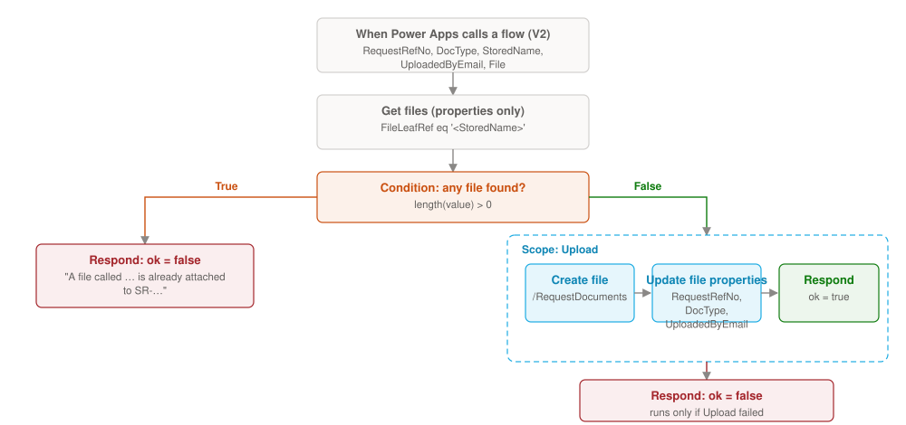

# UploadRequestDocument — the flow that attaches a document

A canvas app can read the `RequestDocuments` library but cannot put a file into it, because the library is a document library, not a list with attachments (schema.md §10). This Power Automate flow does it for the app. The app calls it from **Attach a file** on Request detail (`app-glue.md` §14).

What it does: it receives the file and its details, refuses a file whose stored name is already in the library, creates the file, fills in its three metadata columns, and tells the app whether it worked.

## Build it

1. Go to **make.powerautomate.com**, in the same environment as the app, and select **Create › Instant cloud flow**.
2. Name it `UploadRequestDocument`, choose the trigger **When Power Apps calls a flow (V2)**, and select **Create**.
3. In the trigger, add these inputs **in this order**. The app passes its values in the same order. Make all of them required.

    | # | Type | Name |
    |---|---|---|
    | 1 | Text | `RequestRefNo` |
    | 2 | Text | `DocType` |
    | 3 | Text | `StoredName` |
    | 4 | Text | `UploadedByEmail` |
    | 5 | File | `File` |

4. Add **SharePoint › Get files (properties only)**:
    - **Site Address:** the Office Supplies site. **Library Name:** `RequestDocuments`.
    - **Filter Query:** `FileLeafRef eq '` `StoredName` `'` (the stored name between single quotes).

5. Add a **Condition**: `length(body('Get_files_(properties_only)')?['value'])` *is greater than* `0`.

6. In **True** (the name is taken), add **Respond to a PowerApp or flow** with two text outputs:
    - `ok` = `false`
    - `message` = `A file called ` `StoredName` ` is already attached to ` `RequestRefNo` `. Rename it and try again.`

7. In **False**, add a **Scope** named `Upload`, and inside it:
    - **SharePoint › Create file**: **Site Address** the Office Supplies site, **Folder Path** `/RequestDocuments`, **File Name** `StoredName`, **File Content** the trigger's `File` content.
    - **SharePoint › Update file properties**: **Library Name** `RequestDocuments`, **Id** `ItemId` from **Create file**, then **RequestRefNo** = `RequestRefNo`, **DocType Value** = `DocType`, **UploadedByEmail** = `UploadedByEmail`.
    - **Respond to a PowerApp or flow**: `ok` = `true`, `message` = (leave empty).

8. Still in **False**, *after* the scope, add **Respond to a PowerApp or flow** with `ok` = `false` and `message` = `The document was not attached. Try again, or ask the site owner to check your access.`. Open its **⋯ › Settings › Run after**, untick *is successful* and tick **`Upload` has failed** and **has timed out**. It only runs if something inside the scope failed.

9. Select **Save**, then go back to the app.

## Connect it to the app

1. In Studio, select **Power Automate** in the left rail (the flow icon), then **Add flow**, and pick `UploadRequestDocument`.
2. The app can now call `UploadRequestDocument.Run(RequestRefNo, DocType, StoredName, UploadedByEmail, { contentBytes: …, name: … })`, which returns a record with `ok` and `message`. §14 shows the full button formula.

!!! see "You should now see"
    Attach a small PDF to a request. It appears in the `RequestDocuments` library as `SR-…_yourfile.pdf` with `RequestRefNo`, `DocType` and `UploadedByEmail` filled in, and on the request's Documents tab and timeline. Attach the same file again and the app says it is already attached.

## Notes

- The flow runs as the person using the app, with their SharePoint permission. They need Contribute on the site, as for everything else.
- The app also checks the name against the documents it has already loaded before calling the flow, so the usual duplicate never reaches it. The flow's own check catches a file that someone else attached after the app loaded its list.
- Power Apps passes files up to about 50 MB this way; very large scans should be uploaded straight to the library.
