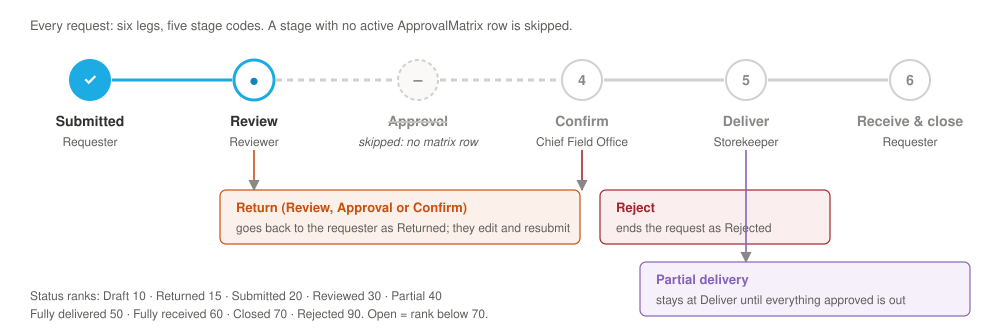
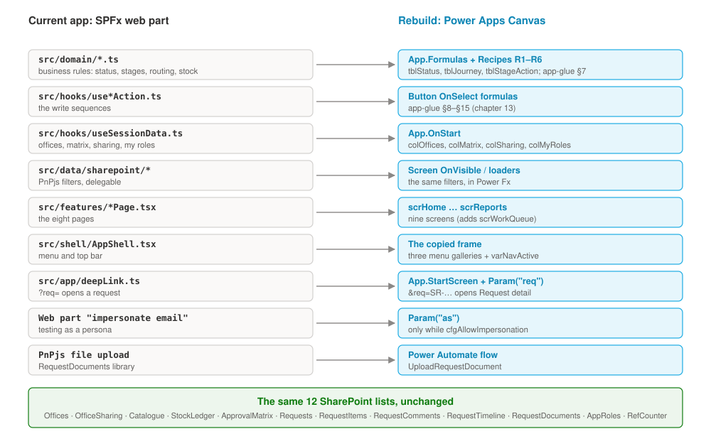

# 1. Start here

This guide walks you through building the **Office Supplies** app again, this time as a **Power Apps Canvas app**. It runs on the same twelve SharePoint lists the current app uses. Follow it from front to back and you end up with an app that behaves the same way as the current one, including every fix found in user acceptance testing (UAT).

## What you are building

Office Supplies lets staff in a field office ask for supplies, and lets the right people check, approve and hand them out. Every request follows the same journey:

Five roles take part. One person can hold several roles.

| Role | What they do in the app |
|---|---|
| **Requester** | Any member of staff. Raises a request, follows it, confirms receipt when it arrives. |
| **Reviewer** | The office's first approver. Sets how much of each item to give out, and can return or reject the request. |
| **Chief Field Office** | Confirms a reviewed request before anything is handed out. |
| **Storekeeper** | Hands out the stock, all at once or in parts. |
| **Administrator** | Sets up offices, the approval chain, the catalogue and stock, and which offices lend to each other. |

Who acts at each stage comes from the **approval matrix**, one row per office and stage. An office that has no row for a stage skips it. That is why Bor has no finance Approval step.

## The screens at a glance

The app has nine screens. Eight match the eight HTML mock-ups in this repository. The ninth, the work queue, lists what is waiting for you at one stage.

<figure><figcaption>Home (scrHome)</figcaption></figure>
<figure><figcaption>New request (scrNewRequest)</figcaption></figure>
<figure><figcaption>Request detail (scrRequestDetail)</figcaption></figure>
<figure><figcaption>Review, approve, confirm (scrReview)</figcaption></figure>
<figure><figcaption>Distribute (scrDistribute)</figcaption></figure>
<figure><figcaption>Confirm receipt (scrReceipt)</figcaption></figure>
<figure><figcaption>Catalogue &amp; matrix (scrAdmin)</figcaption></figure>
<figure><figcaption>Reports (scrReports)</figcaption></figure>

## Where everything comes from

You are not designing anything from scratch. Each part of the app already exists somewhere, and this guide tells you where.

| You need | It is in | Notes |
|---|---|---|
| What each screen looks like | The HTML mock-ups at the root of this repository (`index.html`, `review.html`, …) | Open them in a browser next to Studio. |
| The lists and their columns | `docs/schema.md` (Appendix A) | The definitive contract. If anything disagrees with it, it wins. |
| Colours, sizes, fonts, status table | `powerapps/App.Formulas.fx` | Paste into the app once (chapter 3). |
| Start-up data and the user's roles | `powerapps/App.OnStart.fx` | Paste into the app once (chapter 3). |
| Every button that writes to SharePoint | `powerapps/app-glue.md`, sections 7–15 (chapter 13) | Full Power Fx, ready to paste. |
| The Home screen, already built | `powerapps/screens/scrHome.pa.yaml` | Paste with Cmd+V, then apply the fixes in chapter 4. |
| What Studio accepts when you paste code | `powerapps/oracle/NOTES.md` | Read it before pasting any YAML. |
| How the current app behaves | `pa.init.officesupplies/src/` | Each formula in this guide names the file it was ported from. |

## How to use this guide

- **Work in order.** Chapters 2 and 3 set up the data and the app shell. Each screen chapter assumes the earlier ones are done.
- **Build every screen read-only first,** then wire up its buttons from chapter 13. A screen that shows the right data is much easier to check than one that also writes.
- **Steps are numbered.** Each starts with what to do. Studio click paths are written like this: **Tree view › scrHome › Insert › Gallery**.
- **Copy formulas from the files, not from the PDF.** A PDF wraps long lines and may change quote marks. Every formula in this guide is in a text file in `powerapps/`: `App.Formulas.fx`, `App.OnStart.fx`, `app-glue.md` §7–§15, and the chapter files in `powerapps/guide/` (`30-home.md`, `34-review.md`, …).
- **Formulas name their home.** `btnSubmit.OnSelect` means: select the control `btnSubmit`, choose `OnSelect` in the property list, and paste the formula into the formula bar.
- **Boxes tell you when to stop and check:**

!!! see "You should now see"
    What the screen should show at this point. If it doesn't, fix it before you go on.

!!! trap "Watch out"
    A mistake that is easy to make, usually one the first canvas build actually hit.

!!! def "Defects this screen must get right"
    Behaviours that UAT round 2 checked (DEF numbers from the UAT defect log). Appendix B lists them all.

## What is not in this guide

- **Paste-ready YAML for every screen.** Only Home has it. The other screens are described control by control, with every formula, and you build them in Studio.
- **Email or Teams notifications.** The current app sends none, so this guide adds none.
- **Dataverse.** The data stays in SharePoint.
- **Role gates on the Catalogue & matrix and Reports screens.** The current app leaves both open to every user (DEF-135, by design). Chapter 11 shows how to add a gate if the product owner wants one.
