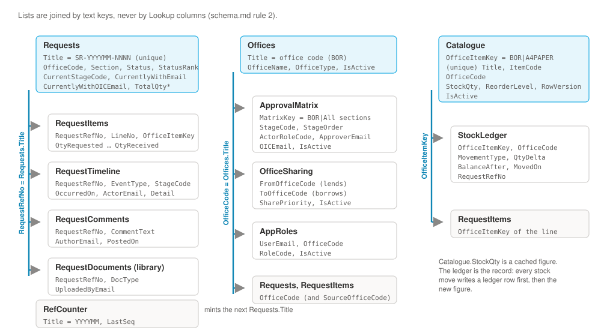

# 2. Before you start

## What you need

| Item | Detail |
|---|---|
| **Licence** | Each user needs a Microsoft 365 licence that includes Power Apps and Power Automate (most E3/E5 and Business plans do). The app uses only *standard* connectors (SharePoint, and Power Apps itself for the flow), so no Power Apps Premium licence is needed. |
| **Environment** | A Power Platform environment you can make apps in. The default environment works; a dedicated one is better for moving between test and production later (chapter 15). |
| **Data loss prevention (DLP)** | If your tenant has DLP policies, the SharePoint connector must be allowed in that environment. Ask your Power Platform admin if you're not sure. |
| **The SharePoint site** | `https://trailanalyticslimited602.sharepoint.com/sites/OfficeSupplies`, with its 12 lists already created. The scripts in `provision/` made them; `provision/README.md` says the site is already provisioned, so you don't need to run them again. |
| **Site permissions** | Every user needs **Contribute** on that site, because the app writes to the lists as the person using it. Administrators of the app need the same. |
| **A browser** | Microsoft Edge or Google Chrome, signed in to the tenant. |
| **The mock-ups** | The eight HTML files at the root of this repository. Open `index.html` in the browser to click through them. |

## The twelve lists

The app reads and writes these lists and the one library. You never create a column: every column already exists with the exact internal name the formulas use.



!!! note "No Lookup columns"
    Lists are joined by text keys: `RequestRefNo` (the request reference), `OfficeCode`, `OfficeItemKey` (`BOR|A4PAPER`) and `MatrixKey` (`BOR|All sections`). This keeps every filter fast on large lists. Appendix A lists every column.

## Create the app

1. Go to **make.powerapps.com** and check the environment picker at the top right shows the right environment.
2. Select **Create › Blank app › Blank canvas app**.
3. Name it `Office Supplies`, choose **Tablet** format, and select **Create**. Tablet, because the mock-ups are a 264-pixel menu beside a content area up to 1,180 pixels wide.
4. In Studio, select **Settings › Display**. Turn **Scale to fit** off and **Lock aspect ratio** off, so the screen fills the browser window the way the mock-ups do.
5. Select **Settings › Updates** and check that **Formula-level error management** is on (in recent versions it is always on and not shown). The formulas rely on `IfError` and on `Blank()` clearing a column.
6. Select **File › Save**.

## Connect the lists

1. In the left rail, select **Data › Add data**, search for **SharePoint**, and pick your SharePoint connection (create one if asked).
2. Enter the site URL above and select **Connect**.
3. Tick all twelve and select **Connect**: `Offices`, `OfficeSharing`, `Catalogue`, `StockLedger`, `ApprovalMatrix`, `Requests`, `RequestItems`, `RequestComments`, `RequestTimeline`, `RequestDocuments`, `AppRoles`, `RefCounter`.

!!! see "You should now see"
    Twelve data sources in the Data pane. `RequestDocuments` is listed as a **document library**. Expand `Requests`: the columns show clean names such as `CurrentlyWithEmail` and `StatusRank`.

!!! trap "Watch out"
    If any column shows as `Office_x0020_Code` or similar, that column was not created by the provisioning script. Recreate it with the right internal name before you build anything on it (schema.md, rule 1).

## Set the data row limit to 1 for now

Power Apps fetches at most a set number of rows (the *data row limit*) whenever it cannot ask SharePoint to filter for it. Filtering that SharePoint does itself is called *delegation*. A formula that does not delegate does not fail: it quietly works on the first rows only and gives a wrong answer that looks right.

1. Select **Settings › General › Data row limit** and set it to **1**.

While the limit is 1, a formula that delegates still returns all its rows (SharePoint filtered them), and one that doesn't returns one row at most. That makes every problem obvious. You raise the limit to 2,000 in chapter 15, once every screen has passed.

!!! trap "Look, don't click, while the limit is 1"
    With the limit at 1, any total the app adds up comes from a single row, and a write button would save that wrong total to SharePoint. Open screens and check the lists they show, but don't press Submit, Proceed, Record distribution or any other button that saves, until the limit is back at 2,000.

## Check the Yes/No filter first

`app-glue.md` §3 records that the SharePoint REST API, queried by hand on this site, returned the *wrong* rows for `IsActive eq true`. The Power Apps connector builds its own query and is expected to get it right, but three of the app's start-up queries depend on it, so check it once:

1. Insert a temporary label on any screen and set its `Text` to:

    ```powerfx
    CountRows(Filter(Catalogue, OfficeCode = "BOR", IsActive = true)) & " / " & CountRows(Filter(ApprovalMatrix, IsActive = true))
    ```

2. Temporarily set the data row limit to 500 and look at the label.

!!! see "You should now see"
    `9 / 4` with the seeded data: nine active Bor items and four matrix rows. Delete the label and set the limit back to 1.

If you see `1 / …` or `0 / …`, the connector has the same defect. Replace `IsActive = true` with `IsActive <> false` everywhere this guide uses it, and tell whoever owns the SharePoint site.
