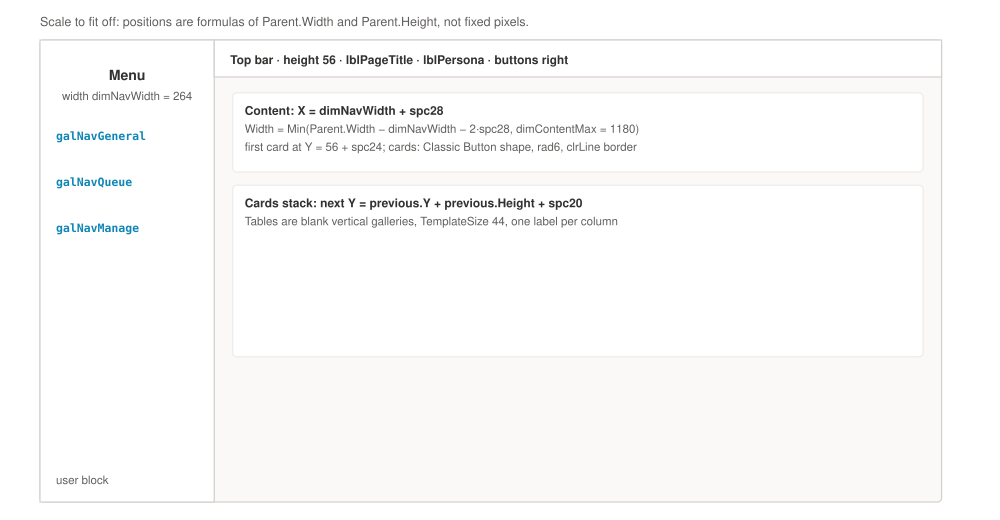

# 3. The app shell

The shell is everything that isn't one screen's content: the named colours and tables, the start-up data, the left menu, the top bar, and the screen names. You build it once.

## Paste App.Formulas

`App.Formulas` holds *named formulas*: values the whole app can use by name, like `clrBrand` for the brand colour or `tblStatus` for the status table. Every colour, size and status lookup in this guide uses these names, never a raw value.

1. In the **Tree view**, select **App**.
2. In the property list at the top left, choose **Formulas**.
3. Open `powerapps/App.Formulas.fx`, copy all of it, and paste it into the formula bar.

!!! see "You should now see"
    No red underline in the formula bar. Type `clrBrand` into any label's `Color` and the text turns cyan.

The file has two parts. The first, from the original canvas plan, holds the design tokens from `styles.css` and the status and journey tables. The second, added for this rebuild, is shown below. It holds the stage-to-screen table, the choice lists, the timeline glyphs, the Reports stage table and a few numbers.

::include ../App.Formulas.fx from="// ══ Added for the full rebuild" code=powerfx

!!! trap "Watch out"
    `cfgAllowImpersonation = true` lets anyone open the app as someone else by adding `&as=<email>` to the link. UAT needs it, because the seeded people have no real accounts. Set it to `false` before real users get the app (chapter 15).

## Paste App.OnStart

`App.OnStart` runs once when the app opens. It loads the small reference lists, works out who the user is and which roles they hold, and sets the working variables.

1. Select **App**, choose **OnStart**, and paste all of `powerapps/App.OnStart.fx`.
2. Right-click **App** in the Tree view and select **Run OnStart**.

::include ../App.OnStart.fx code=powerfx

!!! see "You should now see"
    Select **Variables** (the *(x)* icon in the left rail). `varUserEmail` is your email in lower case, and `colMyRoles` holds your rows from `AppRoles`. If `colMyRoles` is empty, your account has no role yet: add yourself to `AppRoles` in SharePoint (a row with your email, an office code, a role, Active = Yes), or test as a seeded person with the `as` link parameter.

## Create the screens

Screen names matter: formulas use them in `Navigate(scrReview)`, so `Screen2` won't do.

1. Select **Insert › New screen › Blank** nine times, renaming each one in the Tree view straight away:

| # | Screen | Mock-up | Chapter |
|---|---|---|---|
| 1 | `scrHome` | `index.html` | 4 |
| 2 | `scrWorkQueue` | (none: a list like Home's "Awaiting my action") | 5 |
| 3 | `scrNewRequest` | `new-request.html` | 6 |
| 4 | `scrRequestDetail` | `request-detail.html` | 7 |
| 5 | `scrReview` | `review.html` | 8 |
| 6 | `scrDistribute` | `distribute.html` | 9 |
| 7 | `scrReceipt` | `receipt.html` | 10 |
| 8 | `scrAdmin` | `admin.html` | 11 |
| 9 | `scrReports` | `reports.html` | 12 |

2. Delete the original `Screen1`. If Home will be pasted from YAML (chapter 4), don't create `scrHome` here: pasting creates it.
3. Set every screen's `Fill` to `clrCanvas`.

## Set the start screen

A link with `&req=SR-202607-0038` should open that request directly (the canvas equivalent of the current app's `?req=` link).

1. Select **App**, choose **StartScreen**, and enter:

```powerfx
If(IsBlank(Param("req")), scrHome, scrRequestDetail)
```

`App.OnStart` has already put the reference into `varRef`, so Request detail opens on it.

!!! trap "Watch out"
    This relies on `App.OnStart` finishing before the first screen loads. Leave the setting **Non-blocking OnStart** (under **Settings › Updates**) turned **off**. Don't call `Navigate` in `OnStart`; `StartScreen` replaces it.

## The frame every screen shares

Every screen has the same frame: a 264-pixel menu on the left, a 56-pixel top bar, and the content beneath, at most 1,180 pixels wide.



| Part | Controls | Key properties |
|---|---|---|
| Menu background | `recNavBg` (Rectangle) | `X: 0` `Y: 0` `Width: =dimNavWidth` `Height: =Parent.Height` `Fill: =clrSurface` |
| Menu edge | `recNavEdge` (Rectangle) | `X: =dimNavWidth - 1` `Width: 1` `Height: =Parent.Height` `Fill: =clrLine` |
| Brand | `recBrandMark` (Classic Button as a shape), `lblBrandMark` "SR", `lblBrandName` "Supply Requests", `lblBrandOffice` | `lblBrandOffice.Text: =varMyOfficeName` (DEF-116, DEF-131) |
| Menu items | `galNavGeneral`, `galNavQueue`, `galNavManage` (blank vertical galleries) with a group label above each | Below |
| User block | `recAvatar` shape, `lblAvatar`, `lblUserName`, `lblUserRole` | `lblUserName.Text: =varUserName` `lblUserRole.Text: =varPersonaRole` `lblAvatar.Text: =Upper(Left(varUserName, 1) & Mid(varUserName, Find(" ", varUserName & " ") + 1, 1))` |
| Top bar | `recTopBg` (Rectangle), `recTopEdge` (1-pixel Rectangle), `lblPageTitle`, `lblPersona`, the screen's buttons on the right | `recTopBg`: `X: =dimNavWidth` `Height: 56` `Width: =Parent.Width - dimNavWidth` `Fill: =clrSurface` |
| Content | Everything else | `X: =dimNavWidth + spc28` `Width: =Min(Parent.Width - dimNavWidth - 2 * spc28, dimContentMax)` and the first card at `Y: =56 + spc24` |

!!! trap "Watch out"
    - Set `Font: =fntUI` on **every** label and button. Studio gives new controls Open Sans, which looks visibly different.
    - A **Rectangle has no rounded corners** in this tenant. For anything rounded (cards, status pills, the avatar) insert a **Classic Button**, set `Text: =""`, set `HoverFill`, `PressedFill` to `=Self.Fill` and `HoverBorderColor`, `PressedBorderColor` to `=Self.BorderColor`, then set the four `Radius…` properties. Inside a gallery give it `OnSelect: =Select(Parent)`; elsewhere `OnSelect: =false`.

### The menu

The menu is three small galleries. The highlighted item follows the variable `varNavActive`, which every screen sets in its `OnVisible`. Because nothing in the menu names its own screen, the same menu can be copied onto every screen unchanged.

1. On `scrHome`, set `galNavGeneral.Items` to:

    ```powerfx
    Table(
        { Glyph: "⌂", Caption: "Home",        Target: "home" },
        { Glyph: "＋", Caption: "New request", Target: "new" }
    )
    ```

    `galNavQueue.Items`:

    ```powerfx
    Table(
        { Glyph: "☰", Caption: "Review & distribution", Target: "review" },
        { Glyph: "⇥", Caption: "Distribute",            Target: "distribute" },
        { Glyph: "✓", Caption: "Confirm receipt",       Target: "receipt" }
    )
    ```

    `galNavManage.Items`:

    ```powerfx
    Table(
        { Glyph: "⚙", Caption: "Catalogue & matrix", Target: "admin" },
        { Glyph: "◫", Caption: "Reports",            Target: "reports" }
    )
    ```

2. In each gallery's template, the active bar, glyph and caption use `ThisItem.Target = varNavActive`:

    ```powerfx
    // recNavActive.Visible   (the 3-pixel cyan bar at the left of the item)
    ThisItem.Target = varNavActive
    // lblNavGlyph.Color
    If(ThisItem.Target = varNavActive, clrBrandDark, clrInk2)
    // lblNavCaption.Color and .FontWeight
    If(ThisItem.Target = varNavActive, clrBrandDark, clrInk)
    If(ThisItem.Target = varNavActive, FontWeight.Semibold, FontWeight.Normal)
    // the item background (a Classic Button shape): .Fill
    If(ThisItem.Target = varNavActive, clrBrandTint, Color.Transparent)
    ```

3. Set the `OnSelect` of **each of the three galleries** (the gallery itself, not a control inside it) to the same formula:

    ```powerfx
    Switch(
        ThisItem.Target,
        "home",       Navigate(scrHome),
        "new",        Set(varEditRef, ""); Navigate(scrNewRequest),
        "review",     Set(varQueue, "review");     Navigate(scrWorkQueue),
        "distribute", Set(varQueue, "distribute"); Navigate(scrWorkQueue),
        "receipt",    Set(varQueue, "receipt");    Navigate(scrWorkQueue),
        "admin",      Navigate(scrAdmin),
        "reports",    Navigate(scrReports)
    )
    ```

    The three work-queue items open the queue for that stage, not Home (DEF-10).

4. Give every control inside the gallery templates `OnSelect: =Select(Parent)`, so a click anywhere on an item selects it.
5. When the frame is finished on `scrHome`, select all its frame controls in the Tree view (Shift-click), copy (Cmd+C or Ctrl+C), select each other screen, and paste. Studio adds `_1` to the copies' names, which doesn't matter: no formula refers to them by name.

!!! see "You should now see"
    In Preview (F5), clicking **Reports** opens `scrReports` and its menu item turns cyan. Clicking **Distribute** opens the work queue.

!!! note "Why not a component?"
    A canvas *component* would let you build the frame once and change it in one place. Navigating from inside a component needs component *behaviour properties*, which may not be available in your tenant, so this guide copies the frame instead. You can switch to a component later without changing anything else.

### The top bar on each screen

Each screen sets its own title and persona line in its `OnVisible` and binds them:

```powerfx
// lblPageTitle.Text
varPageTitle
// lblPersona.Text — "Viewing as: Reviewer · Bor Zonal Office"
"Viewing as: " & varPersonaRole & " · " & varMyOfficeName
    & If(varImpersonating, "  (testing as " & varUserEmail & ")", "")
```

A screen whose persona line differs (Review shows the stage's actor, Reports shows the period) says so in its chapter.

## Pieces every screen reuses

These patterns appear on several screens. Each screen chapter gives the full formula where it's used; this is what they mean.

| Pattern | Where it is | What it does |
|---|---|---|
| **Status pill** | Every list of requests | A Classic Button shape with `Fill: =Coalesce(LookUp(tblStatus, StatusText = ThisItem.Status.Value).Bg, clrStDraftBg)`, a label with `Color: =Coalesce(LookUp(tblStatus, StatusText = ThisItem.Status.Value).Fg, clrInk2)` and `Text: =LookUp(tblStatus, StatusText = ThisItem.Status.Value).Glyph & "  " & ThisItem.Status.Value` |
| **Reference** | Lists and headers | `Font: =fntMono`, `Size: =szLabel`, `Wrap: =false` so `SR-202607-0038` never breaks at its hyphens (DEF-109, DEF-114) |
| **Recipe R1–R6** | `app-glue.md` §7 | The approval chain, routing, who may act, names from emails, "held for", and the request loader |
| **Busy guard** | Every button that writes | `DisplayMode: =If(varBusy, DisplayMode.Disabled, DisplayMode.Edit)` plus the screen's own rule |
| **Error line** | Under each form | A label with `Text: =varErrorMsg`, `Color: =clrStRejected`, `Visible: =!IsBlank(varErrorMsg)`. Clear it with `Set(varErrorMsg, "")` in `OnVisible` |
| **Empty message** | Under each list | A label with `Visible: =IsEmpty(<gallery>.AllItems)` and the message from the screen chapter |
