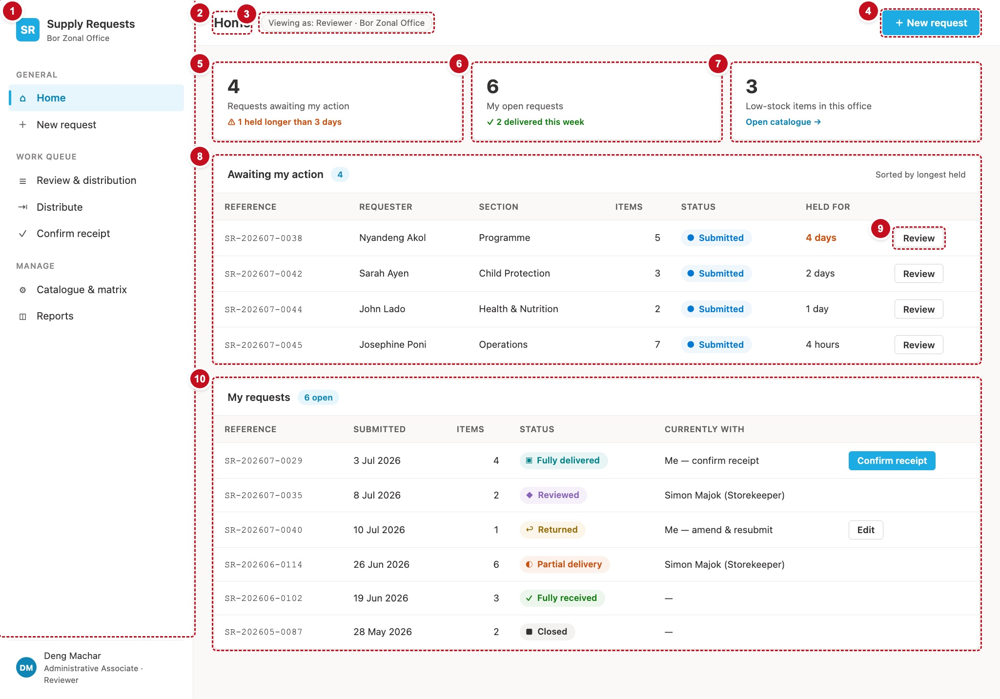

# 4. Home — scrHome

Home is the first screen everyone sees. It shows what is waiting on the user, the user's own requests, and how many items are low on stock in their office.



| # | Part | Controls | What it shows |
|---|---|---|---|
| 1 | Menu | the frame (chapter 3) | `varNavActive = "home"` |
| 2 | Title | `lblPageTitle` | "Home" |
| 3 | Persona | `lblPersona` | "Viewing as: Reviewer · Bor Zonal Office" |
| 4 | New request | `btnNewRequest` | Opens a blank New request |
| 5 | Tile: awaiting me | `recTile1`, `lblTile1Num`, `lblTile1Cap`, `lblTile1Flag` | How many requests wait on me, and how many have waited more than 3 days |
| 6 | Tile: my open requests | `recTile2`, `lblTile2Num`, `lblTile2Cap` | My requests that are not closed or rejected |
| 7 | Tile: low stock | `recTile3`, `lblTile3Num`, `lblTile3Cap`, `btnTile3Link` | Items in my office at or below their reorder level, or out of stock |
| 8 | Awaiting my action | `recCard1`, header labels, `galAwaiting` | The requests I hold, longest-held first |
| 9 | Row action | `btnAwaitingAction` (in the gallery) | Review / Approve / Confirm / Distribute / Confirm receipt / Edit |
| 10 | My requests | `recCard2`, header labels, `galMine` | Everything I have raised, newest first |

## Two ways to build it

**Paste it.** `powerapps/screens/scrHome.pa.yaml` is the Home screen copied out of Studio after a successful paste (84 controls). Paste it, then make the changes in [Fix the pasted screen](#fix-the-pasted-screen) below.

1. On macOS, in a terminal at the repository root, run `pbcopy < powerapps/screens/scrHome.pa.yaml`. On Windows, open the file in a text editor and copy all of it.
2. In Studio, select any screen in the Tree view and press **Cmd+V** (Ctrl+V). Don't use the right-click **Paste** item; it does nothing with text from outside Studio.
3. Studio creates a screen called `scrHome`, or `scrHome_1` if one already exists. Delete the extra screen and rename if needed.

!!! trap "Watch out"
    If the paste is rejected, Studio lists every error with its line number. The usual causes are in `powerapps/oracle/NOTES.md`: a control type without its `Classic/` prefix, a version number Studio doesn't know, or a `Radius…` property on a Rectangle.

**Or build it by hand** with the control list above and the formulas below, following the frame in chapter 3.

## Load the data

`scrHome.OnVisible`:

```powerfx
Set(varNavActive, "home");
Set(varPageTitle, "Home");
Set(varErrorMsg, "");

// Awaiting my action: open, and held by me or by me as the officer in charge.
// The delegation contract, verbatim (schema.md). Oldest submission first.
ClearCollect(
    colAwaiting,
    SortByColumns(
        Filter(
            Requests,
            StatusRank < 70,
            Or(CurrentlyWithEmail = varUserEmail, CurrentlyWithOICEmail = varUserEmail)
        ),
        "SubmittedOn", SortOrder.Ascending
    )
);

// My requests, newest first.
ClearCollect(
    colMine,
    SortByColumns(Filter(Requests, RequesterEmail = varUserEmail), "SubmittedOn", SortOrder.Descending)
);

// My office's active catalogue, for the low-stock tile.
ClearCollect(colHomeCatalogue, Filter(Catalogue, OfficeCode = varMyOffice, IsActive = true))
```

## The tiles

```powerfx
// lblTile1Num.Text
CountRows(colAwaiting)

// lblTile1Flag.Text and .Visible — measured from the last change, not from submission (DEF-132)
With(
    { n: CountRows(Filter(colAwaiting,
            DateDiff(Coalesce(Modified, SubmittedOn), Now(), TimeUnit.Hours) > numOverdueHours)) },
    "⚠ " & n & " held longer than 3 days"
)
CountRows(Filter(colAwaiting, DateDiff(Coalesce(Modified, SubmittedOn), Now(), TimeUnit.Hours) > numOverdueHours)) > 0
// lblTile1Flag.Color
clrStPartial

// lblTile2Num.Text
CountRows(Filter(colMine, StatusRank < 70))

// lblTile3Num.Text — compared here, in the app: SharePoint cannot compare two columns
CountRows(Filter(colHomeCatalogue, StockQty = 0 || (!IsBlank(ReorderLevel) && StockQty <= ReorderLevel)))
// btnTile3Link: Text "Open catalogue →", OnSelect
Navigate(scrAdmin)
```

!!! trap "Watch out"
    The pasted `scrHome` counted low stock with `Filter(Catalogue, …, StockQty <= ReorderLevel)` straight against SharePoint. That compares two columns, which SharePoint cannot do, and it fails with "Fetching items failed". Use the formula above, which compares them in the app after a filter SharePoint *can* do.

## Awaiting my action

`galAwaiting.Items: =colAwaiting`. Columns, left to right, are labels at fixed `X` positions in the template (`TemplateSize: 44`):

| Column | Formula |
|---|---|
| Reference | `ThisItem.Title` (`Font: =fntMono`) |
| Requester | Recipe R4 with E = `ThisItem.RequesterEmail` |
| Section | `ThisItem.Section.Value` |
| Items | `ThisItem.LineCount` (right-aligned) |
| Status | the status pill (chapter 3) |
| Held for | Recipe R5 with Q = `ThisItem`; `Color: =If(DateDiff(Coalesce(ThisItem.Modified, ThisItem.SubmittedOn), Now(), TimeUnit.Hours) > numOverdueHours, clrStPartial, clrInk)` |
| Action | `btnAwaitingAction`, below |

Recipe R4, a name from an email, written out for the Requester column:

```powerfx
With({ E: ThisItem.RequesterEmail },
    If(IsBlank(E), txtNoHolder,
       IsBlank(Find("@", E)), E,
       Proper(Substitute(Substitute(Left(E, Find("@", E) - 1), ".", " "), "_", " "))))
```

Recipe R5, "held for", written out:

```powerfx
With(
    { h: DateDiff(Coalesce(ThisItem.Modified, ThisItem.SubmittedOn), Now(), TimeUnit.Hours) },
    If(h < 1,  "under an hour",
       h < 24, Text(h) & If(h = 1, " hour", " hours"),
       With({ d: RoundDown(h / 24, 0) }, Text(d) & If(d = 1, " day", " days")))
)
```

The row button names the stage it opens, and a Draft or Returned request offers **Edit** instead:

```powerfx
// btnAwaitingAction.Text
If(ThisItem.Status.Value in ["Draft", "Returned"], "Edit",
   Coalesce(LookUp(tblStageAction, StageCode = ThisItem.CurrentStageCode.Value).RowLabel, "Open"))

// btnAwaitingAction.OnSelect   (NOT Select(Parent): the button must not also open the row, DEF-134)
Set(varRef, ThisItem.Title);
If(
    ThisItem.Status.Value in ["Draft", "Returned"],
    Set(varEditRef, ThisItem.Title); Navigate(scrNewRequest),
    Switch(
        LookUp(tblStageAction, StageCode = ThisItem.CurrentStageCode.Value).Screen,
        "review",     Navigate(scrReview),
        "distribute", Navigate(scrDistribute),
        "receipt",    Navigate(scrReceipt),
        Navigate(scrRequestDetail)
    )
)

// galAwaiting.OnSelect — clicking anywhere else on the row opens the request
Set(varRef, ThisItem.Title); Navigate(scrRequestDetail)
```

Empty message: "Nothing is waiting on you right now."

## My requests

`galMine.Items: =colMine`.

| Column | Formula |
|---|---|
| Reference | `ThisItem.Title` |
| Submitted | `If(IsBlank(ThisItem.SubmittedOn), "Draft", Text(ThisItem.SubmittedOn, "d mmm yyyy"))` |
| Items | `ThisItem.LineCount` |
| Status | the status pill |
| Currently with | below |
| Action | `btnMineAction`, below |

```powerfx
// lblMineWith.Text — the holder's name, or "—" when it is finished or nobody holds it (DEF-111).
// The current app shows just the name; the mock-up's "Me — confirm receipt" wording is not reproduced.
If(
    ThisItem.StatusRank >= 70 || IsBlank(ThisItem.CurrentlyWithEmail), txtNoHolder,
    With({ E: ThisItem.CurrentlyWithEmail },
        Proper(Substitute(Substitute(Left(E, Find("@", E & "@") - 1), ".", " "), "_", " ")))
)

// btnMineAction.Visible
ThisItem.Status.Value in ["Draft", "Returned"] || ThisItem.StatusRank = 50
// btnMineAction.Text
If(ThisItem.StatusRank = 50, "Confirm receipt", "Edit")
// btnMineAction.Fill (primary style for Confirm receipt, neutral for Edit)
If(ThisItem.StatusRank = 50, clrBrand, clrSurface)
// btnMineAction.OnSelect
Set(varRef, ThisItem.Title);
If(ThisItem.StatusRank = 50, Navigate(scrReceipt), Set(varEditRef, ThisItem.Title); Navigate(scrNewRequest))

// galMine.OnSelect
Set(varRef, ThisItem.Title); Navigate(scrRequestDetail)
```

Empty message: "You have not submitted any requests yet."

## Fix the pasted screen

If you pasted `scrHome.pa.yaml`, change these. Each is a defect found on the pasted screen or in UAT.

1. **Menu.** Replace the three menu galleries' `Items`, highlight and `OnSelect` with the ones in chapter 3 (the pasted ones have targets but no `OnSelect`).
2. **Low-stock tile.** Replace `lblTile3Num.Text` with the formula above.
3. **Requester column.** It shows a raw email; use Recipe R4 as above.
4. **Row buttons.** Replace the pasted "Review" button formulas with `btnAwaitingAction` above (DEF-03, DEF-120, DEF-124, DEF-134), and the "My requests" action with `btnMineAction`.
5. **Held for.** Use Recipe R5: the pasted screen counts from `SubmittedOn` (DEF-132).
6. **Persona and brand line.** Bind `lblPersona` as in chapter 3 and `lblBrandOffice.Text: =varMyOfficeName`.
7. **Tile 2 flag.** Delete the "delivered this week" flag; the current app doesn't show it.
8. **OnVisible.** Replace with the one above (it adds `varNavActive` and the catalogue for tile 3).

!!! see "You should now see"
    Open the app as the seeded reviewer that UAT-040 uses, by adding `&as=<their email from AppRoles>` to the app link. Tile 1 shows that person's awaiting count, each row's button names its stage, and clicking a row (not the button) opens the request.

!!! def "Defects this screen must get right"
    DEF-03 and DEF-120 (the button names the stage) · DEF-09 (email case) · DEF-102 (by design: my own Returned and Fully delivered requests count as awaiting me, because I hold them) · DEF-111 ("—" when nobody holds it) · DEF-116 (a user with no office sees "No default office") · DEF-124 (Draft and Returned offer Edit) · DEF-132 (held-for from the last change) · DEF-134 (the button doesn't also open the row)
