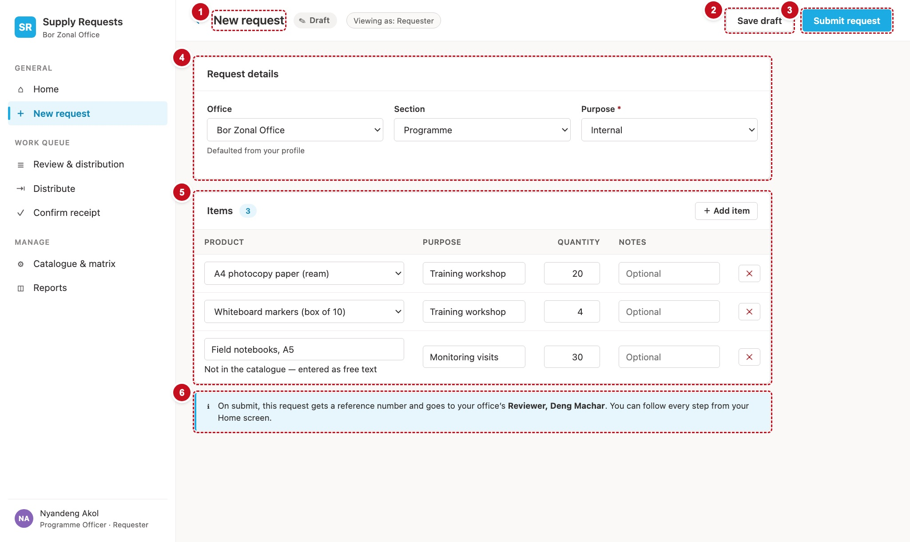

# 6. New request — scrNewRequest

One screen raises a new request and edits an existing Draft or Returned one. `varEditRef` decides which: blank means new, a reference means edit. The menu's **New request** clears it; the **Edit** buttons on Home and Request detail set it.



| # | Part | Controls | What it does |
|---|---|---|---|
| 1 | Title and status | `icoBack`, `lblPageTitle`, status pill | "New request" with a Draft pill, or "Edit request SR-…" with the request's status |
| 2 | Save draft | `btnSaveDraft` | New requests only. Saves without routing (§8) |
| 3 | Submit | `btnSubmit` | "Submit request" or "Resubmit request" (§8, §9) |
| 4 | Request details | `ddOffice`, `lblOfficeHint`, `ddSection`, `ddPurpose` | Office (defaulted from the user's role), section, purpose |
| 5 | Items | `galLines`, `btnAddLine` | One row per item: product (or free text), purpose, quantity, notes, remove |
| 6 | Routing preview | `lblRouting` (in a callout) | Who the request will go to first |

Also on the screen: `lblReturnReason` (a warning callout shown in edit mode for a Returned request), `lblError` (the error line), and three hidden buttons: `btnChain_New`, `btnCreateCore`, `btnResubmitCore`.

## Load the screen

```powerfx
// scrNewRequest.OnVisible
Set(varNavActive, If(IsBlank(varEditRef), "new", ""));          // DEF-129: Edit doesn't light "New request"
Set(varPageTitle, If(IsBlank(varEditRef), "New request", "Edit request " & varEditRef));   // DEF-133
Set(varErrorMsg, "");
If(
    IsBlank(varEditRef),
    Set(varEditReq, Blank());
    Set(varInitOffice, varMyOffice);
    ClearCollect(colLines, {
        RowId: Text(GUID()), IsOther: false, ItemCode: "", ItemName: "", IsCatalogueItem: true,
        OfficeItemKey: "", UnitOfMeasure: "", UnitCost: Value(Blank()), LinePurpose: "", LineNote: "",
        QtyRequested: 1
    }),

    Set(varEditReq, LookUp(Requests, Title = varEditRef));
    Set(varInitOffice, varEditReq.OfficeCode);
    ClearCollect(colLines,
        ForAll(Sort(Filter(RequestItems, RequestRefNo = varEditRef), LineNo) As l, {
            RowId: Text(GUID()), IsOther: !l.IsCatalogueItem, ItemCode: Coalesce(l.ItemCode, ""),
            ItemName: l.ItemName, IsCatalogueItem: l.IsCatalogueItem, OfficeItemKey: Coalesce(l.OfficeItemKey, ""),
            UnitOfMeasure: Coalesce(l.UnitOfMeasure, ""), UnitCost: l.UnitCost,
            LinePurpose: Coalesce(l.LinePurpose, ""), LineNote: Coalesce(l.LineNote, ""), QtyRequested: l.QtyRequested
        }))
);
// The product picker: the office's active catalogue, plus "Other (type it in)…" at the end.
ClearCollect(colPicker,
    ForAll(Sort(Filter(Catalogue, OfficeCode = varInitOffice, IsActive = true), Title) As c,
        { Key: c.OfficeItemKey, Label: c.Title, ItemCode: c.ItemCode, Unit: c.UnitOfMeasure, Cost: c.UnitCost }));
Collect(colPicker, { Key: "__other", Label: "Other (type it in)…", ItemCode: "", Unit: "", Cost: Value(Blank()) });
Reset(ddOffice); Reset(ddSection); Reset(ddPurpose);
Select(btnChain_New)
```

`Value(Blank())` gives an empty *number*, so the `UnitCost` column is typed as a number from the start.

## Request details

```powerfx
// ddOffice.Items — active offices, plus the request's own office if it has since been switched off (DEF-14)
Filter(colOffices, IsActive <> false || Title = varInitOffice)
// ddOffice.Value
"OfficeName"
// ddOffice.Default
LookUp(colOffices, Title = varInitOffice).OfficeName
// ddOffice.OnChange — new office, new catalogue and new chain
ClearCollect(colPicker,
    ForAll(Sort(Filter(Catalogue, OfficeCode = Self.Selected.Title, IsActive = true), Title) As c,
        { Key: c.OfficeItemKey, Label: c.Title, ItemCode: c.ItemCode, Unit: c.UnitOfMeasure, Cost: c.UnitCost }));
Collect(colPicker, { Key: "__other", Label: "Other (type it in)…", ItemCode: "", Unit: "", Cost: Value(Blank()) });
Select(btnChain_New)

// lblOfficeHint.Text and .Visible — only while it really is the profile's office (DEF-115)
"Defaulted from your profile"
IsBlank(varEditRef) && ddOffice.Selected.Title = varMyOffice

// ddSection.Items, .Default, .OnChange
tblSections
If(IsBlank(varEditRef), First(tblSections).Value, varEditReq.Section.Value)
Select(btnChain_New)

// ddPurpose.Items and .Default
tblPurposes
If(IsBlank(varEditRef), "Internal", varEditReq.Purpose.Value)
```

`btnChain_New` is a hidden button holding Recipe R1 for the office and section on screen. It runs whenever either changes, so the routing preview is always current:

```powerfx
// btnChain_New.OnSelect  (Visible: false) — Recipe R1
ClearCollect(
    colChain,
    ForAll(
        Filter(tblJourney, Skippable) As leg,
        With(
            {
                rowSec: LookUp(colMatrix, MatrixKey = ddOffice.Selected.Title & "|" & ddSection.Selected.Value
                        && StageCode.Value = leg.StageCode),
                rowAll: LookUp(colMatrix, MatrixKey = ddOffice.Selected.Title & "|All sections"
                        && StageCode.Value = leg.StageCode)
            },
            With({ row: If(IsBlank(rowSec), rowAll, rowSec) },
                { Leg: leg.Leg, StageCode: leg.StageCode, LegLabel: leg.LegLabel, ActorLabel: leg.ActorLabel,
                  Live: !IsBlank(row), StageOrder: row.StageOrder, Role: row.ActorRoleCode.Value,
                  Approver: Lower(Trim(row.ApproverEmail)), OIC: Lower(Trim(row.OICEmail)) })
        )
    )
)
```

## The items table

`galLines.Items: =colLines`. Each row has a product picker *or* a free-text name, then purpose, quantity, notes and a remove button. Every input saves itself into `colLines` as the user types, found by the row's `RowId`.

```powerfx
// cboProduct (Classic ComboBox) — shown unless the row is free text
//   .Items                 colPicker
//   .DisplayFields         ["Label"]      .SearchFields ["Label"]      .SelectMultiple false
//   .Visible               !ThisItem.IsOther
//   .DefaultSelectedItems  Filter(colPicker, Key = ThisItem.OfficeItemKey)
//   .OnChange:
If(
    Self.Selected.Key = "__other",
    Patch(colLines, LookUp(colLines, RowId = ThisItem.RowId), {
        IsOther: true, ItemName: "", ItemCode: "", OfficeItemKey: "", IsCatalogueItem: false,
        UnitOfMeasure: "", UnitCost: Value(Blank()) }),
    Patch(colLines, LookUp(colLines, RowId = ThisItem.RowId), {
        IsOther: false, ItemName: Self.Selected.Label, ItemCode: Self.Selected.ItemCode,
        OfficeItemKey: Self.Selected.Key, IsCatalogueItem: true,
        UnitOfMeasure: Self.Selected.Unit, UnitCost: Self.Selected.Cost })
)

// txtOtherName (Classic TextInput) — the free-text name
//   .Visible  ThisItem.IsOther      .Default  ThisItem.ItemName      .HintText "Describe the item"
//   .OnChange
Patch(colLines, LookUp(colLines, RowId = ThisItem.RowId), { ItemName: Self.Text })

// btnBackToCatalogue — the "Pick from the catalogue" link under txtOtherName
//   .Visible  ThisItem.IsOther && CountRows(colPicker) > 1
//   .OnSelect
Patch(colLines, LookUp(colLines, RowId = ThisItem.RowId), { IsOther: false, ItemName: "", IsCatalogueItem: true })

// txtLinePurpose .Default ThisItem.LinePurpose, .OnChange:
Patch(colLines, LookUp(colLines, RowId = ThisItem.RowId), { LinePurpose: Self.Text })

// txtQty (Format: TextFormat.Number, Width: =dimQtyBox) .Default ThisItem.QtyRequested, .OnChange:
Patch(colLines, LookUp(colLines, RowId = ThisItem.RowId), { QtyRequested: Max(1, RoundDown(Value(Self.Text), 0)) })

// txtLineNote .Default ThisItem.LineNote, .OnChange (DEF-02: notes are saved):
Patch(colLines, LookUp(colLines, RowId = ThisItem.RowId), { LineNote: Self.Text })

// btnRemoveLine (the ✕) .OnSelect
Remove(colLines, LookUp(colLines, RowId = ThisItem.RowId))

// btnAddLine ("＋ Add item") .OnSelect — a catalogue row, unless the office has no catalogue (DEF-01)
Collect(colLines, {
    RowId: Text(GUID()), IsOther: CountRows(colPicker) <= 1, ItemCode: "", ItemName: "",
    IsCatalogueItem: CountRows(colPicker) > 1, OfficeItemKey: "", UnitOfMeasure: "",
    UnitCost: Value(Blank()), LinePurpose: "", LineNote: "", QtyRequested: 1 })

// lblLinesCount.Text (the pill beside "Items")
CountRows(colLines) & If(CountRows(colLines) = 1, " item", " items")       // DEF-113
```

!!! trap "Watch out"
    The current app's first build showed a free-text box instead of the product picker (DEF-01). A row is free text only when the user chose "Other (type it in)…", or when the office's catalogue is empty. Don't base it on whether the picker has finished loading.

## Top bar, callouts and buttons

```powerfx
// Status pill: text and colours from tblStatus for
If(IsBlank(varEditRef), "Draft", varEditReq.Status.Value)

// lblReturnReason.Text and .Visible (DEF-125) — a warning callout above the details card
"Returned: " & varEditReq.ReturnReason
!IsBlank(varEditRef) && varEditReq.Status.Value = "Returned"

// lblRouting.Text — the routing preview (DEF-110: an edit keeps its reference)
With(
    { first: First(Sort(Filter(colChain, Live, StageCode <> "Receive"), Leg)) },
    If(
        IsBlank(first),
        "On submit, this request gets a reference number. This office has no configured approval chain, so it routes straight to distribution.",
        If(IsBlank(varEditRef),
           "On submit, this request gets a reference number and goes to your office's ",
           "On resubmit, this request keeps its reference " & varEditRef & " and goes back to your office's ")
        & If(first.StageCode = "Review", "Reviewer", first.StageCode)
        & With({ E: Coalesce(first.Approver, first.OIC) },
               If(IsBlank(E), "", ", " & Proper(Substitute(Left(E, Find("@", E & "@") - 1), ".", " "))))
        & ". You can follow every step from your Home screen."
    )
)

// icoBack.OnSelect
Set(varEditRef, ""); Navigate(scrHome)

// btnSaveDraft.Visible / .OnSelect
IsBlank(varEditRef)
Set(varAsDraft, true); Select(btnCreateCore)

// btnSubmit.Text / .OnSelect
If(IsBlank(varEditRef), "Submit request", "Resubmit request")
Set(varAsDraft, false); If(IsBlank(varEditRef), Select(btnCreateCore), Select(btnResubmitCore))

// btnSubmit.DisplayMode and btnSaveDraft.DisplayMode — and in edit mode, only the requester,
// and only while the request is still a Draft or Returned
If(
    varBusy || (!IsBlank(varEditRef)
                && (Lower(varEditReq.RequesterEmail) <> varUserEmail
                    || !(varEditReq.Status.Value in ["Draft", "Returned"]))),
    DisplayMode.Disabled, DisplayMode.Edit
)
```

`btnCreateCore.OnSelect` and `btnResubmitCore.OnSelect` are the formulas in **§8** and **§9** of chapter 13. Paste them into the two hidden buttons when you get to chapter 13.

!!! note "A small addition"
    The current app opens the edit form for anyone who reaches it and relies on the Edit buttons only being shown to the requester. The `DisplayMode` above also disables the buttons when someone else opens a request in edit mode, or when it is no longer a Draft or Returned.

!!! see "You should now see"
    A new request opens with one empty catalogue row, the office set to your own with "Defaulted from your profile" beneath, and the routing preview naming your office's reviewer. Change the office and the hint disappears and the preview changes. Choose **Other (type it in)…** and the row turns into a text box.

!!! def "Defects this screen must get right"
    DEF-01 (the product picker appears) · DEF-02 (item notes are saved) · DEF-06 (a failed save says so) · DEF-110 (an edit keeps its reference) · DEF-113 ("1 item") · DEF-115 (the "defaulted" hint goes when the office changes) · DEF-125 (the return reason is shown) · DEF-129 (Edit doesn't light "New request") · DEF-131 (the brand line isn't blank) · DEF-133 (the Edit title shows the reference)
