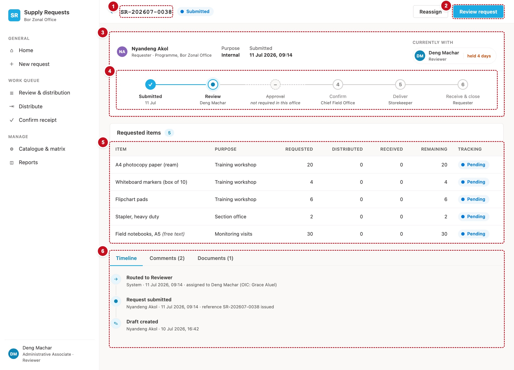

# 7. Request detail — scrRequestDetail

Everything about one request: who raised it, who has it now, where it is on its journey, its items, and its timeline, comments and documents. Anyone who can open the app can open any request here. The buttons decide who can act.



| # | Part | Controls | What it does |
|---|---|---|---|
| 1 | Title | `icoBack`, `lblPageTitle`, status pill | "Request SR-…" and its status |
| 2 | Primary action | `btnPrimary` | **Edit request** for a Draft or Returned request, otherwise the current stage's action (**Review request**, **Distribute**, …) |
| 3 | Summary | `lblRequester`, `lblMeta`, `lblPurpose`, `lblSubmitted`, the "Currently with" chip | Who raised it, when, and who holds it now |
| 4 | Journey rail | `galJourney` (horizontal) | The six legs, each done, current, still to come, or skipped |
| 5 | Requested items | `galItems` | Requested, approved, distributed, received and remaining per line |
| 6 | Tabs | `btnTabTimeline`, `btnTabComments`, `btnTabDocs`, and one panel per tab | Timeline, comments, documents |

## Load the request

The screen loads from a hidden button so a comment or a document can reload it (Recipe R6).

```powerfx
// scrRequestDetail.OnVisible
Set(varNavActive, "");
Set(varDetailTab, "timeline");
Set(varErrorMsg, "");
Select(btnLoad_Detail)

// btnLoad_Detail.OnSelect  (Visible: false)
Set(varReq, LookUp(Requests, Title = varRef));
Set(varPageTitle, "Request " & varRef);
ClearCollect(colLines, Sort(Filter(RequestItems, RequestRefNo = varRef), LineNo));
// Recipe R1 — the approval chain for this request's office and section
ClearCollect(
    colChain,
    ForAll(
        Filter(tblJourney, Skippable) As leg,
        With(
            {
                rowSec: LookUp(colMatrix, MatrixKey = varReq.OfficeCode & "|" & varReq.Section.Value
                        && StageCode.Value = leg.StageCode),
                rowAll: LookUp(colMatrix, MatrixKey = varReq.OfficeCode & "|All sections"
                        && StageCode.Value = leg.StageCode)
            },
            With({ row: If(IsBlank(rowSec), rowAll, rowSec) },
                { Leg: leg.Leg, StageCode: leg.StageCode, LegLabel: leg.LegLabel, ActorLabel: leg.ActorLabel,
                  Live: !IsBlank(row), StageOrder: row.StageOrder, Role: row.ActorRoleCode.Value,
                  Approver: Lower(Trim(row.ApproverEmail)), OIC: Lower(Trim(row.OICEmail)) })
        )
    )
);
// Recipe R3 — who may act
Set(varCanAct, And(varReq.StatusRank < 70,
    Or(!IsBlank(varReq.CurrentlyWithEmail)    && Lower(varReq.CurrentlyWithEmail)    = varUserEmail,
       !IsBlank(varReq.CurrentlyWithOICEmail) && Lower(varReq.CurrentlyWithOICEmail) = varUserEmail)));
Set(varIsOriginator, Lower(varReq.RequesterEmail) = varUserEmail);
Set(varIsEditable,   varReq.Status.Value in ["Draft", "Returned"]);
Set(varIsReviewable, varReq.Status.Value in ["Submitted", "Reviewed"]);
Set(varStage,        If(varIsEditable, "", varReq.CurrentStageCode.Value));

// The timeline, newest first; rows in the same minute keep their order by ID (DEF-130).
ClearCollect(colTimeline,
    SortByColumns(Filter(RequestTimeline, RequestRefNo = varRef),
                  "OccurredOn", SortOrder.Descending, "ID", SortOrder.Descending));
ClearCollect(colComments,
    SortByColumns(Filter(RequestComments, RequestRefNo = varRef), "PostedOn", SortOrder.Ascending));
ClearCollect(colDocs, Filter(RequestDocuments, RequestRefNo = varRef));

// The journey, ported from src/domain/stages.ts resolveJourney.
// DEF-127: a Draft or Returned request is back with its requester, so it shows no current stage.
// DEF-141: a Rejected request stopped where it was; only a finished one ticks every leg.
Set(varJourneyStage, If(varIsEditable || varReq.Status.Value = "Rejected", "", varReq.CurrentStageCode.Value));
Set(varJourneyDone,  varReq.StatusRank >= 70 && varReq.Status.Value <> "Rejected");
ClearCollect(colJourney,
    ForAll(tblJourney As leg,
        With(
            {
                live:   leg.StageCode = "" || LookUp(colChain, StageCode = leg.StageCode).Live,
                curLeg: If(IsBlank(varJourneyStage), Blank(), LookUp(tblJourney, StageCode = varJourneyStage).Leg)
            },
            {
                Leg:      leg.Leg,
                LegLabel: leg.LegLabel,
                State: If(
                    !live,                 "skip",
                    leg.StageCode = "",    If(varIsEditable, "now", "done"),
                    varJourneyDone,        "done",
                    IsBlank(curLeg),       "todo",
                    leg.Leg < curLeg,      "done",
                    leg.Leg = curLeg,      "now",
                    "todo"),
                // DEF-106: the holder's name on the current leg only; otherwise the role label.
                Actor: If(
                    !live, txtLegSkipped,
                    !IsBlank(varReq.CurrentlyWithEmail) && leg.StageCode = varReq.CurrentStageCode.Value,
                        With({ E: varReq.CurrentlyWithEmail },
                             Proper(Substitute(Left(E, Find("@", E & "@") - 1), ".", " "))),
                    leg.StageCode = "" && !IsBlank(varReq.SubmittedOn), Text(varReq.SubmittedOn, "d mmm"),
                    leg.ActorLabel)
            }
        )
    )
)
```

## Header and summary

```powerfx
// btnPrimary.Visible — nothing to offer on a finished request (DEF-124)
varIsEditable || (varReq.StatusRank < 70 && !IsBlank(varStage))
// btnPrimary.Text
If(varIsEditable, "Edit request", LookUp(tblStageAction, StageCode = varStage).DetailLabel)
// btnPrimary.DisplayMode — Edit is the requester's; a stage action is the holder's
If(If(varIsEditable, varIsOriginator, varCanAct), DisplayMode.Edit, DisplayMode.Disabled)
// btnPrimary.OnSelect
If(
    varIsEditable,
    Set(varEditRef, varRef); Navigate(scrNewRequest),
    Switch(LookUp(tblStageAction, StageCode = varStage).Screen,
        "review", Navigate(scrReview), "distribute", Navigate(scrDistribute), Navigate(scrReceipt))
)

// lblRequester.Text and lblMeta.Text
With({ E: varReq.RequesterEmail }, Proper(Substitute(Left(E, Find("@", E & "@") - 1), ".", " ")))
varReq.Section.Value & " · " & Coalesce(LookUp(colOffices, Title = varReq.OfficeCode).OfficeName, varReq.OfficeCode)
// lblPurpose.Text and lblSubmitted.Text
varReq.Purpose.Value
If(IsBlank(varReq.SubmittedOn), "Not yet submitted", Text(varReq.SubmittedOn, "d mmm yyyy, hh:mm"))

// The "Currently with" chip: Visible, who, and the held-for (Recipe R5)
varReq.StatusRank < 70 && !IsBlank(varReq.CurrentlyWithEmail)
With({ E: varReq.CurrentlyWithEmail }, Proper(Substitute(Left(E, Find("@", E & "@") - 1), ".", " ")))
    & " · " & If(varIsEditable, "Requester", LookUp(tblJourney, StageCode = varStage).ActorLabel)
With({ h: DateDiff(Coalesce(varReq.Modified, varReq.SubmittedOn), Now(), TimeUnit.Hours) },
    "held " & If(h < 1, "under an hour", h < 24, Text(h) & If(h = 1, " hour", " hours"),
                 With({ d: RoundDown(h / 24, 0) }, Text(d) & If(d = 1, " day", " days"))))
```

## The journey rail

`galJourney` is a **horizontal** blank gallery with `Items: =colJourney`, `TemplateSize: =Self.Width / 6`, and no scroll bar. Each leg has a 2-pixel connector line, a round dot, a label and a sub-label:

| Control | Property | Formula |
|---|---|---|
| `recLegLine` (Rectangle) | `Fill` | `If(ThisItem.State = "done", clrBrand, clrLine)` (`Height: =dimRailBar`, across the template at the dot's centre; `Visible: =ThisItem.Leg < 6`) |
| `btnLegDot` (Classic Button shape, 28 × 28, radius `radCircle`) | `Fill` | `Switch(ThisItem.State, "done", clrBrand, "skip", clrCanvas, clrSurface)` |
| | `BorderColor` | `If(ThisItem.State in ["done", "now"], clrBrand, clrLineStrong)` |
| | `BorderStyle` | `If(ThisItem.State = "skip", BorderStyle.Dashed, BorderStyle.Solid)` |
| | `Text` | `Switch(ThisItem.State, "done", "✓", "now", "●", "skip", "–", Text(ThisItem.Leg))` |
| | `Color` | `Switch(ThisItem.State, "done", clrOnBrand, "now", clrBrandDark, clrInk3)` |
| `lblLeg` | `Text` | `ThisItem.LegLabel` |
| | `Strikethrough` | `ThisItem.State = "skip"` |
| | `Color`, `FontWeight` | `If(ThisItem.State in ["todo", "skip"], clrInk3, clrInk)`, `If(ThisItem.State in ["todo", "skip"], FontWeight.Normal, FontWeight.Semibold)` |
| `lblLegSub` | `Text` | `ThisItem.Actor` |
| | `Italic` | `ThisItem.State = "skip"` |

## Requested items

`galItems.Items: =colLines`.

| Column | Formula |
|---|---|
| Item | `ThisItem.ItemName & If(ThisItem.IsCatalogueItem, "", "  (free text)")` |
| Purpose | `Coalesce(ThisItem.LinePurpose, txtNoHolder)` |
| Notes | `Coalesce(ThisItem.LineNote, txtNoHolder)` (DEF-121) |
| Requested | `ThisItem.QtyRequested` |
| Approved | `If(IsBlank(ThisItem.QtyApproved), txtNoHolder, Text(ThisItem.QtyApproved))` (DEF-136) |
| Distributed | `Coalesce(ThisItem.QtyDistributed, 0)` |
| Received | `Coalesce(ThisItem.QtyReceived, 0)` |
| Remaining | `Max(0, Coalesce(ThisItem.QtyApproved, ThisItem.QtyRequested) - Coalesce(ThisItem.QtyDistributed, 0))` (DEF-117) |
| Tracking | `Coalesce(ThisItem.LineStatus.Value, "Pending")` in a pill (DEF-108) |

## The tabs

Three Classic Buttons styled as tabs set `varDetailTab` to `"timeline"`, `"comments"` or `"docs"`; each panel's controls have `Visible: =varDetailTab = "…"`. The tab captions carry counts:

```powerfx
"Timeline"
"Comments (" & CountRows(colComments) & ")"
"Documents (" & CountRows(colDocs) & ")"
```

**Timeline.** `galTimeline.Items: =colTimeline`.

```powerfx
// lblTlGlyph.Text
Coalesce(LookUp(tblEventGlyph, EventType = ThisItem.EventType.Value).Glyph, "•")
// lblTlTitle.Text
ThisItem.Title
// lblTlMeta.Text — "System" when the row has no actor
If(IsBlank(ThisItem.ActorEmail), txtSystemActor,
   With({ E: ThisItem.ActorEmail }, Proper(Substitute(Left(E, Find("@", E & "@") - 1), ".", " "))))
& " · " & Text(ThisItem.OccurredOn, "d mmm yyyy, hh:mm")
// lblTlDetail.Text and .Visible
ThisItem.Detail
!IsBlank(ThisItem.Detail)
```

**Comments.** `galComments.Items: =colComments`, showing the author (Recipe R4 on `AuthorEmail`), `PostedOn` and `CommentText`. Below it, `txtComment` (multi-line) and **Post comment** (`btnPostComment`, §14).

**Documents.** `galDocs.Items: =colDocs`, showing `'File name with extension'`, `DocType.Value` and the uploader (`UploadedByEmail`, Recipe R4). The name opens the file: `OnSelect: =Launch(ThisItem.'Link to item')`. Below it, a document-type dropdown `ddDocType` (`Items: =tblDocTypes`), the attachments control `attFile`, and **Attach a file** (`btnAttach`, §14).

### Getting an Attachments control

Studio has no stand-alone file picker. The usual way to get one is to borrow the Attachments control from a form:

1. In SharePoint, create a throw-away list called `UploadHelper` (attachments are on by default for a new list). Add it to the app as a data source.
2. Insert an **Edit form**, set its `DataSource` to `UploadHelper`, and find the **Attachments** card.
3. Select the attachments control inside the card, copy it, select `scrRequestDetail`, and paste. Rename it `attFile`.
4. Delete the form and remove `UploadHelper` from the app's data sources. The pasted control keeps working without it.
5. On `attFile`, set `Items: =Blank()`, `MaxAttachments: =1`, `DisplayMode: =DisplayMode.Edit`, and clear any error that refers to the old form by setting those properties to plain values.

!!! see "You should now see"
    Open `SR-202607-0038` from Home. The journey shows Submitted ticked, Review current with the reviewer's name, and Approval struck through with "not required in this office". The timeline lists newest first.

!!! def "Defects this screen must get right"
    DEF-02 and DEF-121 (item notes are shown) · DEF-101 (a comment or document adds a timeline row) · DEF-106 (a finished request's legs keep their role labels) · DEF-108 (a new line says "Pending") · DEF-111 ("—" for no holder) · DEF-117 (remaining is approved minus distributed) · DEF-124 (Draft and Returned offer Edit, finished requests offer nothing) · DEF-127 (a Returned request shows the journey back at Submitted) · DEF-130 (same-minute rows keep their order) · DEF-136 (an Approved column) · DEF-141 (a Rejected request's later legs are not ticked)
