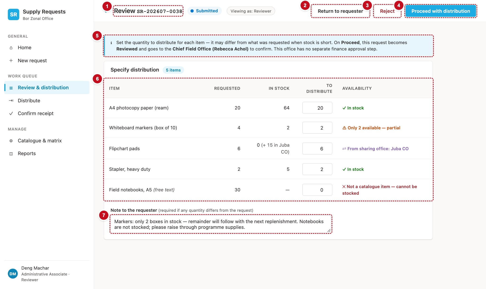

# 8. Review, approve and confirm — scrReview

One screen serves three stages: **Review** (the reviewer sets how much of each item to give out), **Approval** (finance) and **Confirm** (the Chief Field Office). Only Review changes quantities. Approval and Confirm see the approved items and move the request on. At any of the three, the holder can also return the request to its requester or reject it.



| # | Part | Controls | What it does |
|---|---|---|---|
| 1 | Title | `icoBack`, `lblPageTitle`, status pill, `lblPersona` | "Review SR-…", "Approve SR-…" or "Confirm SR-…" (DEF-107) |
| 2 | Return | `btnReturn` | Opens the reason dialog to send it back (§11) |
| 3 | Reject | `btnReject` | Opens the reason dialog to reject it (§11) |
| 4 | Proceed | `btnProceed` | Moves it to the next stage (§10) |
| 5 | What happens next | `lblNextStep` (in a callout) | Says where the request goes on Proceed |
| 6 | Specify distribution | `galReview` (Review), or `galApproved` (Approval, Confirm) | Per line: requested, in stock, to distribute, availability |
| 7 | Note to the requester | `txtNote` | Required when any quantity differs from what was asked |

Also on the screen: the reason dialog (`recDialogShade`, `recDialog`, `lblDialogTitle`, `txtReason`, `btnDialogConfirm`, `btnDialogCancel`), the error line, and `btnLoad_Review`.

## Load the request

```powerfx
// scrReview.OnVisible
Set(varNavActive, "review");
Set(varShowDialog, false);
Set(varErrorMsg, "");
Select(btnLoad_Review)

// btnLoad_Review.OnSelect  (Visible: false)
Set(varReq, LookUp(Requests, Title = varRef));
ClearCollect(colLines, Sort(Filter(RequestItems, RequestRefNo = varRef), LineNo));
// Recipe R1 — the approval chain
ClearCollect(
    colChain,
    ForAll(
        Filter(tblJourney, Skippable) As leg,
        With(
            {
                rowSec: LookUp(colMatrix, MatrixKey = varReq.OfficeCode & "|" & varReq.Section.Value
                        && StageCode.Value = leg.StageCode),
                rowAll: LookUp(colMatrix, MatrixKey = varReq.OfficeCode & "|All sections"
                        && StageCode.Value = leg.StageCode)
            },
            With({ row: If(IsBlank(rowSec), rowAll, rowSec) },
                { Leg: leg.Leg, StageCode: leg.StageCode, LegLabel: leg.LegLabel, ActorLabel: leg.ActorLabel,
                  Live: !IsBlank(row), StageOrder: row.StageOrder, Role: row.ActorRoleCode.Value,
                  Approver: Lower(Trim(row.ApproverEmail)), OIC: Lower(Trim(row.OICEmail)) })
        )
    )
);
// Recipe R3 — who may act
Set(varCanAct, And(varReq.StatusRank < 70,
    Or(!IsBlank(varReq.CurrentlyWithEmail)    && Lower(varReq.CurrentlyWithEmail)    = varUserEmail,
       !IsBlank(varReq.CurrentlyWithOICEmail) && Lower(varReq.CurrentlyWithOICEmail) = varUserEmail)));
Set(varIsOriginator, Lower(varReq.RequesterEmail) = varUserEmail);
Set(varIsEditable,   varReq.Status.Value in ["Draft", "Returned"]);
Set(varIsReviewable, varReq.Status.Value in ["Submitted", "Reviewed"]);
Set(varStage,        If(varIsEditable, "", varReq.CurrentStageCode.Value));
Set(varPageTitle, Coalesce(LookUp(tblStageAction, StageCode = varStage).ScreenTitle, "Review") & " " & varRef);

// Where Proceed would send it (Recipe R2), for the callout.
Set(varRoute,
    With({ fromLeg: Coalesce(LookUp(tblJourney, StageCode = varStage).Leg, 1) },
        With({ next: First(Sort(Filter(colChain, Live, Leg > fromLeg), Leg)) },
            If(IsBlank(next) || next.StageCode = "Receive",
                { NextStage: "Receive", WithEmail: Lower(varReq.RequesterEmail), OICEmail: "" },
                With({ primary: Coalesce(next.Approver, next.OIC) },
                    { NextStage: next.StageCode,
                      WithEmail: Coalesce(primary, Lower(varReq.RequesterEmail)),
                      OICEmail:  If(!IsBlank(next.OIC) && next.OIC <> primary, next.OIC, "") })))));

// Stock: this office's catalogue, and every lending office's, in priority order.
ClearCollect(colCat, Filter(Catalogue, OfficeCode = varReq.OfficeCode));
Clear(colLenderStock);
ForAll(
    Sort(Filter(colSharing, ToOfficeCode = varReq.OfficeCode), SharePriority) As lend,
    Collect(colLenderStock,
        ForAll(Filter(Catalogue, OfficeCode = lend.FromOfficeCode) As c,
            { OfficeCode: c.OfficeCode, ItemCode: c.ItemCode, StockQty: c.StockQty, Priority: lend.SharePriority }))
);

// One row per line, with the stock and the most that may be given out.
// Ported from ReviewPage.tsx: a short catalogue line looks at the lending offices in
// priority order and takes the first with any stock (src/domain/sharing.ts).
ClearCollect(colReview,
    ForAll(colLines As ln,
        With(
            { localStock: Coalesce(LookUp(colCat, OfficeItemKey = ln.OfficeItemKey).StockQty, 0) },
            With(
                { lender: If(ln.IsCatalogueItem && localStock < ln.QtyRequested,
                             First(Sort(Filter(colLenderStock, ItemCode = ln.ItemCode, StockQty > 0), Priority))) },
                With(
                    { maxQty: If(!ln.IsCatalogueItem,              999999,
                                 localStock >= ln.QtyRequested,    localStock,
                                 !IsBlank(lender),                 lender.StockQty,
                                 localStock) },
                    {
                        LineID: ln.ID, LineNo: ln.LineNo, ItemName: ln.ItemName, ItemCode: ln.ItemCode,
                        IsCatalogueItem: ln.IsCatalogueItem, QtyRequested: ln.QtyRequested,
                        LinePurpose: ln.LinePurpose, QtyApproved: ln.QtyApproved,
                        LocalStock: localStock,
                        LenderOffice: lender.OfficeCode, LenderStock: Coalesce(lender.StockQty, 0),
                        MaxQty: maxQty,
                        DefaultQty: If(ln.IsCatalogueItem, Min(ln.QtyRequested, maxQty), 0)
                    }
                )
            )
        )
    )
)
```

## The top of the screen

```powerfx
// lblPersona.Text
"Viewing as: " & Coalesce(LookUp(tblJourney, StageCode = varStage).ActorLabel, "Reviewer")

// lblNextStep.Text — the callout (ReviewPage.tsx)
If(varStage = "Review",
   "Set the quantity to distribute for each item — it may differ from what was requested when stock is short. ", "")
& "On Proceed, this request " & If(varStage = "Review", "becomes", "stays") & " Reviewed and goes to the "
& LookUp(tblJourney, StageCode = varRoute.NextStage).ActorLabel
& " (" & With({ E: varRoute.WithEmail }, Proper(Substitute(Left(E, Find("@", E & "@") - 1), ".", " "))) & ")"
& If(varRoute.NextStage = "Receive", " to confirm receipt.", " to act next.")
```

The `DisplayMode` and `OnSelect` of **Proceed**, **Return**, **Reject** and the dialog's confirm button are in §10 and §11 (chapter 13).

## Specify distribution (Review stage)

`galReview.Items: =colReview`, `Visible: =varStage = "Review"`.

| Column | Formula |
|---|---|
| Item | `ThisItem.ItemName & If(ThisItem.IsCatalogueItem, "", "  (free text)")` |
| Requested | `ThisItem.QtyRequested` |
| In stock | `If(!ThisItem.IsCatalogueItem, txtNoHolder, ThisItem.LocalStock & If(IsBlank(ThisItem.LenderOffice), "", "  (+ " & ThisItem.LenderStock & " in " & LookUp(colOffices, Title = ThisItem.LenderOffice).OfficeName & ")"))` |
| To distribute | `txtApprove` (Classic TextInput, `Format: =TextFormat.Number`, `Width: =dimQtyBox`, `Default: =ThisItem.DefaultQty`) |
| Availability | `lblAvail`, below |

```powerfx
// lblAvail.Text
If(
    !ThisItem.IsCatalogueItem,                       "✕ Not a catalogue item — cannot be stocked",
    !IsBlank(ThisItem.LenderOffice),                 "⇄ From sharing office: " & LookUp(colOffices, Title = ThisItem.LenderOffice).OfficeName,
    ThisItem.LocalStock >= ThisItem.QtyRequested,    "✓ In stock",
    ThisItem.LocalStock > 0,                         "⚠ Only " & ThisItem.LocalStock & " available — partial",
    "✕ Out of stock"
)
// lblAvail.Color
If(
    !ThisItem.IsCatalogueItem,                       clrStockOut,
    !IsBlank(ThisItem.LenderOffice),                 clrStockLend,
    ThisItem.LocalStock >= ThisItem.QtyRequested,    clrStockOk,
    ThisItem.LocalStock > 0,                         clrStockLow,
    clrStockOut
)

// lblOverMax — a small red hint under the box when the number typed is more than can be given
//   .Text     "At most " & ThisItem.MaxQty
//   .Visible  ThisItem.IsCatalogueItem && Value(txtApprove.Text) > ThisItem.MaxQty
```

Proceed saves `Min(Max(typed, 0), MaxQty)`, so a number above the maximum is capped, as the current app caps it. The hint just makes that visible.

**Note to the requester.** `txtNote` (multi-line). Its label reads "Note to the requester (required if any quantity differs from the request)". §10's `btnProceed.DisplayMode` enforces it.

## Approved items (Approval and Confirm stages)

`galApproved.Items: =colReview`, `Visible: =varStage in ["Approval", "Confirm"]`. Three read-only columns: Item, Purpose (`Coalesce(ThisItem.LinePurpose, txtNoHolder)`) and Approved (`Coalesce(ThisItem.QtyApproved, 0)`). The card's title is "Approved items" with the count `CountRows(colReview) & If(CountRows(colReview) = 1, " item", " items")`.

## The reason dialog

A dialog in canvas is a set of controls shown together:

1. Insert a full-screen Rectangle `recDialogShade` (`Fill: =RGBA(0, 0, 0, 0.35)`), then a Classic Button shape `recDialog` centred on it (`Fill: =clrSurface`, radius `rad6`), then on top of that `lblDialogTitle`, `txtReason` (multi-line), `lblDialogError`, `btnDialogCancel` and `btnDialogConfirm`. They must be the **last** controls in the Tree view so they draw over everything.
2. Set `Visible: =varShowDialog` on all of them.
3. Set the texts:

```powerfx
// lblDialogTitle.Text
If(varDialog = "return", "Return " & varRef & " to the requester", "Reject " & varRef)
// txtReason.HintText
If(varDialog = "return", "What needs to change? The requester sees this.", "Why is this request rejected?")
// btnDialogConfirm.Text
If(varDialog = "return", "Return to requester", "Reject request")
// btnDialogCancel.OnSelect
Set(varShowDialog, false)
// lblDialogError.Text / .Visible — a failed write keeps the dialog open and says why (DEF-06)
varErrorMsg
!IsBlank(varErrorMsg)
```

!!! see "You should now see"
    As the reviewer of `SR-202607-0038`: "Review SR-202607-0038", five lines with availability badges (one from the sharing office, one not a catalogue item), and **Proceed** greyed out until you write a note, because the markers line asks for 4 but only 2 are in stock. As someone who doesn't hold the request, all three buttons are greyed out.

!!! def "Defects this screen must get right"
    DEF-04 (Return, Reject and Proceed only for the holder, at a review stage) · DEF-06 (a failed save says so) · DEF-107 (the title names the stage) · DEF-113 ("1 item") · DEF-114 (the reference isn't clipped) · DEF-124 (a Returned request can't be acted on here)
