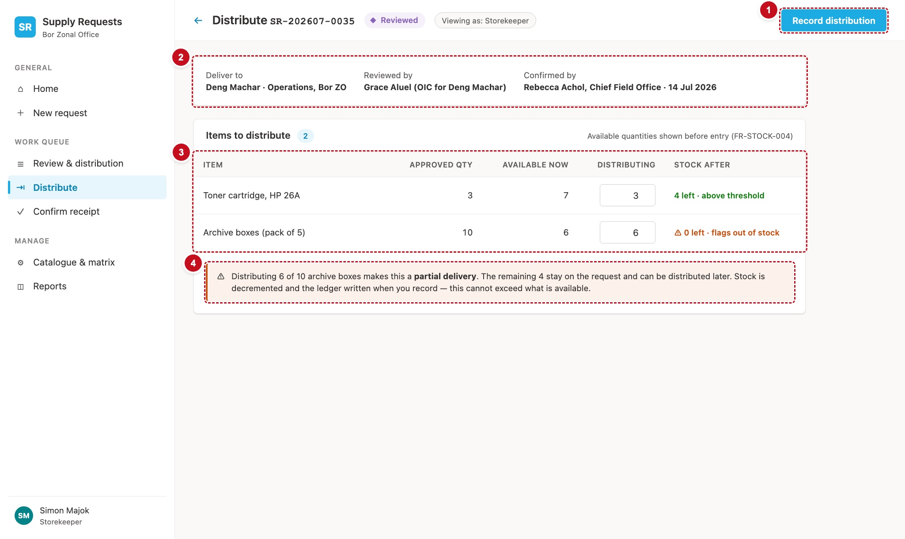

# 9. Distribute — scrDistribute

The storekeeper records what is handed out. Stock comes off the office that supplies each line: the request's own office, or the lending office the reviewer chose. A delivery can be done in parts. The request stays with the storekeeper until everything approved has gone out, then moves to the requester to confirm receipt.



| # | Part | Controls | What it does |
|---|---|---|---|
| 1 | Record distribution | `btnRecordDistribution` | Writes the ledger, the stock and the lines, then the request (§12) |
| 2 | Who and how | `lblDeliverTo`, `lblReviewedBy`, `lblConfirmedBy` | Who it goes to, who reviewed and who confirmed it |
| 3 | Items to distribute | `galDist` | Per line: approved, available now, distributing, stock after |
| 4 | Partial warning | `lblPartial` (in a warning callout) | Shown when this will not finish the request |

## Load the request

```powerfx
// scrDistribute.OnVisible
Set(varNavActive, "distribute");
Set(varErrorMsg, "");
Set(varDistReady, false);
Select(btnLoad_Distribute)

// btnLoad_Distribute.OnSelect  (Visible: false)
Set(varReq, LookUp(Requests, Title = varRef));
Set(varPageTitle, "Distribute " & varRef);
ClearCollect(colLines, Sort(Filter(RequestItems, RequestRefNo = varRef), LineNo));
// Recipe R1 — the approval chain (Record distribution needs the Deliver stage's holders)
ClearCollect(
    colChain,
    ForAll(
        Filter(tblJourney, Skippable) As leg,
        With(
            {
                rowSec: LookUp(colMatrix, MatrixKey = varReq.OfficeCode & "|" & varReq.Section.Value
                        && StageCode.Value = leg.StageCode),
                rowAll: LookUp(colMatrix, MatrixKey = varReq.OfficeCode & "|All sections"
                        && StageCode.Value = leg.StageCode)
            },
            With({ row: If(IsBlank(rowSec), rowAll, rowSec) },
                { Leg: leg.Leg, StageCode: leg.StageCode, LegLabel: leg.LegLabel, ActorLabel: leg.ActorLabel,
                  Live: !IsBlank(row), StageOrder: row.StageOrder, Role: row.ActorRoleCode.Value,
                  Approver: Lower(Trim(row.ApproverEmail)), OIC: Lower(Trim(row.OICEmail)) })
        )
    )
);
// Recipe R3 — who may act
Set(varCanAct, And(varReq.StatusRank < 70,
    Or(!IsBlank(varReq.CurrentlyWithEmail)    && Lower(varReq.CurrentlyWithEmail)    = varUserEmail,
       !IsBlank(varReq.CurrentlyWithOICEmail) && Lower(varReq.CurrentlyWithOICEmail) = varUserEmail)));
Set(varIsEditable, varReq.Status.Value in ["Draft", "Returned"]);
Set(varStage,      If(varIsEditable, "", varReq.CurrentStageCode.Value));
ClearCollect(colTimeline, SortByColumns(Filter(RequestTimeline, RequestRefNo = varRef), "OccurredOn", SortOrder.Ascending));

// The catalogue lines still owed, each with the live stock of the office that supplies it.
Refresh(Catalogue);
ClearCollect(colDistView,
    ForAll(Filter(colLines, IsCatalogueItem, Coalesce(QtyApproved, 0) > Coalesce(QtyDistributed, 0)) As ln,
        With(
            { source: Coalesce(ln.SourceOfficeCode, varReq.OfficeCode) },
            With(
                { cat: LookUp(Catalogue, OfficeItemKey = source & "|" & ln.ItemCode) },
                {
                    LineID: ln.ID, ItemName: ln.ItemName, ItemCode: ln.ItemCode,
                    SourceOffice: source, OfficeItemKey: source & "|" & ln.ItemCode,
                    QtyApproved: Coalesce(ln.QtyApproved, 0), QtyDistributed: Coalesce(ln.QtyDistributed, 0),
                    Remaining: Coalesce(ln.QtyApproved, 0) - Coalesce(ln.QtyDistributed, 0),
                    Available: Coalesce(cat.StockQty, 0), ReorderLevel: cat.ReorderLevel
                }
            )
        )
    )
);
Set(varDistReady, true)
```

The gallery and the button wait for `varDistReady`, so the screen never shows every line at zero stock while the figures load (DEF-144).

## Who and how

```powerfx
// lblDeliverTo.Text
With({ E: varReq.RequesterEmail }, Proper(Substitute(Left(E, Find("@", E & "@") - 1), ".", " ")))
& " · " & varReq.Section.Value & ", " & Coalesce(LookUp(colOffices, Title = varReq.OfficeCode).OfficeName, varReq.OfficeCode)

// lblReviewedBy.Text — the first "Reviewed" timeline row
With({ ev: First(Filter(colTimeline, EventType.Value = "Reviewed")) },
    If(IsBlank(ev), txtNoHolder,
       With({ E: ev.ActorEmail }, Proper(Substitute(Left(E, Find("@", E & "@") - 1), ".", " ")))))

// lblConfirmedBy.Text — the latest "Confirmed" row, or a note when the office has no Confirm stage
With({ ev: Last(Filter(colTimeline, EventType.Value = "Confirmed")) },
    If(
        !LookUp(colChain, StageCode = "Confirm").Live, "Not required in this office",
        IsBlank(ev), txtNoHolder,
        With({ E: ev.ActorEmail }, Proper(Substitute(Left(E, Find("@", E & "@") - 1), ".", " ")))
        & " (" & LookUp(colChain, StageCode = "Confirm").Role & ") · " & Text(ev.OccurredOn, "d mmm")))
```

## Items to distribute

`galDist.Items: =colDistView`, `Visible: =varDistReady`.

| Column | Formula |
|---|---|
| Item | `ThisItem.ItemName` |
| Approved qty | `ThisItem.QtyApproved` |
| Available now | `ThisItem.Available & If(ThisItem.SourceOffice <> varReq.OfficeCode, " · from " & LookUp(colOffices, Title = ThisItem.SourceOffice).OfficeName, "")` (DEF-112) |
| Distributing | `txtDist` (Classic TextInput, number, `Width: =dimQtyBox`, `Default: =Min(ThisItem.Remaining, ThisItem.Available)`) |
| Stock after | `lblAfter`, below |

```powerfx
// lblAfter.Text — DEF-118: "at threshold" when equal, "below" only under it; DEF-126: nothing without a threshold
With(
    { after: ThisItem.Available - Min(Max(Coalesce(Value(txtDist.Text), 0), 0), ThisItem.Remaining, ThisItem.Available),
      lvl:   ThisItem.ReorderLevel },
    With(
        { wording: If(IsBlank(lvl), "", after < lvl, "below threshold", after = lvl, "at threshold", "above threshold") },
        If(
            after = 0,                               "⚠ 0 left · flags out of stock",
            !IsBlank(lvl) && after <= lvl,           "⚠ " & after & " left · " & wording,
            after & " left" & If(IsBlank(wording), "", " · " & wording)
        )
    )
)
// lblAfter.Color
With({ after: ThisItem.Available - Min(Max(Coalesce(Value(txtDist.Text), 0), 0), ThisItem.Remaining, ThisItem.Available) },
    If(after = 0, clrStockOut,
       !IsBlank(ThisItem.ReorderLevel) && after <= ThisItem.ReorderLevel, clrStockLow,
       clrStockOk))
```

```powerfx
// lblPartial.Visible — some line will still be owed after this step
!IsEmpty(Filter(galDist.AllItems, Min(Max(Coalesce(Value(txtDist.Text), 0), 0), Remaining, Available) < Remaining))
// lblPartial.Text
"Part of this request will still be owed after this distribution. It stays with you at Deliver until everything approved has been handed out; then it goes to the requester to confirm receipt."

// btnRecordDistribution.DisplayMode
If(varCanAct && varDistReady && !varBusy && !IsEmpty(colDistView), DisplayMode.Edit, DisplayMode.Disabled)
// btnRecordDistribution.OnSelect — §12, chapter 13
```

Empty message, when every line is already out: "Everything approved on this request has been distributed."

!!! see "You should now see"
    As the storekeeper of a request at Deliver: each catalogue line with its approved quantity and the live stock, a line supplied by Juba Country Office says "· from Juba Country Office", and changing a quantity changes the "Stock after" text as you type.

!!! def "Defects this screen must get right"
    DEF-05 (the remainder of a partial delivery can be distributed) · DEF-06 (each line that failed is listed) · DEF-112 (the lending office is named) · DEF-118 and DEF-126 (the threshold wording) · DEF-119 (the timeline gives this step's quantity and the running total) · DEF-122 (the hand-over to the requester writes a Routed row) · DEF-144 (no zero stock while loading)
