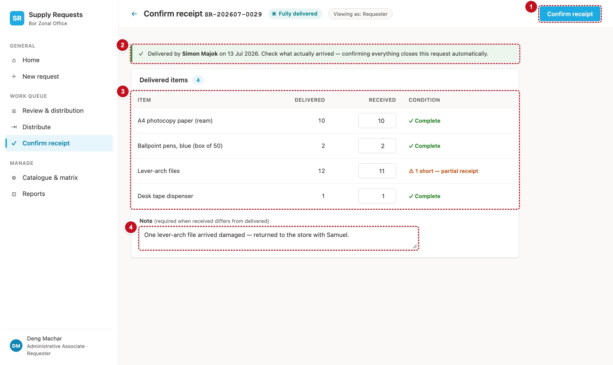

# 10. Confirm receipt — scrReceipt

The requester records what actually arrived, line by line. When everything approved has been delivered, confirming closes the request, even if something arrived short or damaged; the shortfall is kept on the line.



| # | Part | Controls | What it does |
|---|---|---|---|
| 1 | Confirm receipt | `btnConfirmReceipt` | Saves what arrived and closes the request (§13) |
| 2 | Delivery note | `lblDeliveredBy` (in a success callout) | Who delivered it and when; confirming everything closes the request |
| 3 | Delivered items | `galReceipt` | Per line: delivered, received, condition |
| 4 | Note | `txtReceiptNote` | Recommended when something is short; saved on the lines that aren't Complete |

## Load the request

```powerfx
// scrReceipt.OnVisible
Set(varNavActive, "receipt");
Set(varErrorMsg, "");
Select(btnLoad_Receipt)

// btnLoad_Receipt.OnSelect  (Visible: false)
Set(varReq, LookUp(Requests, Title = varRef));
Set(varPageTitle, "Confirm receipt " & varRef);
ClearCollect(colLines, Sort(Filter(RequestItems, RequestRefNo = varRef), LineNo));
// Recipe R3 — who may act (no chain is needed on this screen)
Set(varCanAct, And(varReq.StatusRank < 70,
    Or(!IsBlank(varReq.CurrentlyWithEmail)    && Lower(varReq.CurrentlyWithEmail)    = varUserEmail,
       !IsBlank(varReq.CurrentlyWithOICEmail) && Lower(varReq.CurrentlyWithOICEmail) = varUserEmail)));
Set(varIsOriginator, Lower(varReq.RequesterEmail) = varUserEmail);
ClearCollect(colTimeline, SortByColumns(Filter(RequestTimeline, RequestRefNo = varRef), "OccurredOn", SortOrder.Ascending))
```

## The screen

```powerfx
// lblPersona.Text
"Viewing as: Requester"

// lblDeliveredBy.Text — the first "Distributed" row
With({ ev: First(Filter(colTimeline, EventType.Value = "Distributed")) },
    If(IsBlank(ev), "",
       "Delivered by " & With({ E: ev.ActorEmail }, Proper(Substitute(Left(E, Find("@", E & "@") - 1), ".", " ")))
       & " on " & Text(ev.OccurredOn, "d mmm yyyy") & ". ")
) & "Confirming everything closes this request."

// galReceipt.Items — the lines that had something delivered
Filter(colLines, Coalesce(QtyDistributed, 0) > 0)
```

| Column | Formula |
|---|---|
| Item | `ThisItem.ItemName` |
| Delivered | `Coalesce(ThisItem.QtyDistributed, 0)` |
| Received | `txtReceived` (Classic TextInput, number, `Width: =dimQtyBox`, `Default: =Coalesce(ThisItem.QtyDistributed, 0)`) |
| Condition | `ddCondition` (Classic DropDown, `Items: =tblConditions`), `Default` below |

```powerfx
// ddCondition.Default — set from the number received; the user can still change it
With(
    { rec: Min(Max(Coalesce(Value(txtReceived.Text), 0), 0), Coalesce(ThisItem.QtyDistributed, 0)) },
    If(rec <= 0, "Not received", rec < Coalesce(ThisItem.QtyDistributed, 0), "Short", "Complete")
)

// lblShortHint.Visible / .Text — under the note box
!IsEmpty(Filter(galReceipt.AllItems, Coalesce(Value(txtReceived.Text), 0) < Coalesce(QtyDistributed, 0)))
"Something arrived short. Add a note saying what is missing, so the storekeeper can follow it up."

// btnConfirmReceipt.DisplayMode — only the requester, while they hold it
If(varCanAct && varIsOriginator && !varBusy && !IsEmpty(galReceipt.AllItems), DisplayMode.Edit, DisplayMode.Disabled)
// btnConfirmReceipt.OnSelect — §13, chapter 13
```

!!! note "The note is recommended, not required"
    The mock-up labels the note "required" when something is short. The current app only recommends it, and saves it on each line whose condition isn't Complete. This guide does the same.

!!! see "You should now see"
    As the requester of a Fully delivered request: every delivered line with its quantity filled in and the condition "Complete". Change a received quantity to less than delivered and the condition turns to "Short" and the hint appears.

!!! def "Defects this screen must get right"
    DEF-06 (a failed save says so) · DEF-123 (the receipt timeline row says how many of how many arrived) · DEF-134 (Home's Confirm receipt opens this screen, not Request detail)
