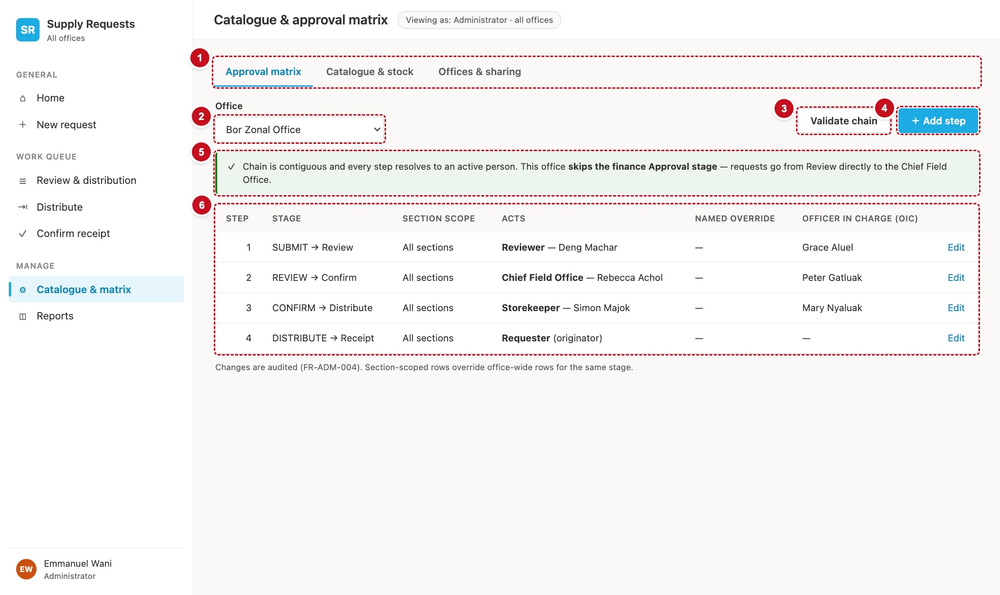
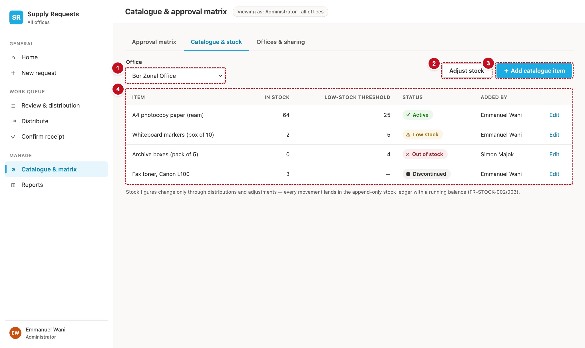
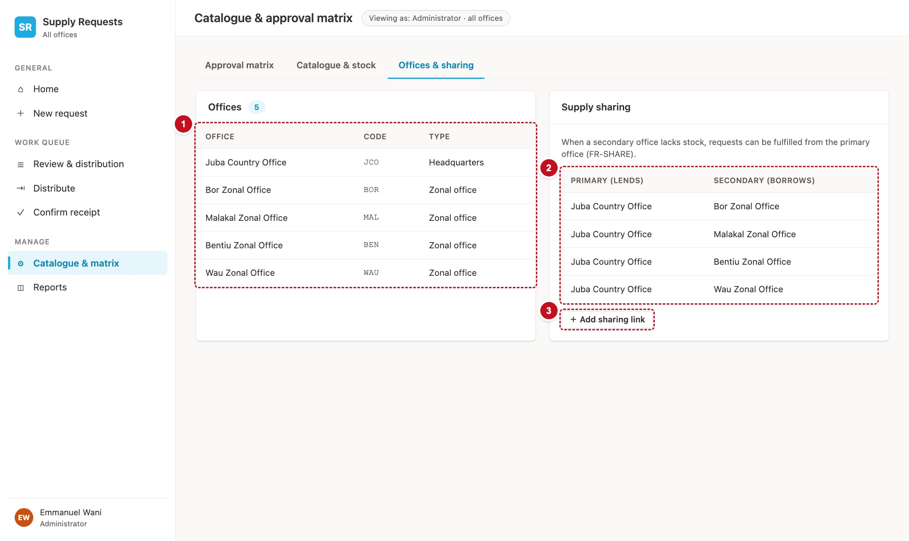

# 11. Catalogue & matrix — scrAdmin

The administrator's screen, with three tabs: the **approval matrix** (who acts at each stage, per office), the **catalogue and stock**, and **offices and sharing** (which offices exist, and which lend stock to which).



| # | Part | Controls | What it does |
|---|---|---|---|
| 1 | Tabs | `btnTabMatrix`, `btnTabCatalogue`, `btnTabOffices` | Set `varAdminTab` |
| 2 | Office | `ddAdminOffice` | The office the first two tabs show |
| 3 | Validate chain | `btnValidateChain` | Checks every stage resolves to a person (§15.2) |
| 4 | Add step | `btnAddStep` | Opens the add-step dialog (§15.1) |
| 5 | Chain result | `lblChain` (in a callout) | Green when valid, red with the problem steps when not |
| 6 | Steps | `galMatrix` | One row per active matrix row, in step order |

## Load the screen

```powerfx
// scrAdmin.OnVisible
Set(varNavActive, "admin");
Set(varPageTitle, "Catalogue & approval matrix");
Set(varAdminTab, Coalesce(varAdminTab, "matrix"));
Set(varAdminOffice, Coalesce(varAdminOffice, varMyOffice, First(Filter(colOffices, IsActive <> false)).Title));
Set(varChainMsg, "");
Select(btnLoad_AdminCatalogue)

// btnLoad_AdminCatalogue.OnSelect  (Visible: false) — every item, including discontinued ones (DEF-11)
ClearCollect(colAdminCat, Sort(Filter(Catalogue, OfficeCode = varAdminOffice), Title));
// The office-wide chain, for the step labels (Recipe R1 with S = "All sections")
ClearCollect(
    colAdminChain,
    ForAll(
        Filter(tblJourney, Skippable) As leg,
        With({ row: LookUp(colMatrix, MatrixKey = varAdminOffice & "|All sections"
                                 && StageCode.Value = leg.StageCode) },
            { Leg: leg.Leg, StageCode: leg.StageCode, LegLabel: leg.LegLabel, Live: !IsBlank(row) })
    )
)

// lblPersona.Text
"Viewing as: Administrator · all offices"

// ddAdminOffice — Items, Value, Default, OnChange
Filter(colOffices, IsActive <> false)
"OfficeName"
LookUp(colOffices, Title = varAdminOffice).OfficeName
Set(varAdminOffice, Self.Selected.Title); Set(varChainMsg, ""); Select(btnLoad_AdminCatalogue)
```

Each tab's controls have `Visible: =varAdminTab = "matrix"` (or `"catalogue"`, `"offices"`). The tab buttons set it and are styled from it: `Color: =If(varAdminTab = "matrix", clrBrandDark, clrInk2)` and a 2-pixel cyan bar under the active one.

!!! note "Who can open this screen"
    The current app lets every user open and change this screen (DEF-135, by design for now). If the product owner wants it for administrators only, set the menu item's visibility in `galNavManage` to `ThisItem.Target <> "admin" || varIsAdmin`, and in `scrAdmin.OnVisible` add `If(!varIsAdmin, Navigate(scrHome))` as the first line.

## Tab 1 — Approval matrix

`galMatrix.Items`:

```powerfx
Sort(Filter(colMatrix, OfficeCode = varAdminOffice), StageOrder)
```

| Column | Formula |
|---|---|
| Step | `ThisItem.StageOrder` |
| Stage | below: derived from the stages before it, never stored |
| Section scope | `ThisItem.Section` |
| Acts | `ThisItem.ActorRoleCode.Value & If(ThisItem.StageCode.Value = "Receive", " (originator)", If(IsBlank(ThisItem.ApproverEmail), "", " · " & ThisItem.ApproverEmail))` |
| Named override | `txtNoHolder` (the current app shows "—": there is no column for it) |
| OIC | `Coalesce(ThisItem.OICEmail, txtNoHolder)` |
| Edit | `btnEditStep`, below |

```powerfx
// lblStage.Text — "REVIEW → Confirm", "SUBMIT → Review" (src/domain/stages.ts stageTransitionLabel)
With(
    { myLeg: LookUp(tblJourney, StageCode = ThisItem.StageCode.Value).Leg },
    With(
        { prev: Last(Sort(Filter(colAdminChain, Live, Leg < myLeg), Leg)) },
        If(IsBlank(prev), "SUBMIT", Upper(prev.LegLabel)) & " → " & LookUp(tblJourney, Leg = myLeg).LegLabel
    )
)

// btnEditStep.OnSelect — the dialog starts from this row (DEF-105)
Set(varEditStep, ThisItem);
Reset(txtEditSection); Reset(ddEditRole); Reset(txtEditApprover); Reset(txtEditOIC); Reset(txtEditOrder);
Set(varShowEditStep, true)

// btnAddStep.OnSelect — the dialog starts blank every time (DEF-105)
Reset(ddStepStage); Reset(txtStepSection); Reset(ddStepRole); Reset(txtStepApprover); Reset(txtStepOIC); Reset(txtStepOrder);
Set(varShowAddStep, true)

// lblChain — the validation callout
//   .Text     varChainMsg
//   .Visible  !IsBlank(varChainMsg)
//   .Color    If(varChainOk, clrStReceived, clrStRejected)   (and the callout's fill: clrStReceivedBg / clrStRejectedBg)
```

**The add-step dialog** has `ddStepStage` (Items `["Review", "Approval", "Confirm", "Deliver", "Receive"]`), `txtStepSection` (Default `"All sections"`), `ddStepRole` (Items `tblRoles`), `txtStepApprover`, `txtStepOIC` and `txtStepOrder` (number, Default `CountRows(Filter(colMatrix, OfficeCode = varAdminOffice)) + 1`), with **Save** (`btnSaveNewStep`, §15.1). **The edit dialog** has the same fields except the stage, with each `Default` from `varEditStep` (for example `txtEditApprover.Default: =varEditStep.ApproverEmail`), and **Save** (`btnSaveStep`, §15.1). Build both dialogs the way chapter 8 builds the reason dialog: a shade, a panel and the fields, last in the Tree view, shown by their variable.

## Tab 2 — Catalogue & stock



Markers: **1** the office (the same `ddAdminOffice`), **2** **Adjust stock** (`btnAdjust`), **3** **＋ Add catalogue item** (`btnAddItem`), **4** the items (`galCatalogue`).

`galCatalogue.Items: =colAdminCat`.

| Column | Formula |
|---|---|
| Item | `ThisItem.Title` with `ThisItem.ItemCode` beneath in `clrInk2` |
| In stock | `ThisItem.StockQty` |
| Low-stock threshold | `Coalesce(Text(ThisItem.ReorderLevel), txtNoHolder)` |
| Status | the stock badge, below |
| Category | `Coalesce(ThisItem.Category, txtNoHolder)` |
| Edit | `btnEditItem`: `Set(varEditItem, ThisItem); Reset(txtEditItemName); …; Set(varShowEditItem, true)` |

```powerfx
// The stock badge: derived, never stored (schema.md §3; src/domain/status.ts stockStateOf)
// lblStockState.Text
With({ st: If(!ThisItem.IsActive, "Discontinued",
              ThisItem.StockQty = 0, "Out of stock",
              !IsBlank(ThisItem.ReorderLevel) && ThisItem.StockQty <= ThisItem.ReorderLevel, "Low stock",
              "Active") },
     LookUp(tblStockState, StateText = st).Glyph & "  " & st)
// lblStockState.Color — the same With(...), then
//   LookUp(tblStockState, StateText = st).Fg      (and .Bg for the pill's Fill)
```

**Adjust stock** opens a dialog with `ddAdjustItem` (`Items: =Filter(colAdminCat, IsActive)`, `Value: "Title"`), `txtAdjustQty` (a signed number: `-3` takes three off) and `txtAdjustReason`, all required, and **Save** (`btnSaveAdjustment`, §15.3). **Add catalogue item** opens a dialog with name, code, category, unit, reorder level and unit cost (`btnSaveNewItem`, §15.3); stock always starts at 0, and stock is never edited directly, only adjusted. **Edit** has the same fields except the code, plus an **Active** toggle `tglEditItemActive` (`btnSaveItem`, §15.3).

## Tab 3 — Offices & sharing



Markers: **1** the offices (`galOffices`), **2** the sharing links (`galSharing`), **3** **＋ Add office** (`btnAddOffice`).

```powerfx
// galOffices.Items — every office, active or not (DEF-14)
Sort(colOffices, OfficeName)
// columns: OfficeName · Title (the code) · OfficeType.Value · If(ThisItem.IsActive <> false, "Active", "Inactive")

// btnAddOffice.OnSelect
Set(varEditOffice, Blank()); Set(varCodeTouched, false); Set(varFrozenCode, "");
Reset(txtOfficeName); Reset(ddOfficeType); Reset(txtOfficeCountry); Reset(tglOfficeActive); Reset(txtOfficeCode);
Set(varShowOfficeDialog, true)

// btnEditOffice.OnSelect (in the gallery)
Set(varEditOffice, ThisItem); Set(varCodeTouched, true); Set(varFrozenCode, ThisItem.Title);
Reset(txtOfficeName); Reset(ddOfficeType); Reset(txtOfficeCountry); Reset(tglOfficeActive); Reset(txtOfficeCode);
Set(varShowOfficeDialog, true)

// galSharing.Items — the active links
colSharing
// columns: "From: " & LookUp(colOffices, Title = ThisItem.FromOfficeCode).OfficeName & " lends"
//          "To: " & LookUp(colOffices, Title = ThisItem.ToOfficeCode).OfficeName & " borrows"
//          ThisItem.SharePriority
```

**The office dialog** serves both Add and Edit. Its fields: `txtOfficeName` (Default `varEditOffice.OfficeName`), `ddOfficeType` (Items `tblOfficeTypes`, Default `Coalesce(varEditOffice.OfficeType.Value, "Field office")`), `txtOfficeCountry` (Default `Coalesce(varEditOffice.Country, "South Sudan")`), `tglOfficeActive` (Default `Coalesce(varEditOffice.IsActive, true)`), and the code field, which suggests a code as you type the name and stops following it once you type over it. The code-field formulas, `lblCodeSuggestion`, `lblOfficeCodeError` and both **Save** buttons are in §15.4 and §15.5. Show `btnSaveNewOffice` when `IsBlank(varEditOffice)` and `btnSaveOffice` otherwise.

!!! trap "Renaming an office code"
    Saving an office with a new code rewrites that code in seven lists (§15.5). It takes a while on a busy office, and it stops at the first list that fails, so it is safe to run again. Tell users not to work in that office while it runs.

**Add sharing link** opens a dialog with `ddShareFrom` and `ddShareTo` (Items: active offices), `txtSharePriority` (Default `1`), and **Save** (`btnSaveNewSharing`, §15.4). The current app has no edit or delete for sharing links; switch a link off by setting `IsActive` to No in SharePoint.

!!! see "You should now see"
    For Bor: four steps (Review, Confirm, Deliver, Receive) labelled "SUBMIT → Review", "REVIEW → Confirm", "CONFIRM → Deliver" and "DELIVER → Receive & close". **Validate chain** says the chain is valid and that this office skips the Approval stage.

!!! def "Defects this screen must get right"
    DEF-11 (a discontinued item can be switched back on) · DEF-14 (inactive offices are listed here, hidden from pickers) · DEF-105 (each dialog opens blank) · DEF-135 (by design: any role can open this screen) · DEF-139 (the Active hint in the office dialog matches the toggle)
