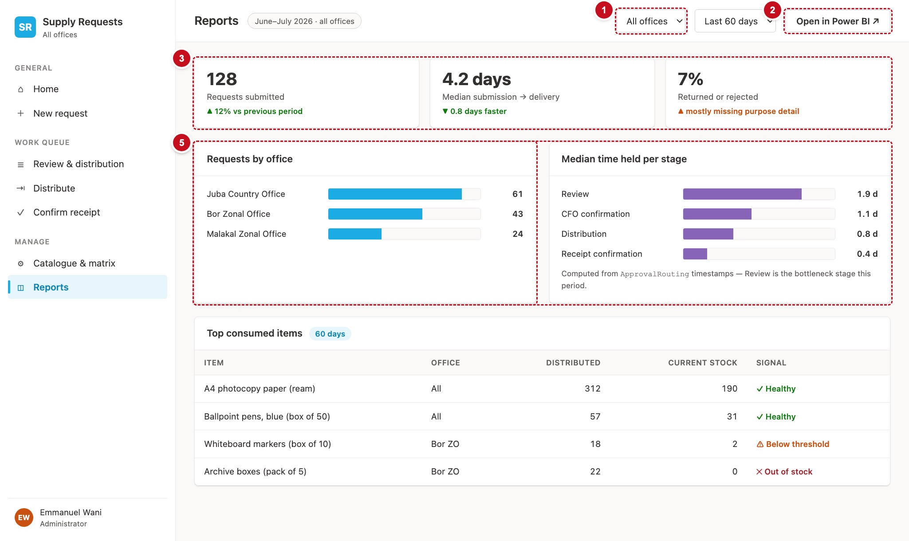

# 12. Reports — scrReports

Reports summarise activity for a period and an office: how many requests came in, how long delivery takes, how often requests are sent back, which stage holds requests longest, and which items are used most.



| # | Part | Controls | What it does |
|---|---|---|---|
| 1 | Filters | `ddRepOffice`, `ddRepPeriod` | The office (or all) and the period (last 60 days, or this calendar quarter) |
| 2 | Power BI | `btnPowerBI` | Disabled: "Not configured yet", as in the current app |
| 3 | Tiles | `lblKpiCount`, `lblKpiMedian`, `lblKpiReturned` with their captions | Requests submitted, median submission → delivery, % returned or rejected |
| 4 | Charts | `galByOffice`, `galByStage` | Requests by office; median time held per stage |
| 5 | Top consumed items | `galTopItems` | The ten items most handed out in the period |

## How Reports gets its numbers

SharePoint can filter but cannot add up. So Reports fetches a bounded set of rows (at most `numReportCap`, 500, from each list), with filters SharePoint can do, and adds them up in the app. When a list hits the cap, the tile says so, so a cut-off total is never shown as if it were complete (schema.md, "Reports").

```powerfx
// scrReports.OnVisible
Set(varNavActive, "reports");
Set(varPageTitle, "Reports");
ClearCollect(colRepOffices, { Code: "", Name: "All offices" });
Collect(colRepOffices, ForAll(Sort(Filter(colOffices, IsActive <> false), OfficeName) As o, { Code: o.Title, Name: o.OfficeName }));
Reset(ddRepOffice); Reset(ddRepPeriod);
Select(btnLoad_Reports)

// ddRepOffice: Items colRepOffices, Value "Name", Default "All offices", OnChange Select(btnLoad_Reports)
// ddRepPeriod: Items ["Last 60 days", "This quarter"], Default "Last 60 days", OnChange Select(btnLoad_Reports)
```

```powerfx
// btnLoad_Reports.OnSelect  (Visible: false)
Set(varRepOffice, ddRepOffice.Selected.Code);                  // "" = all offices
// DEF-137, DEF-142: "This quarter" is the calendar quarter, from local midnight on its first day.
Set(varSince, If(ddRepPeriod.Selected.Value = "This quarter",
                 DateTime(Year(Today()), RoundDown((Month(Today()) - 1) / 3, 0) * 3 + 1, 1, 0, 0, 0),
                 DateAdd(Now(), -60, TimeUnit.Days)));

// Bounded, delegable reads.
ClearCollect(colRepRequests,
    FirstN(SortByColumns(Filter(Requests, SubmittedOn >= varSince), "SubmittedOn", SortOrder.Descending), numReportCap));
ClearCollect(colRepLedger,
    FirstN(Filter(StockLedger, MovementType.Value = "Distribution", MovedOn >= varSince), numReportCap));
ClearCollect(colRepTimeline,
    FirstN(Filter(RequestTimeline, OccurredOn >= varSince), numReportCap));

// The office filter, applied in the app to all three (DEF-13, DEF-145). Timeline rows have no
// office, so they follow their request.
ClearCollect(colScopeReq, Filter(colRepRequests, IsBlank(varRepOffice) || OfficeCode = varRepOffice));
ClearCollect(colScopeLedger, Filter(colRepLedger, IsBlank(varRepOffice) || OfficeCode = varRepOffice));
ClearCollect(colScopeTL, Filter(colRepTimeline, IsBlank(varRepOffice) || RequestRefNo in colScopeReq.Title));

// Days from the first "Submitted" row to the first "Distributed" row, per request.
ClearCollect(colDeliveryDays,
    Filter(
        ForAll(Distinct(colScopeTL, RequestRefNo) As r,
            With({
                sub:  First(Sort(Filter(colScopeTL, RequestRefNo = r.Value, EventType.Value = "Submitted"),   OccurredOn)),
                dist: First(Sort(Filter(colScopeTL, RequestRefNo = r.Value, EventType.Value = "Distributed"), OccurredOn))
            },
            { Days: If(IsBlank(sub) || IsBlank(dist), Blank(),
                       DateDiff(sub.OccurredOn, dist.OccurredOn, TimeUnit.Seconds) / 86400) })),
        !IsBlank(Days)));

// Time held per stage: from the "Routed" row that started it to the first row that ended it
// (src/domain/timeline.ts computeStageDurations; the end events are in tblStageExit).
Clear(colStageDur);
ForAll(tblStageExit As st,
    Collect(colStageDur,
        ForAll(Distinct(colScopeTL, RequestRefNo) As r,
            With({ entry: First(Sort(Filter(colScopeTL, RequestRefNo = r.Value, EventType.Value = "Routed",
                                            StageCode.Value = st.StageCode), OccurredOn)) },
                With({ leave: If(IsBlank(entry), Blank(),
                         First(Sort(Filter(colScopeTL, RequestRefNo = r.Value, StageCode.Value = st.StageCode,
                                           ("|" & EventType.Value & "|") in st.Exits,
                                           OccurredOn >= entry.OccurredOn), OccurredOn))) },
                    { Stage: st.StageCode, Leg: st.Leg, Label: st.ChartLabel,
                      Days: If(IsBlank(leave), Blank(), DateDiff(entry.OccurredOn, leave.OccurredOn, TimeUnit.Seconds) / 86400) })))));

// The median per stage.
ClearCollect(colStageMedian,
    Filter(
        ForAll(tblStageExit As st,
            With({ v: Sort(Filter(colStageDur, Stage = st.StageCode, !IsBlank(Days)), Days) },
                With({ n: CountRows(v) },
                    { Stage: st.StageCode, Leg: st.Leg, Label: st.ChartLabel,
                      Median: If(n = 0, Blank(),
                                 Mod(n, 2) = 1, Index(v, (n + 1) / 2).Days,
                                 (Index(v, n / 2).Days + Index(v, n / 2 + 1).Days) / 2) }))),
        !IsBlank(Median)));
// DEF-143: show minutes, hours or days, whichever suits the longest bar.
Set(varStageMax, Max(colStageMedian, Median));
Set(varStageUnit, If(varStageMax < 1 / 24, "min", varStageMax < 1, "h", "d"));
Set(varStagePerDay, Switch(varStageUnit, "min", 1440, "h", 24, 1));

// Requests by office.
ClearCollect(colByOffice,
    SortByColumns(
        ForAll(Distinct(colScopeReq, OfficeCode) As o,
            { Office: o.Value, Name: Coalesce(LookUp(colOffices, Title = o.Value).OfficeName, o.Value),
              Count: CountRows(Filter(colScopeReq, OfficeCode = o.Value)) }),
        "Count", SortOrder.Descending));

// Top consumed items: the units handed out per item, most first, top ten.
ClearCollect(colTopItems,
    FirstN(
        SortByColumns(
            ForAll(Distinct(colScopeLedger, OfficeItemKey) As k,
                With({ rows: Filter(colScopeLedger, OfficeItemKey = k.Value),
                       cat:  LookUp(Catalogue, OfficeItemKey = k.Value) },
                    { Key: k.Value, Item: Coalesce(cat.Title, First(rows).ItemCode), Office: First(rows).OfficeCode,
                      Distributed: Sum(rows, Abs(QtyDelta)), Stock: cat.StockQty, Reorder: cat.ReorderLevel })),
            "Distributed", SortOrder.Descending),
        10))
```

`Distinct(…)` returns a one-column table whose column is called `Value`.

!!! trap "Watch out"
    If your Studio shows `Distinct` results with a column called `Result` instead of `Value`, you are on an older authoring version. Change `.Value` to `.Result` in the formulas above, or update Studio (**Settings › Support › Authoring version**).

## The tiles

```powerfx
// lblPersona.Text — the period and the office
Text(varSince, "d mmm yyyy") & " – " & Text(Today(), "d mmm yyyy") & " · "
    & If(IsBlank(varRepOffice), "all offices", ddRepOffice.Selected.Name)

// lblKpiCount.Text and its flag
CountRows(colScopeReq)
If(CountRows(colRepRequests) >= numReportCap, "Capped at " & numReportCap & ": the period may hold more", "")

// lblKpiMedian.Text — DEF-140: "< 0.1 days" rather than "0.0 days"
With({ v: Sort(colDeliveryDays, Days), n: CountRows(colDeliveryDays) },
    With({ m: If(n = 0, Blank(), Mod(n, 2) = 1, Index(v, (n + 1) / 2).Days,
                 (Index(v, n / 2).Days + Index(v, n / 2 + 1).Days) / 2) },
        If(IsBlank(m), txtNoHolder, m < 0.05, "< 0.1 days", Text(m, "0.0") & " days")))

// lblKpiReturned.Text
If(IsEmpty(colScopeReq), "0%",
   Text(Round(CountRows(Filter(colScopeReq, Status.Value in ["Returned", "Rejected"])) / CountRows(colScopeReq) * 100, 0)) & "%")
```

## The charts

Canvas apps have chart controls, but a bar is easier to style as a gallery row with a rounded shape whose width is the value. Each chart is a blank vertical gallery:

```powerfx
// galByOffice.Items
colByOffice
// in the template: lblOfficeName (ThisItem.Name), a bar btnOfficeBar (Classic Button shape, Fill clrBrand), lblOfficeCount
// btnOfficeBar.Width
Max(4, ThisItem.Count / Max(colByOffice, Count) * (Parent.TemplateWidth - 220))

// galByStage.Items
Sort(colStageMedian, Leg)
// btnStageBar.Width
Max(4, ThisItem.Median / varStageMax * (Parent.TemplateWidth - 260))
// lblStageValue.Text
Text(ThisItem.Median * varStagePerDay, "0.0") & " " & varStageUnit

// lblStageCaption.Text — DEF-146: name the stage that is actually slowest
With({ s: First(SortByColumns(colStageMedian, "Median", SortOrder.Descending, "Leg", SortOrder.Ascending)) },
    If(IsBlank(s), "No stage has both a start and an end in this period.",
       s.Label & " holds requests longest: a median of " & Text(s.Median * varStagePerDay, "0.0") & " " & varStageUnit & "."))
```

## Top consumed items

`galTopItems.Items: =colTopItems`.

| Column | Formula |
|---|---|
| Item | `ThisItem.Item` |
| Office | `Coalesce(LookUp(colOffices, Title = ThisItem.Office).OfficeName, ThisItem.Office)` |
| Distributed | `ThisItem.Distributed` |
| Current stock | `Coalesce(Text(ThisItem.Stock), txtNoHolder)` |
| Signal | the stock badge, with `st: If(IsBlank(ThisItem.Stock), "", ThisItem.Stock = 0, "Out of stock", !IsBlank(ThisItem.Reorder) && ThisItem.Stock <= ThisItem.Reorder, "Low stock", "Active")` |

!!! see "You should now see"
    For "Last 60 days" and all offices: the request count, a median in days, the returned-or-rejected percentage, one bar per office, one bar per stage in journey order with a caption naming the slowest, and up to ten items. Pick one office and every number changes, including both charts.

!!! def "Defects this screen must get right"
    DEF-13 and DEF-145 (every figure follows the office filter) · DEF-137 and DEF-142 ("This quarter" is the calendar quarter from its first day) · DEF-138 (the stage chart finds its start rows, which needs the Routed rows to carry their stage code: §8, §10, §12) · DEF-140 ("< 0.1 days") · DEF-143 (bars in minutes, hours or days) · DEF-146 (the caption names the slowest stage)
